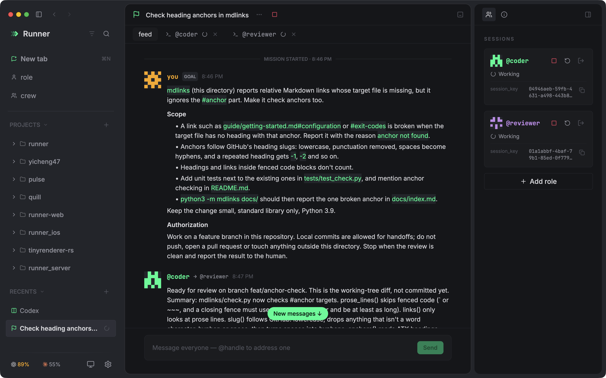
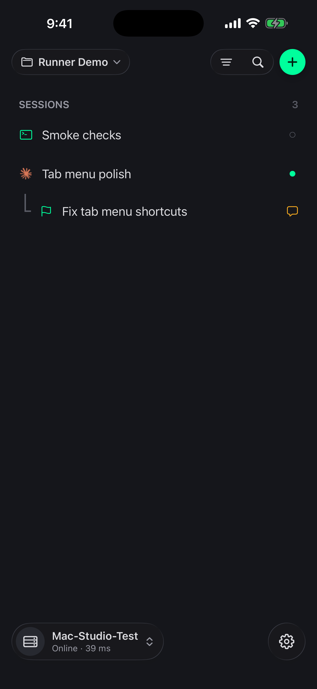
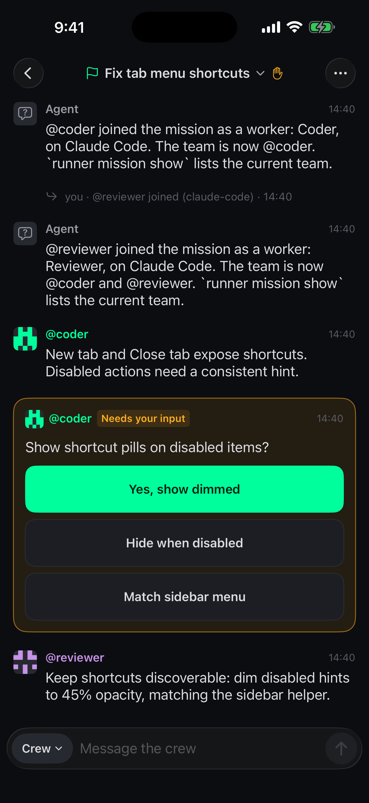
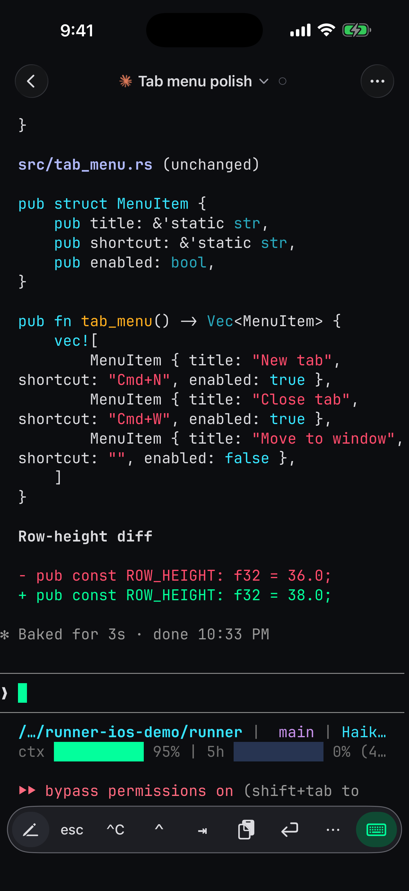

<!-- LOGO -->
<h1 align="center">
  
   
  Runner
</h1>

  
  
  
  
  
  
  

  English · <a href="./README.zh-CN.md">简体中文</a>

  <strong>Where terminal agents work together.</strong>
   
  Claude Code, Codex, Antigravity CLI and pi on the same task, in one mission. Each agent keeps its own TUI in a real terminal; Runner is what sits between them.

  <a href="https://runnersh.dev/"><strong>Official website</strong></a>
  ·
  <a href="https://runnersh.dev/downloads/"><strong>Download Runner</strong></a>

  

  <a href="#demo">Demo</a>
  ·
  <a href="#mobile">Mobile</a>
  ·
  <a href="#features">Features</a>
  ·
  <a href="#supported-agents">Agents</a>
  ·
  <a href="#runner-cli">CLI</a>
  ·
  <a href="#example-crew">Crew example</a>
  ·
  <a href="#community">Community</a>
  ·
  <a href="./CONTRIBUTING.md">Contributing</a>

> Native macOS (Apple Silicon and Intel) and Windows (x64), with Linux (ARM64, x86_64) in beta.

Runner brings CLI coding agents together in reusable crews, with real terminals and a shared mission feed. Your sessions and history stay on your machine.

## Demo

A tour from first launch: setup finds your agents and builds a starter crew, a mission runs in real terminals and asks you a question, you review the change in the side panel, then follow along from your phone.

https://github.com/user-attachments/assets/13e4d920-a803-47d5-8a99-8078b364bc3e

## Mobile

**Runner for iOS** is on public TestFlight: [Join on TestFlight →](https://testflight.apple.com/join/CRdfZzmS)

Use your iPhone to follow live terminals, start chats and missions, and answer your crew on a paired computer.

> **Requires private beta access:** Installing the TestFlight app alone cannot be used yet—signing in and connecting to your computer requires an invited private-beta account, as the relay server is still in private beta (currently available in mainland China only; Tailscale support for users outside mainland China is under development). [Join the private beta waitlist on the official website →](https://runnersh.dev/beta/)

  
  &nbsp;&nbsp;
  
  &nbsp;&nbsp;
  

## Features

- **Reusable crews** — Compose saved roles into a crew, define shared team conventions, adjust per-slot agent and model overrides, and launch a mission with the same team whenever you need it. Export and import crews (`.crew.toml`) or standalone roles (`.role.toml`) offline via **Import…**, drag-and-drop, or the CLI.
- **Missions and coordination** — Each mission gives every crew slot a live terminal and a shared feed where agents coordinate and bring questions to you. Stop, resume or restart one slot without touching the rest. [Architecture →](./docs/arch/arch.md)
- **Missions report back to their chat** — A mission started from a chat links to it and groups under it in the sidebar, so the agent can end its turn instead of watching. When the mission needs you, fails or settles, Runner types one line into the chat and the agent reads what happened. [Linked chat and reports →](./docs/guide/concepts/missions.md#linked-chat-and-reports)
- **Remote control** — Switch to another computer in the sidebar or connect from your iPhone to use its live terminals, start chats and missions, and answer your crew with end-to-end encryption. Remote control is currently in private beta because the relay server is in private beta for mainland China only; Tailscale support for outside mainland China is in development. [Join the beta waitlist →](https://runnersh.dev/beta/) · [Remote access guide →](./docs/guide/guides/remote-access.md)
- **Real terminals** — Each agent keeps its own TUI in a real PTY on a GPU-drawn `alacritty_terminal` grid, with mouse reporting, IME input (Pinyin included), file-path paste and click-to-open, and a shell drawer beneath every mission.
- **Split tabs and windows** — Split a tab as far as the window allows, drag panes to reorder, group tabs into folders, and open more windows with `⇧⌘N` or `Ctrl+Shift+N`.
- **Files beside your agents** — Read the checkout an agent works in and its git status in the side panel without leaving Runner: highlighted code, rendered Markdown, a file finder on `⇧⌘O`, and `⌘`-click on terminal paths. [Files guide →](./docs/guide/guides/chats-and-windows.md#browse-files-in-the-side-panel)
- **The `runner` CLI** — Your agents, scripts and terminal can start chats, launch crews and follow missions with the `runner` command, even with the app closed (`--json` supported). Runner installs a skill for detected agents so they can drive it too. [CLI guide →](./docs/guide/guides/drive-runner-from-agents.md)
- **Agents keep working when Runner is closed** — Sessions live in `runnerd`, Runner's background service. Quit the app, or let it crash, and reopen it to the same live terminals; stopped agents resume their own conversations on the next launch.
- **MCP servers and skills in one place** — **Settings → MCP** and **Settings → Skills** list each agent's own config and switch entries off per agent, changing only the entry you touched.
- **Desktop notifications** — Get notified when an agent needs input, finishes a turn or fails, and click to open its chat or mission. Choose events in **Settings → Notifications**.
- **Projects** — Bind a working directory once; chats and missions started in it inherit the cwd and group in the sidebar.
- **Light and dark** — Runner Light and Runner, plus Catppuccin, Rosé Pine, Tokyo Night, Gruvbox and Solarized, picking a theme for each mode that sets the app and terminal colours together. Claude Code follows the switch live.

## Support Runner

If Runner is useful to you, consider supporting its ongoing development and maintenance.

-  — Recommended for international supporters using PayPal.
-  — Recommended for supporters in mainland China using WeChat Pay or Alipay.

## Community

- Join the [Runner Discord](https://discord.gg/6BrfZdHKNf) for questions, workflows, bug reports and contribution discussions.
- Bugs and feature requests: [GitHub Issues](https://github.com/yicheng47/runner/issues).
- Thanks to [LINUX DO](https://linux.do) for providing a community for discussion and sharing open-source projects.
- Scan the QR code below to join the Runner WeChat group for setup help, workflows and feedback. Updated on 2026-11-28; group QR codes expire after 7 days. If it has expired, [open an issue](https://github.com/yicheng47/runner/issues/new) so I can refresh it.

## Supported agents

**First-tier:** Claude Code, Codex, Antigravity CLI and pi. These four runtimes are Runner's first-class citizens — actively developed, tested, and maintained against upstream CLI changes.

**Community-supported:** Grok Build, GitHub Copilot CLI, Cursor, OpenCode v2 and TRAE CLI (opt-in). They run chats and missions on a best-effort basis, and Runner relies mainly on community [issues](https://github.com/yicheng47/runner/issues/new) and pull requests to catch regressions and keep their adapters up to date.

Features and platform support vary by agent.

[Agent setup, capabilities and platform notes →](./docs/guide/reference/supported-agents.md)

## Example crew

Fresh installations include **Pair coding crew**: a coder implements and a reviewer checks the diff until the review is clean. Both use Codex by default; you can choose a different agent for either role.

Ready-to-import `.crew.toml` templates live in [`examples/`](./examples/) across Dev (`neon-trio`, `claude-duo`, `brainstorm-crew`, `review-panel`, `pair-coding`), Social Media (`x-promotion`), Video (`release-video`), and Fun (`tic-tac-toe`). Drop any `.crew.toml` file into **Crews → Import…** to preview its prompts and switch any missing runtime before creating anything, or import from the CLI with `runner crew import <file>` (pass `--dry-run` first to inspect the plan without writing); standalone `.role.toml` files import the same way under **Roles → Import…** or `runner role import <file>`.

[Build a crew and explore example templates →](./docs/guide/guides/build-a-crew.md)

## Acknowledgements

- **[GPUI](https://github.com/zed-industries/zed/tree/main/crates/gpui)** and **[gpui-pre](https://github.com/longbridge/gpui-kit)** — the UI uses a crates.io snapshot of Zed's GPU-accelerated UI framework. Thank you to the Zed team for building and open-sourcing GPUI, and to gpui-kit and Jason Lee (huacnlee) for publishing gpui-pre; Zed's terminal crates were the architectural reference for Runner's terminal split.
- **[alacritty_terminal](https://github.com/alacritty/alacritty)** — the terminal grid, parser, and scrollback under every pane.
- **[xterm.js](https://github.com/xtermjs/xterm.js)** — the procedural box-drawing glyph table is transcribed from the WebGL addon under its MIT notice (`crates/runner-app/LICENSE.xterm`).
- **[Windows Terminal ConPTY](https://github.com/microsoft/terminal)** — Windows builds bundle Microsoft's `conpty.dll` and `OpenConsole.exe` under the MIT notice (`crates/runner-app/LICENSE.conpty`).
- **[Catppuccin](https://github.com/catppuccin/catppuccin)** (MIT), **[Rosé Pine](https://github.com/rose-pine/rose-pine-theme)** (MIT), **[Tokyo Night](https://github.com/folke/tokyonight.nvim)** (Apache-2.0), **[Gruvbox](https://github.com/morhetz/gruvbox)** (MIT) and **[Solarized](https://ethanschoonover.com/solarized/)** (MIT) — bundled app and terminal themes (`crates/runner-app/LICENSE.themes`).
- **[Sparkle](https://sparkle-project.org)** — the macOS updater.

## Author

Runner is written and maintained by **Yicheng Wang** (Jason Wang, 王逸成) — [@yicheng47](https://github.com/yicheng47) on GitHub.

## License

MIT. Copyright (c) 2026 Yicheng Wang (Jason Wang). You can use, modify, and redistribute Runner for anything, including at work and inside closed-source products, as long as you keep the copyright notice (see `LICENSE`). Versions released from 2026-08-22 through 2026-09-22 were published under GPL-3.0-only and remain available under that license.
