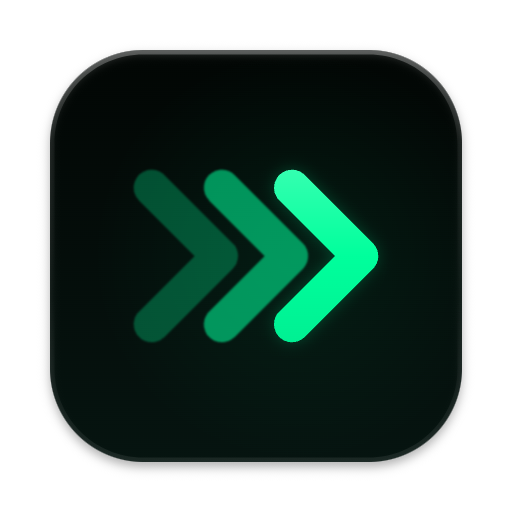
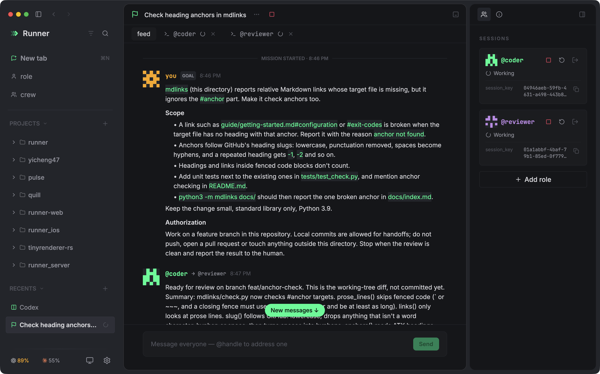
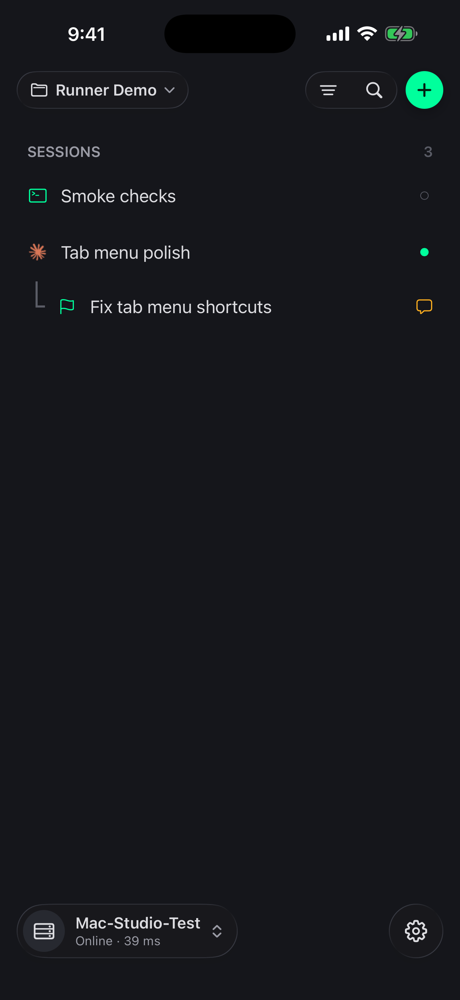
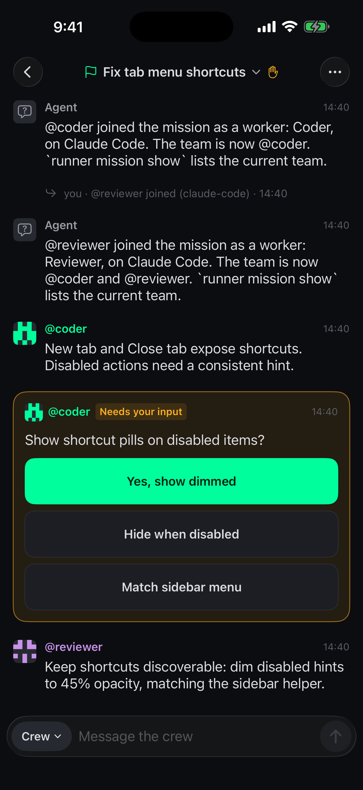
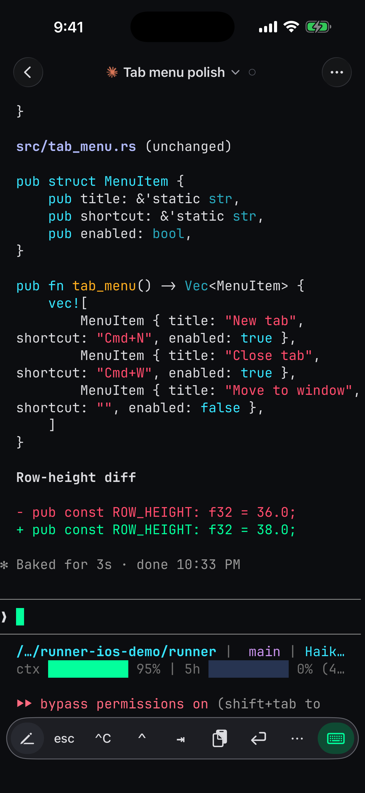

<!-- LOGO -->
<h1 align="center">
  
   
  Runner
</h1>

  
  
  
  
  
  
  

  <a href="./README.md">English</a> · <a href="./README.zh-CN.md">简体中文</a> · Türkçe

  <strong>Terminal ajanlarının birlikte çalıştığı yer.</strong>
   
  Claude Code, Codex, Antigravity CLI ve pi aynı görev üzerinde, tek bir görev akışında (mission). Her ajan gerçek bir terminalde kendi TUI'sini korur; Runner ise aralarında köprü kurar.

  <a href="https://runnersh.dev/"><strong>Resmî web sitesi</strong></a>
  ·
  <a href="https://runnersh.dev/downloads/"><strong>Runner'ı İndir</strong></a>

  

  <a href="#demo">Demo</a>
  ·
  <a href="#mobil">Mobil</a>
  ·
  <a href="#özellikler">Özellikler</a>
  ·
  <a href="#desteklenen-ajanlar">Ajanlar</a>
  ·
  <a href="#runner-cli">CLI</a>
  ·
  <a href="#örnek-ekip">Örnek ekip</a>
  ·
  <a href="#topluluk">Topluluk</a>
  ·
  <a href="./CONTRIBUTING.md">Katkıda bulunma</a>

> Yerel macOS (Apple Silicon ve Intel) ve Windows (x64); Linux (ARM64, x86_64) beta aşamasındadır.

Runner; CLI kodlama ajanlarını gerçek terminaller ve paylaşılan bir görev akışıyla (mission feed) yeniden kullanılabilir ekipler (crews) hâlinde bir araya getirir. Oturumlarınız ve geçmişiniz kendi makinenizde kalır.

## Demo

İlk açılıştan itibaren bir tur: kurulum ajanlarınızı bulur ve bir başlangıç ekibi oluşturur, bir görev gerçek terminallerde çalışır ve size bir soru sorar, değişikliği yan panelde incelersiniz, ardından telefonunuzdan takip edersiniz.

https://github.com/user-attachments/assets/13e4d920-a803-47d5-8a99-8078b364bc3e

## Mobil

**iOS için Runner** herkese açık TestFlight'ta: [TestFlight'ta Katıl →](https://testflight.apple.com/join/CRdfZzmS)

Canlı terminalleri takip etmek, sohbet ve görevler başlatmak ve eşleştirilmiş bir bilgisayardaki ekibinize yanıt vermek için iPhone'unuzu kullanın.

> **Özel beta erişimi gerektirir:** TestFlight uygulamasını tek başına yüklemek henüz kullanım için yeterli değildir—giriş yapmak ve bilgisayarınıza bağlanmak için davetli bir özel beta hesabı gerekir; aktarım sunucusu hâlen özel beta aşamasındadır (şu anda yalnızca Çin anakarasında kullanılabilir; Çin anakarası dışındaki kullanıcılar için Tailscale desteği geliştirilmektedir). [Resmî web sitesinden özel beta bekleme listesine katılın →](https://runnersh.dev/beta/)

  
  &nbsp;&nbsp;
  
  &nbsp;&nbsp;
  

## Özellikler

- **Yeniden kullanılabilir ekipler** — Kaydedilmiş rolleri bir ekip içinde birleştirin, paylaşılan ekip kurallarını tanımlayın, yuva başına ajan ve model geçersiz kılmalarını ayarlayın ve ihtiyaç duyduğunuz her an aynı takımla bir görev başlatın. Ekipleri (`.crew.toml`) veya bağımsız rolleri (`.role.toml`) **Import…**, sürükle-bırak ya da CLI aracılığıyla çevrimdışı olarak dışa ve içe aktarın.
- **Görevler ve koordinasyon** — Her görev, her ekip yuvasına canlı bir terminal ve ajanların koordine olup size sorular getirdiği paylaşılan bir akış sunar. Diğerlerine dokunmadan tek bir yuvayı durdurun, devam ettirin veya yeniden başlatın. [Mimari →](./docs/arch/arch.md)
- **Görevler sohbetlerine geri bildirim verir** — Bir sohbetten başlatılan görev ona bağlanır ve kenar çubuğunda onun altında gruplanır; böylece ajan izlemek yerine kendi sırasını sonlandırabilir. Görev size ihtiyaç duyduğunda, başarısız olduğunda veya tamamlandığında Runner sohbete tek bir satır yazar ve ajan ne olduğunu okur. [Bağlı sohbet ve raporlar →](./docs/guide/concepts/missions.md#linked-chat-and-reports)
- **Uzaktan kontrol** — Kenar çubuğundan başka bir bilgisayara geçin veya canlı terminallerini kullanmak, sohbet ve görev başlatmak ve ekibinize uçtan uca şifreleme ile yanıt vermek için iPhone'unuzdan bağlanın. Aktarım sunucusu yalnızca Çin anakarası için özel beta aşamasında olduğundan uzaktan kontrol şu anda özel betadadır; Çin anakarası dışı için Tailscale desteği geliştirilmektedir. [Beta bekleme listesine katılın →](https://runnersh.dev/beta/) · [Uzaktan erişim rehberi →](./docs/guide/guides/remote-access.md)
- **Gerçek terminaller** — Her ajan, GPU ile çizilen bir `alacritty_terminal` ızgarası üzerinde gerçek bir PTY içinde kendi TUI'sini korur; fare raporlama, IME girişi (Pinyin dâhil), dosya yolu yapıştırma ve tıklayıp açma ile her görevin altında bir kabuk çekmecesi sunar.
- **Bölünmüş sekmeler ve pencereler** — Bir sekmeyi pencerenin izin verdiği ölçüde bölün, bölmeleri sürükleyerek yeniden sıralayın, sekmeleri klasörler hâlinde gruplayın ve `⇧⌘N` veya `Ctrl+Shift+N` ile yeni pencereler açın.
- **Ajanlarınızın yanında dosyalar** — Runner'dan ayrılmadan bir ajanın çalıştığı dizini ve git durumunu yan panelde okuyun: vurgulanmış kod, işlenmiş Markdown, `⇧⌘O` ile dosya bulucu ve terminal yollarına `⌘`-tıklama. [Dosyalar rehberi →](./docs/guide/guides/chats-and-windows.md#browse-files-in-the-side-panel)
- **`runner` CLI** — Ajanlarınız, betikleriniz ve terminaliniz, uygulama kapalıyken bile `runner` komutuyla sohbet başlatabilir, ekip çalıştırabilir ve görevleri takip edebilir (`--json` desteklenir). Runner, algılanan ajanların da kendisini sürebilmesi için onlar için bir beceri (skill) yükler. [CLI rehberi →](./docs/guide/guides/drive-runner-from-agents.md)
- **Runner kapalıyken ajanlar çalışmaya devam eder** — Oturumlar Runner'ın arka plan hizmeti `runnerd` içinde yaşar. Uygulamadan çıkın veya çökmesine izin verin, yeniden açtığınızda aynı canlı terminalleri bulursunuz; durdurulan ajanlar bir sonraki başlatmada kendi konuşmalarına devam eder.
- **MCP sunucuları ve beceriler tek yerde** — **Settings → MCP** ve **Settings → Skills**, her ajanın kendi yapılandırmasını listeler ve yalnızca dokunduğunuz girdiyi değiştirerek ajan bazında girdileri kapatıp açar.
- **Masaüstü bildirimleri** — Bir ajan girdi beklediğinde, bir turu tamamladığında veya başarısız olduğunda bildirim alın ve sohbetini veya görevini açmak için tıklayın. Olayları **Settings → Notifications** bölümünden seçin.
- **Projeler** — Bir çalışma dizinini bir kez bağlayın; içinde başlatılan sohbetler ve görevler çalışma dizinini (cwd) devralır ve kenar çubuğunda gruplanır.
- **Açık ve koyu tema** — Runner Light ve Runner'ın yanı sıra Catppuccin, Rosé Pine, Tokyo Night, Gruvbox ve Solarized; uygulama ve terminal renklerini birlikte ayarlayan her mod için bir tema seçin. Claude Code bu değişikliği canlı olarak takip eder.

## Runner'ı Destekleyin

Runner işinize yarıyorsa, devam eden geliştirme ve bakımını desteklemeyi düşünebilirsiniz.

-  — PayPal kullanan uluslararası destekçiler için önerilir.
-  — WeChat Pay veya Alipay kullanan Çin anakarasındaki destekçiler için önerilir.

## Topluluk

- Sorular, iş akışları, hata bildirimleri ve katkı tartışmaları için [Runner Discord](https://discord.gg/6BrfZdHKNf) sunucusuna katılın.
- Hatalar ve özellik istekleri: [GitHub Issues](https://github.com/yicheng47/runner/issues).
- Açık kaynaklı projeleri tartışmak ve paylaşmak için bir topluluk sağladığı için [LINUX DO](https://linux.do) topluluğuna teşekkürler.
- Kurulum yardımı, iş akışları ve geri bildirim için Runner WeChat grubuna katılmak üzere aşağıdaki QR kodunu tarayın. 2026-11-23 tarihinde güncellendi; grup QR kodlarının süresi 7 gün sonra dolar. Süresi dolmuşsa yenileyebilmem için [bir issue açın](https://github.com/yicheng47/runner/issues/new).

## Desteklenen ajanlar

**Birinci sınıf:** Claude Code, Codex, Antigravity CLI ve pi. Bu dört çalışma zamanı Runner'ın birinci sınıf vatandaşlarıdır — üst akış CLI değişikliklerine karşı aktif olarak geliştirilir, test edilir ve bakımı yapılır.

**Topluluk destekli:** Grok Build, GitHub Copilot CLI, Cursor, OpenCode v2 ve TRAE CLI (isteğe bağlı). Sohbetleri ve görevleri en iyi çaba temelinde çalıştırırlar ve Runner gerilemeleri yakalamak ve adaptörlerini güncel tutmak için ağırlıklı olarak topluluk [issue](https://github.com/yicheng47/runner/issues/new)'larına ve pull request'lerine güvenir.

Özellikler ve platform desteği ajana göre değişiklik gösterir.

[Ajan kurulumu, yetenekler ve platform notları →](./docs/guide/reference/supported-agents.md)

## Örnek ekip

Yeni kurulumlar **Pair coding crew** ile birlikte gelir: bir kodlayıcı geliştirir ve bir inceleyici inceleme temiz olana kadar diff'i kontrol eder. Her ikisi de varsayılan olarak Codex kullanır; her iki rol için de farklı bir ajan seçebilirsiniz.

İçe aktarılmaya hazır `.crew.toml` şablonları [`examples/`](./examples/) dizininde yer alır: Geliştirme (`neon-trio`, `claude-duo`, `brainstorm-crew`, `review-panel`, `pair-coding`), Sosyal Medya (`x-promotion`), Video (`release-video`) ve Eğlence (`tic-tac-toe`). Herhangi bir `.crew.toml` dosyasını **Crews → Import…** bölümüne bırakarak istemlerini önizleyebilir ve oluşturmadan önce eksik çalışma zamanlarını değiştirebilirsiniz; ya da CLI'dan `runner crew import <file>` komutuyla içe aktarabilirsiniz (yazmadan önce planı incelemek için önce `--dry-run` ekleyin). Bağımsız `.role.toml` dosyaları da aynı şekilde **Roles → Import…** veya `runner role import <file>` ile içe aktarılır.

[Bir ekip oluşturun ve örnek şablonları keşfedin →](./docs/guide/guides/build-a-crew.md)

## Teşekkürler

- **[GPUI](https://github.com/zed-industries/zed/tree/main/crates/gpui)** ve **[gpui-pre](https://github.com/longbridge/gpui-kit)** — kullanıcı arayüzü Zed'in GPU hızlandırmalı UI çerçevesinin crates.io anlık görüntüsünü kullanır. GPUI'yi geliştirip açık kaynak yaptığı için Zed ekibine ve gpui-pre'yi yayınladıkları için gpui-kit ile Jason Lee'ye (huacnlee) teşekkürler; Runner'ın terminal bölünmesi için Zed'in terminal crate'leri mimari referans oldu.
- **[alacritty_terminal](https://github.com/alacritty/alacritty)** — her bölmenin altındaki terminal ızgarası, ayrıştırıcısı ve geri kaydırma geçmişi.
- **[xterm.js](https://github.com/xtermjs/xterm.js)** — prosedürel kutu çizim glif tablosu MIT bildirimi altında WebGL eklentisinden uyarlanmıştır (`crates/runner-app/LICENSE.xterm`).
- **[Windows Terminal ConPTY](https://github.com/microsoft/terminal)** — Windows derlemeleri Microsoft'un `conpty.dll` ve `OpenConsole.exe` dosyalarını MIT bildirimi altında içerir (`crates/runner-app/LICENSE.conpty`).
- **[Catppuccin](https://github.com/catppuccin/catppuccin)** (MIT), **[Rosé Pine](https://github.com/rose-pine/rose-pine-theme)** (MIT), **[Tokyo Night](https://github.com/folke/tokyonight.nvim)** (Apache-2.0), **[Gruvbox](https://github.com/morhetz/gruvbox)** (MIT) ve **[Solarized](https://ethanschoonover.com/solarized/)** (MIT) — yerleşik uygulama ve terminal temaları (`crates/runner-app/LICENSE.themes`).
- **[Sparkle](https://sparkle-project.org)** — macOS güncelleyicisi.

## Yazar

Runner, **Yicheng Wang** (Jason Wang, 王逸成) — GitHub'da [@yicheng47](https://github.com/yicheng47) tarafından yazılmakta ve sürdürülmektedir.

## Lisans

MIT. Copyright (c) 2026 Yicheng Wang (Jason Wang). Telif hakkı bildirimini koruduğunuz sürece (`LICENSE` dosyasına bakın), Runner'ı iş yerinde ve kapalı kaynaklı ürünlerin içinde de dâhil olmak üzere her şey için kullanabilir, değiştirebilir ve yeniden dağıtabilirsiniz. 2026-08-22 ile 2026-09-22 tarihleri arasında yayınlanan sürümler GPL-3.0-only altında yayınlanmıştır ve bu lisans altında kullanılmaya devam edebilir.
