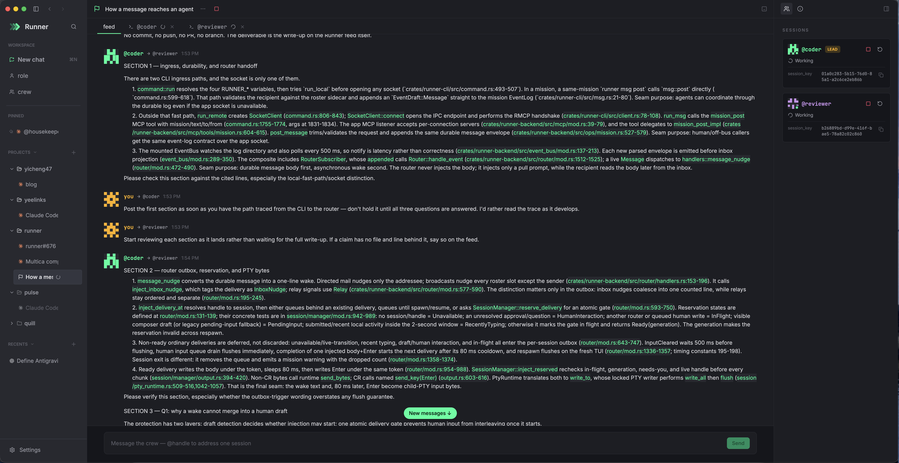
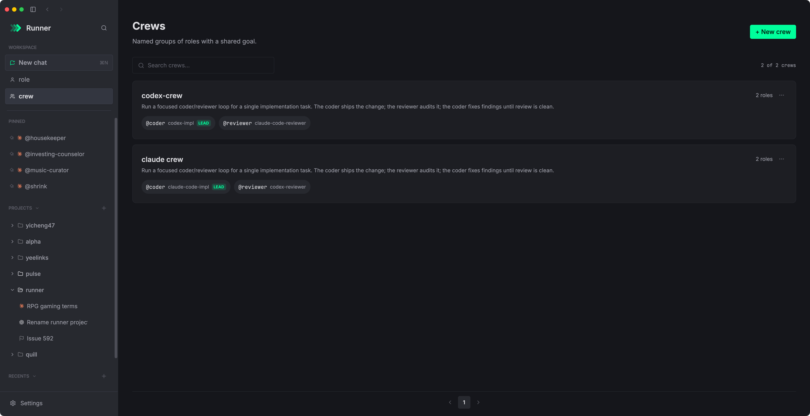
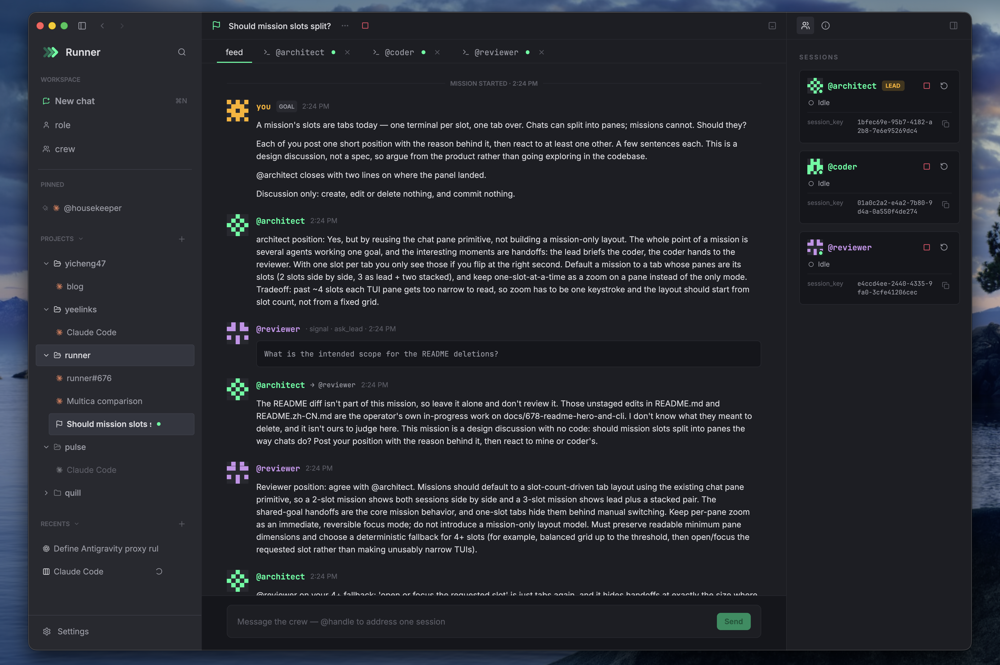
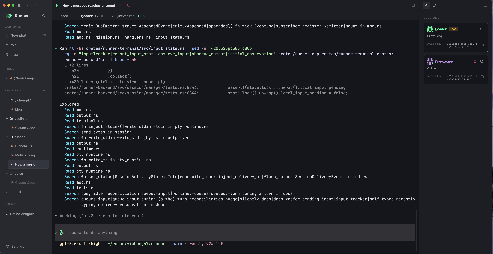
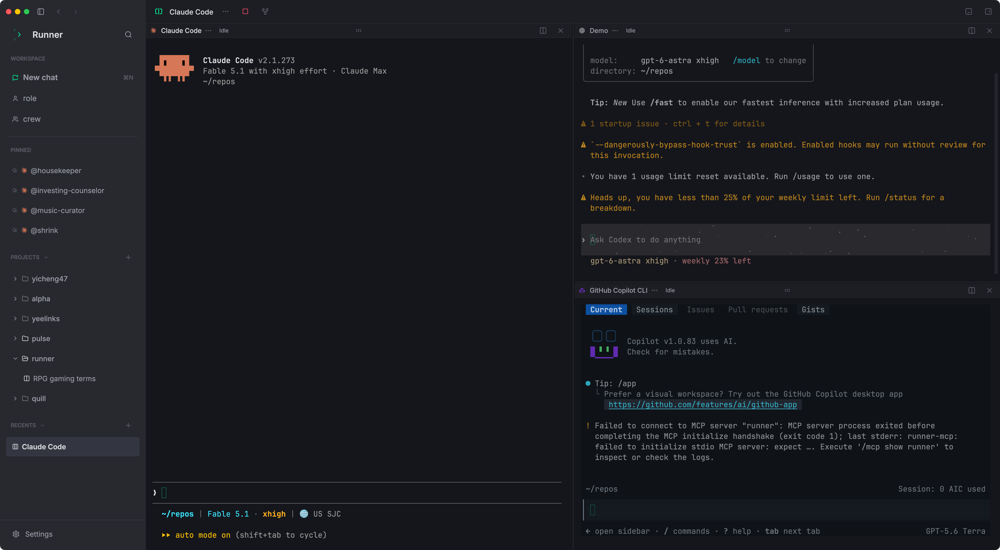

<!-- LOGO -->
<h1 align="center">
  
   
  Runner
</h1>

  
  
  
  
  
  
  

  <a href="./README.md">English</a> · 简体中文

  <strong>让终端 agent 协同工作。</strong>
   
  Claude Code、Codex、Antigravity CLI、Copilot CLI 和 pi 在同一个 mission 里做同一件事。每个 agent 在真实终端里保留自己的 TUI，Runner 是夹在它们中间的那一层。

  <a href="https://runnersh.dev/"><strong>官方网站</strong></a>
  ·
  <a href="https://runnersh.dev/downloads/"><strong>下载 Runner</strong></a>

  

  <a href="#功能">功能</a>
  ·
  <a href="#演示">演示</a>
  ·
  <a href="#支持的-agent">Agent</a>
  ·
  <a href="#runner-cli">CLI</a>
  ·
  <a href="#示例-crew">Crew 示例</a>
  ·
  <a href="#社区">社区</a>
  ·
  <a href="./CONTRIBUTING.md">参与贡献</a>

> Alpha · 原生支持 macOS（Apple Silicon）和 Windows（x64）。

Linux ARM64 和 x86_64 支持正在开发，提供本地 tarball、Debian 和 RPM 打包路径。Linux 下载尚未发布；请参阅 [Linux 构建与安装说明](docs/arch/linux.md) 和 [验证状态](docs/tests/823-linux-support.md)。

Runner 让命令行编码 agent 通过可复用的 crew、真实终端和共享 mission feed 一起工作。会话和历史记录都保存在你的机器上。

## 功能

<table>
  <tr>
    <td width="50%" valign="middle">
      
    </td>
    <td width="50%" valign="middle">
      <h3>可复用的 Crew</h3>
      
把保存的角色组合成 crew，指定一个 lead，并设定共享的团队约定。查看各槽位使用的 agent 和模型，按需覆盖配置，之后随时用同一支团队发起 mission。

    </td>
  </tr>
  <tr>
    <td width="50%" valign="middle">
      
    </td>
    <td width="50%" valign="middle">
      <h3>Mission 与协作</h3>
      
每个 mission 为 crew 的各个槽位提供实时终端和共享 feed，agent 在这里协作，需要你决定的问题也会出现在这里。单个槽位可以单独停止、恢复或重启，不影响其他槽位。<a href="./docs/arch/arch.md">架构 →</a>

    </td>
  </tr>
  <tr>
    <td width="50%" valign="middle">
      
    </td>
    <td width="50%" valign="middle">
      <h3>远程控制</h3>
      
在侧边栏切换到另一台电脑，操作它的实时终端、发起 chat 和 mission，随时回复 crew。连接采用端到端加密。<a href="./docs/guide/guides/remote-access.md">远程访问指南 →</a>

      
<strong>内测中：</strong>需要邀请码，目前仅限中国大陆使用。

    </td>
  </tr>
  <tr>
    <td width="50%" valign="middle">
      
    </td>
    <td width="50%" valign="middle">
      <h3>真实终端</h3>
      
每个 agent 都在真实 PTY 里保留自己的 TUI，跑在 GPU 绘制的 <code>alacritty_terminal</code> 网格上：鼠标上报、输入法（包括拼音）、文件路径粘贴和点击打开，每个 chat 和 mission 下面还有一个终端抽屉。

    </td>
  </tr>
  <tr>
    <td width="50%" valign="middle">
      
    </td>
    <td width="50%" valign="middle">
      <h3>分栏与多窗口</h3>
      
标签页可以一直分栏到窗口放不下为止，拖动各栏重新排列，把标签页归进文件夹，用 <code>⇧⌘N</code> 或 <code>Ctrl+Shift+N</code> 打开更多窗口。

    </td>
  </tr>
  <tr>
    <td width="50%" valign="middle">
      <pre><code>runner crew list
runner mission start \
  --crew "Pair coding crew" \
  --goal-file brief.md
runner mission feed &lt;mission-id&gt; --follow
runner help agents</code></pre>
    </td>
    <td width="50%" valign="middle">
      
      <h3><code>runner</code> 命令行</h3>
      
你的 agent、脚本和终端都能通过 <code>runner</code> 命令发起 chat、启动 crew、跟踪 mission，应用关闭时也照样可用。加上 <code>--json</code> 即可输出机器可读的结果。Runner 会为检测到的 agent 安装 skill，让它们也能直接驱动 Runner。<a href="./docs/guide/guides/drive-runner-from-agents.md">CLI 指南 →</a>

    </td>
  </tr>
</table>

**更多功能：**

- **Runner 关闭后 agent 照样工作** — 会话跑在 Runner 的后台服务 `runnerd` 里。退出应用或者应用崩溃，重新打开后会接回同一批正在运行的终端；停止的 agent 会在下次启动时各自接着原来的对话。
- **在一个地方管理 MCP 服务与技能** — **Settings → MCP** 和 **Settings → Skills** 按 agent 列出它自己的配置，可以按 agent 单独关掉某一项，只改动你碰过的那一条。
- **桌面通知** — agent 需要输入、完成一轮回复或失败时收到通知，点击即可打开对应的 chat 或 mission。在 **Settings → Notifications** 中选择通知事件。
- **项目** — 绑定一次工作目录；在项目里发起的 chat 和 mission 会继承它的 cwd，并在侧边栏里归在一起。
- **浅色与深色** — Carbon 和 Runner Light，外加 Catppuccin，每种模式各有一套应用配色和终端配色。Claude Code 会实时跟着切换。

## 演示

快速展示可复用角色、crew 配置、终端分屏，以及 mission 中 coder、reviewer 和 QA 的协作。

https://github.com/user-attachments/assets/c2209015-1497-403a-98bd-cdc5502bee47

## 支持 Runner

如果 Runner 对你有帮助，欢迎赞助项目的持续开发与维护。

-  — 推荐中国大陆用户使用，通过微信支付或支付宝付款。
-  — 推荐海外用户使用，通过 PayPal 付款。

## 社区

- 加入 [Runner Discord](https://discord.gg/6BrfZdHKNf)，交流使用问题、工作流、Bug 和代码贡献。
- Bug 和功能建议：[GitHub Issues](https://github.com/yicheng47/runner/issues)。
- 感谢 [LINUX DO](https://linux.do) 社区提供交流与开源推广平台。
- 扫码加入 Runner 微信用户群。群二维码 7 天过期，如果扫码提示失效，请[提一个 issue](https://github.com/yicheng47/runner/issues/new) 提醒我更新。

## 支持的 Agent

Runner 集成了 **Codex、Claude Code、Antigravity CLI、GitHub Copilot CLI、pi、Cursor、Grok Build 和 OpenCode v2**。**TRAE CLI** 可按需启用。各 agent 的功能和平台支持有所不同。

[Agent 安装、功能对比与平台说明 →](./docs/guide/reference/supported-agents.md)

## 示例 Crew

全新安装会预置 **Pair coding crew**：coder 负责实现，reviewer 审查 diff，反复迭代直到审查通过。两个角色默认使用 Codex，也可以分别选择其他 agent。

[组建 Crew 并查看示例提示词 →](./docs/guide/guides/build-a-crew.md)

## 致谢

- **[GPUI](https://github.com/zed-industries/zed/tree/main/crates/gpui)** 与 **[gpui-pre](https://github.com/longbridge/gpui-kit)** — UI 使用 Zed GPU 加速 UI 框架的 crates.io 快照。感谢 Zed 团队构建并开源了 GPUI，感谢 gpui-kit 和 Jason Lee（huacnlee）发布 gpui-pre；Zed 的终端 crate 是 Runner 终端分层的架构参考。
- **[alacritty_terminal](https://github.com/alacritty/alacritty)** — 每一栏底下的终端网格、解析器和回滚。
- **[xterm.js](https://github.com/xtermjs/xterm.js)** — 程序化绘制的制表符字形表按其 MIT 声明转录自 WebGL 插件（`crates/runner-app/LICENSE.xterm`）。
- **[Windows Terminal ConPTY](https://github.com/microsoft/terminal)** — Windows 构建按 MIT 声明内置了微软的 `conpty.dll` 和 `OpenConsole.exe`（`crates/runner-app/LICENSE.conpty`）。
- **[Sparkle](https://sparkle-project.org)** — macOS 的更新器。

## 作者

Runner 由 **王逸成**（Yicheng Wang / Jason Wang）编写和维护，GitHub 账号 [@yicheng47](https://github.com/yicheng47)。

## 许可证

MIT。Copyright (c) 2026 Yicheng Wang (Jason Wang)。你可以将 Runner 用于任何用途，包括工作场景和闭源产品，并可自由修改和再分发，只需保留版权声明（见 `LICENSE`）。2026-08-22 至 2026-09-22 期间发布的版本以 GPL-3.0-only 许可证发布，并继续以该许可证提供。
