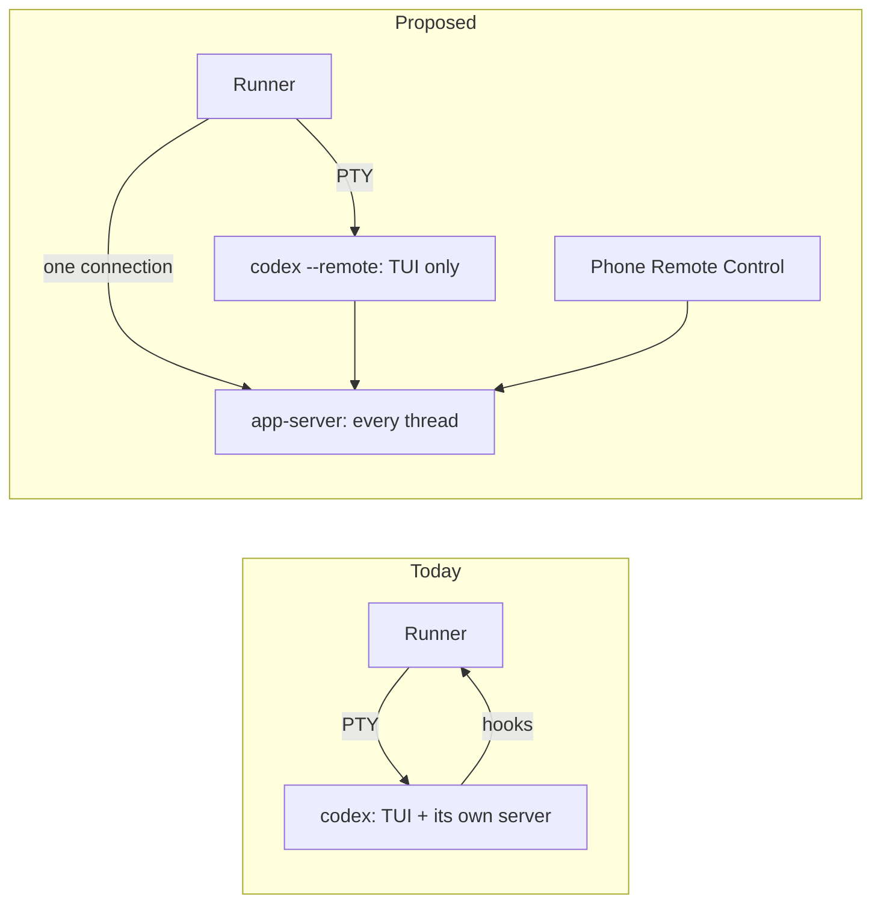

# 1012 — Run Codex sessions on Codex's app-server

> Tracking issue: [#1012](https://github.com/yicheng47/runner/issues/1012). Priority: P2, needs design.
> Status: draft for discussion, 2026-10-28; nothing built. The core mechanism was tested by hand against Codex 0.165.0 ([test record](../tests/1012-codex-app-server.md)).
> Related: [#1046](https://github.com/yicheng47/runner/issues/1046) (inbox delivery), which builds on this; [#861](https://github.com/yicheng47/runner/issues/861) and [#1051](https://github.com/yicheng47/runner/issues/1051) (status); [#940](https://github.com/yicheng47/runner/issues/940) and [#1018](https://github.com/yicheng47/runner/issues/1018) (draft holds); [748](./748-mission-watch-delivery.md).

## Problem

**Remote Control (#1012).** Runner launches Codex with `-c` overrides and hook flags. Codex then runs its app-server inside the TUI process instead of joining its shared background server, so the phone's Remote Control cannot open a Runner chat: the embedded server holds the thread's writer lock. #1012 has the source trail.

**Runner can only reach Codex through its terminal and its hooks.** Codex status combines injected hooks, transcript tailing (for API errors and interrupts, which run no `Stop`) and screen reading. Inbox notices are typed into the composer, so Runner must detect drafts from the screen; #940 and #1018 were both stale holds on an idle Codex. Codex exposes no hook that fires while it is idle, so #1046 cannot fix Codex delivery with hooks.

## Proposal

Codex's TUI is a client of an app-server. Instead of the embedded one, every Runner Codex session attaches its TUI to a shared app-server with `--remote`, and Runner opens one client connection to the same server.

Through that connection Runner gets:

- **Status from Codex's own events:** `turn/started`, `turn/completed` and item events for every thread it subscribes to.
- **Input without the composer:** `turn/start` runs a turn on a thread and leaves the person's draft alone. #1046 uses this for Codex.
- **Thread identity:** thread ids come from the server, not from scanning rollout files.
- **Remote Control:** a session on Codex's shared daemon is one the phone can continue.

## Findings (2026-10-28)

Tested on Codex 0.165.0 with a server on a scratch socket, the TUI in a pseudo-terminal and a second WebSocket client standing in for Runner. Details are in the [test record](../tests/1012-codex-app-server.md).

| Question | Result |
| --- | --- |
| Does the TUI work attached with `--remote unix://PATH`? | Yes. Turns run and the screen is unchanged. |
| Does a second client see a TUI thread's turns? | After `thread/resume` on the live thread, yes. Without it, the client gets `thread/started` (broadcast to every client) but no turn events. Subscribing did not disturb the TUI. |
| Does `turn/start` from the second client leave a draft alone? | Yes. With `DRAFT-123 keep me` in the composer, the TUI showed the notice as an ordinary user message followed by the reply, and the composer kept the draft. Enter then submitted exactly `DRAFT-123 keep me`. |
| Can sessions on one server have different environment variables? | Yes. The TUI's `-c shell_environment_policy.set.RUNNER_SPIKE="tui-a"` reached its thread's commands as `tui-a`; a client-created thread with the same key in `config` got `client-b`. |
| Can Runner tell which thread belongs to which TUI? | Yes. With `thread-id` in `tui.terminal_title`, two TUIs started together each put their own thread id in their terminal title. |
| Can a TUI attach to a thread Runner created? | Not before its first turn: `codex resume --remote <id>` fails with "no rollout found" until a turn has written the thread's file. The TUI creates new threads itself. |

Read from Codex source at [`bea47c0`](https://github.com/openai/codex/tree/bea47c06dfac12ecce362090418e12a6faeedbf9), not run:

- A bare `unix://` is Codex's shared daemon, `$CODEX_HOME/app-server-control/app-server-control.sock`, which Remote Control uses.
- `turn/start` on a thread with an active turn adds the input to that turn instead of starting another.
- `resume` and `fork` accept `--remote`; the server also has `thread/fork`.
- `--add-dir` and `sandbox_workspace_write.writable_roots` overrides are rejected with `--remote`; `thread/resume` takes `runtimeWorkspaceRoots`.
- `--remote` and `turn/start` were already in Codex 0.152.

## Which server

One app-server process can host many threads and many clients.

| Setup | Processes for N Codex sessions | Remote Control |
| --- | --- | --- |
| Today | N, each TUI with its own server | No |
| Codex's shared daemon (`unix://`) | N TUIs; the daemon may already run for the person's own Codex use | Yes |
| One server Runner starts | N TUIs + 1 | Only if Runner enables it there |

Recommendation: Codex's shared daemon, because it is what #1012 asks for and adds no process. A role that sets its own `CODEX_HOME` resolves `unix://` to that home's daemon, so separate accounts stay separate. A server Runner starts is the fallback if the shared daemon cannot be used.

## Session lifecycle

1. **Start.** Launch `codex --remote unix:// …` in the session's PTY, with the per-session settings below. The TUI creates its thread.
2. **Identify.** Read the thread id from the terminal title, which Runner already parses, then subscribe with `thread/resume` on Runner's connection. That call also sets the mission folder as a workspace root through `runtimeWorkspaceRoots`, replacing `--add-dir`.
3. **Run.** Take status from the connection's events. Deliver inbox notices with `turn/start` (#1046).
4. **Resume.** Launch `codex resume --remote unix:// <id>`, then subscribe again.
5. **Fork.** Call `thread/fork` on the connection, then attach a TUI to the new thread with `resume`.

### What each launch setting becomes

| Today | On the app-server |
| --- | --- |
| `-c model`, `model_reasoning_effort`, `service_tier` | Same flags on the TUI, which forwards them to its thread as per-thread config |
| `-c check_for_update_on_startup=false`, `-c tui.terminal_title=…` | Stay on the TUI. The title gains `thread-id`. |
| Per-session environment (`RUNNER_*`) in the Codex process | `-c shell_environment_policy.set.<NAME>=<value>` on the TUI, because commands now run in the server process |
| `--enable hooks`, `--dangerously-bypass-hook-trust`, `mcp_servers.runner_hooks`, `hooks.*` | Dropped. Status comes from the connection. |
| `--add-dir <mission folder>` | `runtimeWorkspaceRoots` on Runner's `thread/resume` |
| Positional first prompt | Unchanged on the TUI |
| `codex resume <id>` | `codex resume --remote unix:// <id>` |
| Headless `codex exec fork` | `thread/fork` on the connection |
| Rollout scan for the conversation key | Thread id from the terminal title and the connection |

### Status

- `turn/started` → Working.
- `turn/completed` → Idle, with completed, interrupted or failed as the outcome.
- Approvals and questions arrive as server requests. Runner treats them as Needs you and never answers them; the TUI or the phone does.
- The TUI still reports OSC 7501, which stays a second source as #861 built it.

For Codex sessions on the app-server this replaces hook status, transcript tailing and rollout scanning.

### Failure

- **The server restarts or stops:** every Codex session on it loses its server. Runner marks them unavailable, reconnects, subscribes again to `thread/loaded/list`, and resumes any TUI that exited. The shared daemon restarts on Codex's schedule, not Runner's.
- **Runner's connection drops:** reconnect and subscribe again. The TUIs are unaffected.

## Rollout

An opt-in Codex setting first, as #1012's acceptance asks, with today's launch unchanged when it is off. It becomes the default after macOS, Windows and Linux validation. Runner checks the Codex version and keeps today's launch for versions without `--remote`.

## Affected guide pages

[Supported agents](../guide/reference/supported-agents.md): the Codex column's status, resume and fork rows, plus Remote Control. [Roles](../guide/concepts/roles.md): the new Codex setting. Both have zh-CN copies.

## Out of scope

Inbox delivery itself, which #1046 builds on this; other runtimes; Codex cloud threads.

## Open questions

1. **Shared daemon or a Runner-started server by default?** The recommendation is the shared daemon. Does Runner start it when it is missing (`codex app-server daemon`), or does `--remote unix://` start it?
2. **Opt-in or default?** Opt-in first; when does it become the default?
3. **When the server restarts,** does the TUI exit, wait or reconnect?
4. **Approvals with several clients.** Does Runner's connection receive approval requests, and is the first answer from the TUI or the phone final?
5. **Windows and Linux.** Does `unix://` work for the TUI and the shared daemon on Windows?
6. **Remote Control end to end.** A Runner chat continued from the phone while the desktop stays attached, and resumed. This needs Jason's paired phone.
