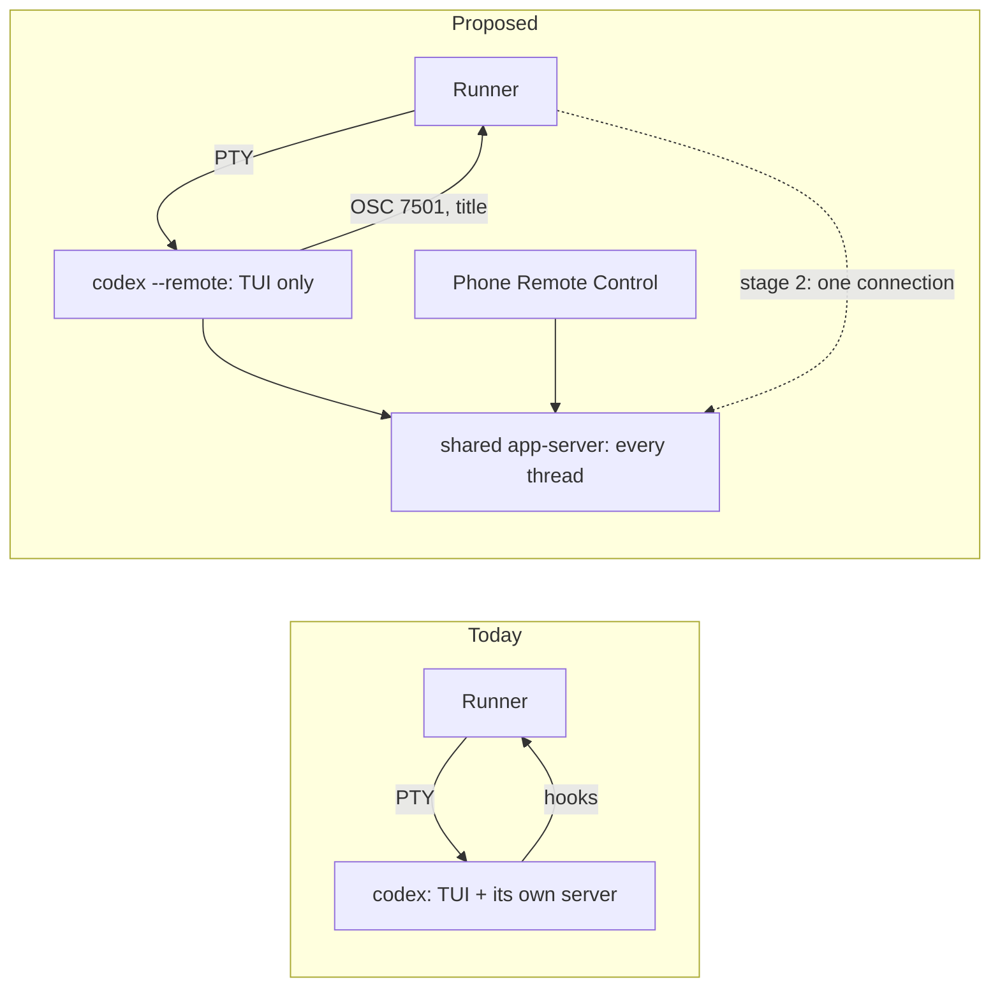

# 1012 — Run Codex sessions on Codex's app-server

> Tracking issue: [#1012](https://github.com/yicheng47/runner/issues/1012). Priority: P0, milestone 0.18.
> Status: draft for discussion, 2026-10-28; revised 2026-10-30 after reading Codex 0.165.0's source (below), which splits the work into two stages; nothing built. The core mechanism was tested by hand against Codex 0.165.0 ([test record](../tests/1012-codex-app-server.md)).
> Related: [#1046](https://github.com/yicheng47/runner/issues/1046) (inbox delivery), which builds stage 2; [#861](https://github.com/yicheng47/runner/issues/861) and [#1051](https://github.com/yicheng47/runner/issues/1051) (status); [#940](https://github.com/yicheng47/runner/issues/940) and [#1018](https://github.com/yicheng47/runner/issues/1018) (draft holds); [748](./748-mission-watch-delivery.md).

## Problem

**Remote Control (#1012).** Runner launches Codex with `-c` overrides and hook flags. Codex then runs its app-server inside the TUI process instead of joining its shared background server, so the phone's Remote Control cannot open a Runner chat: the embedded server holds the thread's writer lock. #1012 has the source trail.

**Runner can only reach Codex through its terminal and its hooks.** Codex status combines injected hooks, transcript tailing (for API errors and interrupts, which run no `Stop`) and screen reading. Inbox notices are typed into the composer, so Runner must detect drafts from the screen; #940 and #1018 were both stale holds on an idle Codex. Codex exposes no hook that fires while it is idle, so #1046 cannot fix Codex delivery with hooks.

## Proposal

Codex's TUI is a client of an app-server. Instead of the embedded one, every Runner Codex session attaches its TUI to Codex's shared app-server with `--remote unix://`, which is the server the phone's Remote Control uses. The work comes in two stages:

1. **Stage 1 (#1012).** The TUI attaches with `--remote`. Status comes from the OSC 7501 reports the TUI already writes to its terminal, and the thread id from the terminal title. Codex sessions in this mode drop the status hooks, and Runner opens no connection to the server.
2. **Stage 2 (#1046).** Runner opens one client connection to the same server, for `turn/start` delivery without the composer and for the mission folder as a workspace root.

Stage 1 alone fixes #1012. Stage 2's connection adds:

- **Input without the composer:** `turn/start` runs a turn on a thread and leaves the person's draft alone. #1046 uses this for Codex.
- **Mission folder:** `runtimeWorkspaceRoots` on `thread/resume` replaces `--add-dir`, which `--remote` rejects.
- **A second status source:** `turn/started`, `turn/completed` and approval requests for every thread Runner subscribes to.

## Findings (2026-10-28)

Tested on Codex 0.165.0 with a server on a scratch socket, the TUI in a pseudo-terminal and a second WebSocket client standing in for Runner. Details are in the [test record](../tests/1012-codex-app-server.md).

| Question | Result |
| --- | --- |
| Does the TUI work attached with `--remote unix://PATH`? | Yes. Turns run and the screen is unchanged. |
| Does a second client see a TUI thread's turns? | After `thread/resume` on the live thread, yes. Without it, the client gets `thread/started` (broadcast to every client) but no turn events. Subscribing did not disturb the TUI. |
| Does `turn/start` from the second client leave a draft alone? | Yes. With `DRAFT-123 keep me` in the composer, the TUI showed the notice as an ordinary user message followed by the reply, and the composer kept the draft. Enter then submitted exactly `DRAFT-123 keep me`. |
| Can sessions on one server have different environment variables? | Yes. The TUI's `-c shell_environment_policy.set.RUNNER_SPIKE="tui-a"` reached its thread's commands as `tui-a`; a client-created thread with the same key in `config` got `client-b`. |
| Can Runner tell which thread belongs to which TUI? | Yes. With `thread-id` in `tui.terminal_title`, two TUIs started together each put their own thread id in their terminal title. |
| Can a TUI attach to a thread Runner created? | Not before its first turn: `codex resume --remote <id>` fails with "no rollout found" until a turn has written the thread's file. The TUI creates new threads itself. |

Read from Codex source at [`bea47c0`](https://github.com/openai/codex/tree/bea47c06dfac12ecce362090418e12a6faeedbf9), not run:

- A bare `unix://` is Codex's shared daemon, `$CODEX_HOME/app-server-control/app-server-control.sock`, which Remote Control uses.
- `turn/start` on a thread with an active turn adds the input to that turn instead of starting another.
- `resume` and `fork` accept `--remote`; the server also has `thread/fork`.
- `--add-dir` and `sandbox_workspace_write.writable_roots` overrides are rejected with `--remote`; `thread/resume` takes `runtimeWorkspaceRoots`.
- `--remote` and `turn/start` were already in Codex 0.152.

## Findings (2026-10-30)

Read from Codex source at `rust-v0.165.0`, not run. The question was whether adding `--remote` to today's launch, hooks and flags unchanged, would be enough. It is not.

### Today's launch flags under `--remote`

- A `--remote` TUI forwards only an allowlist of its `-c` overrides to the server (`config_request_overrides_from_config` in `tui/src/app_server_session.rs`): `features`, `shell_environment_policy`, the permission and sandbox keys, `personality`, `allow_login_shell` and `suppress_unstable_features_warning`, plus reasoning effort, summary, verbosity and web search. Model, service tier and working directory travel as thread parameters, and `--dangerously-bypass-hook-trust` as `bypass_hook_trust`.
- `hooks.*` and `mcp_servers.*` are not on the list, so Runner's hooks and its `runner_hooks` MCP server never reach the server, and nothing reports an error. Codex's startup delivery expects the `SessionStart` hook (`startup_delivery_uses_hooks`), so a session would wait for reports that never arrive.
- Even if they reached it, the hook MCP server takes `RUNNER_HOOK_ENDPOINT`, `RUNNER_HOOK_SESSION` and `RUNNER_HOOK_GENERATION` from the environment of the process that starts it. On the shared daemon that is the daemon's environment, not the session's, so reports could not be matched to a session.
- `--add-dir` with `--remote` is a startup error (`tui/src/startup_orchestration.rs`), so a mission launch fails.
- Commands run in the server, so the session's `RUNNER_*` environment reaches them only through `-c shell_environment_policy.set.<NAME>=<value>`, which is on the allowlist.
- `check_for_update_on_startup` and `tui.terminal_title` are read by the TUI itself and keep working.

### Codex's OSC 7501 reports

The TUI writes OSC 7501 reports to its terminal (`tui/src/terminal_program_status.rs`), so they reach Runner under `--remote` as they do today.

| Report | Codex sends it when |
| --- | --- |
| `working` | A turn is running or about to start, or background commands are still running |
| `done` | A turn completed |
| `error` | A turn failed, including API errors |
| `idle` | At startup, after an interrupt, and once a finished result has been seen |
| `blocked` with `kind` | Codex waits on the person: `permission`, `question` or `auth` |

Codex 0.163 sent only `blocked`, without a kind; `done`, `error` and the kinds arrived in 0.164. That is why Runner today uses Codex's OSC 7501 only for Needs you and leaves work, completion, interruption and identity to hooks. Reports describe the thread the TUI shows, which for a Runner session is its own thread. `error` also covers the API failures that run no `Stop` hook and that Runner now finds by tailing the transcript.

What the hooks give that OSC 7501 does not:

- **Conversation identity** for Resume. The terminal title's `thread-id` replaces it; the rollout scan remains the fallback.
- **Startup readiness**, the `SessionStart` hook that gates the first delivery. The `idle` report at startup should replace it; to verify.

## Status hooks after OSC 7501

Runner's hooks exist for status detection. With OSC 7501, status for an agent that reports it can come from the terminal stream instead, which raises whether the hooks are still needed at all.

- **Codex 0.164+, Claude Code 2.1.295+ and pi 1.1.0+** report OSC 7501. For them the hooks can shrink to identity: Claude Code's and pi's `SessionStart` rekey after `/clear` and `/resume`, and Codex's thread id until the terminal title replaces it. #1051 owns that switch and the hook-versus-OSC comparison for Claude Code and pi; with the findings above, Codex 0.164+ belongs in it too.
- **Agents that do not report OSC 7501**, such as Copilot, Grok and OpenCode, keep their hooks as their only semantic status. Without them they fall back to terminal activity.

So the hook machinery (the bridge, the queue and `runner hook serve`) stays for now. What shrinks is the set of hooked events for each agent that reports OSC 7501. Stage 1 is the first case: Codex on `--remote` runs with no status hooks.

## Which server

One app-server process can host many threads and many clients.

| Setup | Processes for N Codex sessions | Remote Control |
| --- | --- | --- |
| Today | N, each TUI with its own server | No |
| Codex's shared daemon (`unix://`) | N TUIs; the daemon may already run for the person's own Codex use | Yes |
| One server Runner starts | N TUIs + 1 | Only if Runner enables it there |

Recommendation: Codex's shared daemon, because it is what #1012 asks for and adds no process. A role that sets its own `CODEX_HOME` resolves `unix://` to that home's daemon, so separate accounts stay separate. A server Runner starts is the fallback if the shared daemon cannot be used.

## Session lifecycle

Stage 1:

1. **Start.** Launch `codex --remote unix:// …` in the session's PTY, with the per-session settings below. The TUI creates its thread.
2. **Identify.** Read the thread id from the terminal title, which Runner already parses; the title gains `thread-id`.
3. **Run.** Take status from OSC 7501. Inbox notices are typed into the composer as today, with today's draft holds.
4. **Resume.** Launch `codex resume --remote unix:// <id>`.
5. **Fork.** Today's headless `codex exec fork` writes the new thread's rollout; the TUI then resumes it with `--remote`. To verify.

Stage 2 adds Runner's connection: after step 2 it subscribes with `thread/resume`, setting the mission folder through `runtimeWorkspaceRoots`; step 3 delivers inbox notices with `turn/start` (#1046); step 5 can use `thread/fork`.

### What each launch setting becomes

| Today | Stage 1 |
| --- | --- |
| `-c model`, `model_reasoning_effort`, `service_tier` | Same flags on the TUI, which sends them with the thread |
| `-c check_for_update_on_startup=false`, `-c tui.terminal_title=…` | Stay on the TUI. The title gains `thread-id`. |
| Per-session environment (`RUNNER_*`) in the Codex process | `-c shell_environment_policy.set.<NAME>=<value>` on the TUI, because commands now run in the server process |
| `--enable hooks`, `--dangerously-bypass-hook-trust`, `mcp_servers.runner_hooks`, `hooks.*` | Dropped. Status comes from OSC 7501. |
| `--add-dir <mission folder>` | Rejected with `--remote`. Missions keep today's launch until stage 2 sets `runtimeWorkspaceRoots`, unless open question 8 shows they need no extra root. |
| Positional first prompt | Unchanged on the TUI |
| `codex resume <id>` | `codex resume --remote unix:// <id>` |
| Headless `codex exec fork` | Unchanged, then resumed with `--remote`; stage 2 can use `thread/fork` |
| Rollout scan for the conversation key | Thread id from the terminal title, with the scan as fallback |

### Status

Runner's reducer already maps OSC 7501's states to status and outcomes (#861). For Codex:

- `working` → Working.
- `done` → Idle, completed.
- `error` → Idle, failed.
- `idle` straight after `working`, with no `done` → Idle, interrupted. Codex sends nothing else for an interrupt, so this inference is new; to verify against open question 7.
- `blocked` → Needs you. Its `kind` can tell an approval from a question or a sign-in, which Runner's Codex Needs you does not do today.

What changes is ownership. A Codex session on `--remote` has no live hook bridge, so OSC 7501 holds status authority, and Codex's runtime-owned parser publishes every report instead of overlaying only `blocked`. Hook status, transcript tailing and the rollout scan as the primary key source stop for these sessions. Stage 2's connection events become a second source.

### Failure

- **The server restarts or stops:** every Codex session on it loses its server. Runner marks them unavailable and resumes any TUI that exited; in stage 2 it also reconnects and subscribes again through `thread/loaded/list`. The shared daemon restarts on Codex's schedule, not Runner's.
- **Runner's connection drops (stage 2):** reconnect and subscribe again. The TUIs are unaffected.

## Rollout

An opt-in Codex setting first, as #1012's acceptance asks, with today's launch unchanged when it is off. It becomes the default after macOS, Windows and Linux validation. The mode needs Codex 0.164 or later, for `--remote` and the full set of OSC 7501 reports; Runner checks the version and keeps today's launch for older Codex.

## Affected guide pages

[Supported agents](../guide/reference/supported-agents.md): the Codex column's status, Needs-input, resume and fork rows, plus Remote Control. [Roles](../guide/concepts/roles.md): the new Codex setting. Both have zh-CN copies.

## Out of scope

Stage 2's connection, which #1046 builds with inbox delivery; status hooks for other agents (#1051); Codex cloud threads.

## Open questions

1. **Shared daemon or a Runner-started server by default?** The recommendation is the shared daemon. Does Runner start it when it is missing (`codex app-server daemon`), or does `--remote unix://` start it?
2. **Opt-in or default?** Opt-in first; when does it become the default?
3. **When the server restarts,** does the TUI exit, wait or reconnect?
4. **Approvals with several clients.** Is the first answer from the TUI or the phone final, and in stage 2 does Runner's connection receive approval requests?
5. **Windows and Linux.** Does `unix://` work for the TUI and the shared daemon on Windows?
6. **Remote Control end to end.** A Runner chat continued from the phone while the desktop stays attached, and resumed. This needs Jason's paired phone.
7. **OSC 7501 on a `--remote` TUI.** Record the reports through startup, a turn, an interrupt, an approval and a failed turn on Codex 0.165.0. Does the startup `idle` arrive reliably enough to replace the `SessionStart` readiness?
8. **Missions without `--add-dir`.** Do mission agents need the mission folder as an extra workspace root, or can missions also run on `--remote` in stage 1?
