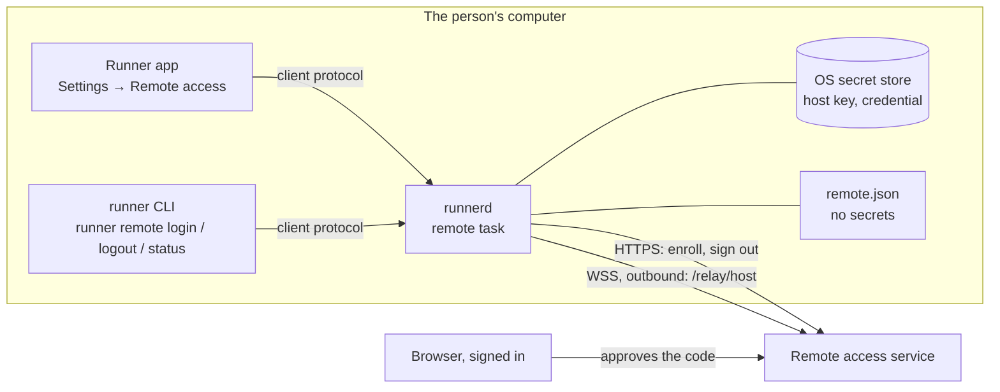

# 836 — Web remote control

> Tracking issue: [#836](https://github.com/yicheng47/runner/issues/836). Scheduling and priority live on the issue and in the [roadmap](../roadmap.md). Platforms: macOS and Windows first; Linux wherever `runnerd` runs ([#823](https://github.com/yicheng47/runner/issues/823)).
> Status: Phase 1, connecting a host to an account, is specified in full for the desktop and ready to build; the service's side of it went live on 2026-10-16. Phase 2's client trust model and the terminal-size rule are written (2026-10-19), and the rest of the companion protocol (2026-10-20); the encrypted channel and the adapter that serves the protocol (Phase 3) were drafted on 2026-10-20 for review, and Phase 4, the Tailscale route, is released together with the hosted service. On 2026-10-21 Jason made the client another Runner desktop rather than a browser: the service only relays, and serves no terminal page ([Clients are Runner apps](#clients-are-runner-apps)). On 2026-10-22 he signed off the client's design: a computer picker in the sidebar, one route at a time, and the account in its own Settings pane ([Runner as a client](#runner-as-a-client)).
> Scope: Runner's side only, what runs on the person's computer: `runnerd`, the `runner` CLI and the desktop app. The web panel and the service are developed separately; this spec describes them only as far as Runner talks to them.
> Design: `runner/desktop/specs/836-web-remote-control.pen` in `yeelinks_design`, the Settings → Remote access pane: every state, the Disconnect confirmation, a light-theme Connected and the five stop reasons. Jason chose the status-card layout on 2026-10-18: one card whose dot, sentence and actions change with the state, then an Access section with the switch and Disconnect. The same file holds Terminal size's desktop states, merged in from `836-terminal-size.pen` on 2026-10-22, and Runner as a client's screens, signed off by Jason that day. Since 2026-10-22 the file reads as the person's journey in numbered steps, each section with a note naming the mission that builds it: 1 set up this computer, 2 pair from another computer, 3 work on it, 4 when the connection breaks, 5 manage access, and 6 the account. m7's layout is the final one for Remote access, and frames drawn in the earlier layout are in a Superseded section at the bottom, after the decision notes from earlier rounds.
> Related: [#912](https://github.com/yicheng47/runner/issues/912) (iOS on the same foundation), [#808](https://github.com/yicheng47/runner/issues/808) (SSH hosts), [#838](https://github.com/yicheng47/runner/issues/838) (the desktop's own second-window resize, separate from Terminal size).

## Motivation

Since 0.13, agents keep running in `runnerd` after the desktop app closes, but the person still needs that desktop to see progress or unblock them. Remote control connects the computer to the person's account so they can reach the same sessions from Runner on another computer, on another network, and later from the iPhone app.

## Phases

| Phase | What Runner builds |
| --- | --- |
| 1 | Connect a host: enrollment under an account, the stored secrets, the outbound connection, and its state in Settings and the CLI |
| 2 | The companion protocol v1 in `runner-core`, with golden JSON for every message, and how a host decides which clients it trusts |
| 3 | The end-to-end channel in `runnerd` (Noise through `snow`) and the adapter that serves the protocol from `runnerd`'s state: overview, live status, terminal attach, input and resize; the host desktop's side of a remote client; and Runner as the client, connecting to another host through the relay |
| 4 | The Tailscale route: a listener on the host's Tailscale interface, which a Runner client reaches directly over the tailnet with no service in between, carrying Phase 3's channel and Phase 2's protocol unchanged; a computer uses it instead of the relay, not beside it |

Phase 1 is plumbing: the web panel shows the computer online or offline. Nothing a session contains leaves the computer before Phase 3.

**Two routes, one release (Jason, 2026-10-18).** Remote control is released with two ways to reach a host, as two options of the same release: Tailscale for users worldwide, with no account or service, and the hosted service, invite-only, for users in mainland China. A computer uses one of the two, chosen once (Jason, 2026-10-22; [Runner as a client](#runner-as-a-client)). Neither audience comes first, so the order of the phases follows how easily each part is built and tested: the relay goes first because its service is live and Phase 1 already connects to it, and Tailscale follows Phase 3 on the same protocol and channel. Remote control is 0.17's focus, and each phase is a sub-issue of #836: [#951](https://github.com/yicheng47/runner/issues/951), [#952](https://github.com/yicheng47/runner/issues/952), [#953](https://github.com/yicheng47/runner/issues/953) and [#954](https://github.com/yicheng47/runner/issues/954).

### Clients are Runner apps

Jason, 2026-10-21, after the first live pass of a browser against a local service. The client that reaches a host is Runner itself: first the desktop app on another computer, later the iPhone app ([#912](https://github.com/yicheng47/runner/issues/912)). The service is a conduit: it keeps accounts and enrolled devices and relays channels it cannot read, and it serves no terminal page and no client code.

- **Why.** A page the service sends is code the service can change, so a compromised service could capture the PIN or type into a paired terminal; a client installed from Runner's signed releases removes that. The channel, records and protocol then have one implementation, in Rust in `runner-core`, instead of a second one in TypeScript, and the client renders terminals with the desktop's own renderer.
- **Routes.** A person with Tailscale connects one Runner to another directly over the tailnet (Phase 4), and the service is not involved. Without Tailscale, both ends reach each other through the relay. Each computer uses one route, chosen once, so two computers reach each other only on the same route.
- **Unchanged.** The host side built in m1–m5, the PIN pairing and trust, the channel, records and companion protocol, and Terminal size's single controller. In this spec, *browser* in Phase 2 and Phase 3 now means a remote Runner client; the device names in examples, such as Chrome on Windows, read as Runner on another computer.
- **Dropped.** The service's browser side of the channel and its terminal and host pages (`runner_server`'s R2–R4), and the browser test page `/dev/remote`.

## Phase 1 — Connect a host



`runnerd` owns everything: the enrollment calls, the secrets, the connection and the state. The app and the CLI only send requests over the client protocol and render the status `runnerd` pushes back. Neither receives a secret from the daemon; the app or interactive CLI sends the PIN only when the person sets it.

### What the person does

**From the app.**

1. Settings → Remote access → **Connect this computer**.
2. Runner shows a short code, the computer's fingerprint and the time left, and opens the browser at the service's Add host page with the code filled in. The person can also type the code on another device, such as a phone, at the short link shown beside it.
3. The person signs in if needed, checks that the fingerprint on the page matches the one in Runner, names the computer and approves.
4. Within a few seconds Settings shows **Connected as @jason** with the name the computer was given, and the web panel shows it online.

**From the CLI.** For a machine without the app, such as a Linux box reached over ssh, or for people who prefer the terminal:

```text
$ runner remote login
Connect this computer to https://runner.yeelinks.com.cn
Remote access is a private beta, available only in mainland China for now.
Signing in needs an account created from an invite code.

  Open         https://runner.yeelinks.com.cn/hosts/add?code=BCDF-GHJK
  Code         BCDF-GHJK
  Fingerprint  630d cd29 66c4 3366 9112

Check that the page shows the same fingerprint, then approve it there.
Waiting for approval… 9:52 left

Approved by @jason (Jason).
Allow remote access to this computer from @jason (Jason)? [y/N] y
Connected as @jason. This computer is "Mac Studio" on your account.
```

**Pause.** The **Allow remote access** switch closes the connection and reopens it, without leaving the account. The computer shows offline in the web panel while paused.

**Disconnect.** Settings → **Disconnect**, or `runner remote logout`, removes the computer from the account and deletes its enrollment credential. Connecting again needs a new code and keeps the host identity key and fingerprint. Reset identity disconnects, creates a new key, clears the PIN and unpairs every device.

**Removed elsewhere.** When the computer is removed in the web panel, or the account is deactivated, the connection closes and Settings says so. **Connect again** starts a fresh enrollment; **Try again** reconnects with the existing credential, which works if an administrator has since reactivated the account.

In every case the agents keep running. Remote access never stops, restarts or replaces `runnerd` or its sessions, and a failure in it never takes the daemon down.

### Who may connect a host

Connecting a host to an account grants that account a route to the computer. From Phase 3 on, reaching its terminals also requires a device paired with the PIN the person sets at the host. Runner's agents run as the same user, can run the `runner` CLI, and can be steered by text they read. An agent that connected the computer to someone else's account, after a prompt injection or by mistake, would give that account a route to attempt pairing. Setting or changing the PIN, unlocking PIN entry and Reset identity follow the same person-only rules:

- **The person starts it.** From the app, the click on Connect is the person's consent. `runner remote login` requires an interactive terminal: stdin and stdout are both terminals (`std::io::IsTerminal`), which an agent's command tool does not provide. It also refuses when `RUNNER_HANDLE` is set, which Runner sets for every agent session it starts; Runner's own terminal tabs do not set it, so a person can log in from one.
- **The person confirms the account.** The approval in the browser happens under whatever account approved it. Before `runnerd` saves the credential for connection, the CLI shows the approving account and asks to allow it; a refusal follows the sign-out cleanup path. The app flow shows the account in the Connected state with Disconnect beside it.
- **Not through the generic call or the agent guide.** The remote requests are absent from `runner call`'s table, and `runner remote` is absent from the agent guide that `runner help` prints for agents; it appears only in clap's own `runner remote --help`.
- **The limit, stated plainly.** Any program running as the user can do what the user can, including connecting to `runnerd`'s socket and reading files. These rules stop an agent from connecting the computer through Runner's own paths or by mistake; they are not a sandbox.

### Secrets on the host

The host holds its identity private key and optional PIN in one secret-store item, and the credential the service issues at enrollment in a separate item. The device code is another secret, but it lives only in `runnerd`'s memory while enrollment or recovery of the approved response is pending, bounded by the enrollment or claim deadline. The private key never leaves the computer; the credential is sent only to the service, in the `Authorization` header over TLS.

- **Storage.** The operating system's secret store, as Platforms describes: the macOS Keychain or Windows Credential Manager, and an owner-only file on Linux for now. Development builds use their own entries, so `make run` never touches the installed app's enrollment.
- **Nowhere else.** Never in Runner's SQLite database, settings, `remote.json`, logs, crash reports or any export; never printed by the CLI after enrollment; never served through `runnerd`'s client protocol to the app or the CLI; never in an environment variable, because every agent and shell `runnerd` starts inherits its environment. The types that hold them implement `Debug` as `[redacted]`.
- **Agents run as the same user.** A Windows credential or an owner-only file is readable by any process of that user, an agent included. The macOS Keychain is not: another program's read raises a prompt the person sees. The Keychain is therefore required on macOS; elsewhere Runner uses the best store available, and nothing in Runner points an agent at the secrets.
- **Transport.** HTTPS and WSS with certificate verification against the system's trust store, with no option to turn it off; a proxy carries the TLS connection through unopened. The only exception is a development service on `http://localhost` or `http://127.0.0.1`, and only when that origin is given explicitly.
- **Recovery.** Removing the host from the account, or a completed `SignOutHost`, invalidates the credential at once. Logout deletes the enrollment credential first and asks the service to remove the host as a best effort; if it cannot, the leftover host is harmless and the web panel removes it. The identity and PIN survive logout and a new enrollment, as do paired devices. A suspected leak calls for Reset identity at the host, which disconnects, changes the key and clears the PIN and devices.
- **What the key will protect.** From Phase 3 the private key authenticates the host to browsers over the end-to-end channel. Noise mixes a fresh ephemeral key into every session, so a stolen host key does not decrypt sessions recorded earlier; it does let its holder pose as the host from then on.

### Talking to the service

What Runner sends and how it reacts. A released Runner speaks this, so a change to it is compatible (new optional fields, new message types, new close codes) or goes into a new path version. Every JSON example in this section is a golden file in Runner's tests.

#### Calls

- The service is one HTTPS origin, written `https://runner.example` in the examples. The default is the hosted service, `https://runner.yeelinks.com.cn`; `runner remote login --server` chooses another, and the app always uses the saved or default origin.
- **Origins** are kept canonical: scheme, lowercase host and a port only when it is not the scheme's default, with no path, query or trailing slash. `https://Runner.Example:443/` becomes `https://runner.example`. Anything else is refused before a request is made: another scheme, a path, user info, or `http://` for a host other than `localhost` or `127.0.0.1`.
- Calls are [Connect](https://connectrpc.com/docs/protocol/) unary calls in JSON: `POST <origin>/api/runner_server.v1.HostEnrollmentService/<Method>` with `Content-Type: application/json`. `reqwest` and `serde` are enough; no protobuf or Connect library is needed. Each call times out after 15 seconds.
- JSON follows the protobuf JSON mapping: lowerCamelCase field names, 64-bit integers such as `hostId` as decimal **strings**, `bytes` as standard base64 with padding, enums by their full names. Fields with default values may be missing from responses and take their defaults. Unknown fields are ignored.
- A failure is a non-200 status with `{"code": "...", "message": "..."}` and possibly `details`, which Runner ignores. Runner acts on `code` alone:

| `code` | Runner |
| --- | --- |
| `invalid_argument` | Logs the message; stops with reason update required, since a released Runner only sends valid requests |
| `resource_exhausted` | Rate limited: on `PollEnrollment` adds 5 s to the poll interval; on `StartEnrollment` returns to Not connected with "Too many attempts. Try again in a minute." |
| `unauthenticated` | On a credential call, the credential no longer identifies a host |
| `unavailable`, `internal`, `unknown`, a timeout or a network error | Transient: retried with backoff |

StartEnrollment is the exception: transient failures are retried for at most 30 seconds, then Runner returns to Not connected with the error, so Connect and runner remote login never wait indefinitely.

#### Host identity

- **Host key.** One persistent X25519 identity key pair per host, generated on first enrollment or PIN setup by `snow` (`Builder::generate_keypair`) from the operating system's secure random source, so the key is the Noise static key Phase 3 uses. Only the 32-byte public half is sent, at enrollment. Disconnect, removal and enrolling again keep it. Reset identity creates a new key and requires enrolling again. A legacy enrollment adopts its existing key into the identity item before its enrollment item is rewritten without the key.
- **Fingerprint.** The lowercase hex of the first 10 bytes of SHA-256 over the 32 raw public-key bytes, in five groups of four separated by spaces. Runner shows it at enrollment and in the Connected state so the person can compare it with the web panel. Golden vector: key bytes `00 01 02 … 1f` (base64 `AAECAwQFBgcICQoLDA0ODxAREhMUFRYXGBkaGxwdHh8=`) have fingerprint `630d cd29 66c4 3366 9112`.
- **Host info.** Sent at enrollment and in `hello` on every connection, so the web panel shows current values after an update. Every field is normalized to its rule before sending; a value that cannot be read falls back to `unknown`.

| Field | Rule | Runner reports |
| --- | --- | --- |
| `hostname` | 1–255 bytes | The OS host name (`gethostname`), cut at a character boundary |
| `platform` | `macos`, `windows` or `linux` | From `std::env::consts::OS` |
| `arch` | 1–16 characters of `a-z0-9_` | `arm64` for `aarch64`, `x86_64` for `x86_64`; anything else lowercased with other characters dropped |
| `osVersion` | 1–64 bytes | macOS: `macOS ` and `sysctl kern.osproductversion` (`macOS 15.4`). Windows: from `HKLM\SOFTWARE\Microsoft\Windows NT\CurrentVersion`, `Windows 11` when `CurrentBuildNumber` is 22000 or higher (the `ProductName` value still says Windows 10 there), else `Windows 10`, then `DisplayVersion` (`Windows 11 24H2`). Linux: `PRETTY_NAME` from `/etc/os-release` |
| `runnerVersion` | 1–32 bytes | `runner_core::version::CRATE_VERSION`, such as `0.18.2`; nightlies report their base version |

#### Enrollment

A device-code flow in the style of [RFC 8628](https://www.rfc-editor.org/rfc/rfc8628).

**`StartEnrollment`**, no authentication:

```json
{
  "host": {"hostname": "jason-mac-studio", "platform": "macos", "arch": "arm64", "osVersion": "macOS 15.4", "runnerVersion": "0.18.2"},
  "hostKey": "AAECAwQFBgcICQoLDA0ODxAREhMUFRYXGBkaGxwdHh8="
}
```

```json
{
  "deviceCode": "pV8m2Qy1nX0bJk3sTq7wE5rLc9aZ4hUd6gFiYoN1MjA",
  "userCode": "BCDF-GHJK",
  "verificationUri": "https://runner.example/hosts/add",
  "verificationUriComplete": "https://runner.example/hosts/add?code=BCDF-GHJK",
  "expiresIn": 600,
  "interval": 5
}
```

Runner keeps `deviceCode` in memory only and never shows or logs it. It shows `userCode` as given, the two links, the fingerprint and the time left, counted down from `expiresIn` seconds after the response. Both links must be on the service's origin; a response that points elsewhere is treated as `invalid_argument`.

**`PollEnrollment`**, no authentication, with `{"deviceCode": "..."}`, first `interval` seconds after the start response and then every `interval` seconds:

| `state` | Runner |
| --- | --- |
| `ENROLLMENT_STATE_PENDING` | keeps polling |
| `ENROLLMENT_STATE_DENIED` | stops: denied |
| `ENROLLMENT_STATE_EXPIRED` | stops: expired |
| `ENROLLMENT_STATE_APPROVED` | confirms the account where required, stores the secrets and connects |

```json
{"state": "ENROLLMENT_STATE_PENDING"}
{"state": "ENROLLMENT_STATE_DENIED"}
{"state": "ENROLLMENT_STATE_EXPIRED"}
```

```json
{
  "state": "ENROLLMENT_STATE_APPROVED",
  "hostId": "7383920468475904",
  "credential": "rhc_Zm9vYmFyYmF6cXV4cXV1eGNvcmdlZ3JhdWx0Z2FycGx",
  "relayUrl": "wss://runner.example/relay/host",
  "account": {"username": "jason", "displayName": "Jason"},
  "claimExpiresAt": "2026-10-16T10:10:00Z"
}
```

- **Recoverable claim.** After a transient failure, Runner retries `PollEnrollment` with the same in-memory device code, at the poll interval with backoff, instead of starting again. Before `claimExpiresAt`, retries return the same host id, credential and deadline and never create another host or extend the deadline. Because an approval may land just before expiry and its response may be lost, Runner keeps retrying transient failures until the service gives a definite state, or until five minutes past the enrollment's expiry, then stops: expired.
- **First connection deadline.** `claimExpiresAt` is an RFC 3339 UTC timestamp. Account confirmation and the first `welcome` must finish before it; otherwise the provisional credential expires and the service removes the unconnected host. An expired or revoked claim, or an inactive approving account, returns `ENROLLMENT_STATE_EXPIRED`.
- **Checks.** An approved response with a missing credential, a credential that is not `rhc_` followed by 43 base64url characters, or a `relayUrl` that is not `wss://` on the service's host (`ws://` only for a development origin on `http://`) is treated as `invalid_argument`.
- The device code is discarded once the approved result is stored, refused or expired.

#### Credential

`rhc_` followed by 43 base64url characters. Runner stores it as Secrets on the host describes, sends it only as `Authorization: Bearer <credential>` on the `/relay/host` upgrade and on `SignOutHost`, never in a URL, and redacts anything matching `rhc_[A-Za-z0-9_-]+` from text it logs. After the first `welcome` it does not expire; it stops working when the host is removed, signs out, or while its account is deactivated.

#### The host connection: `/relay/host`

`runnerd` keeps one WebSocket to `relayUrl` while remote access is on. The upgrade is an HTTP/1.1 `GET` with `Authorization: Bearer <credential>` and `Sec-WebSocket-Protocol: runner-relay.v1`, and no `Origin` header: the service refuses any upgrade that carries one, so a browser page can never pose as a host. Runner checks `Sec-WebSocket-Accept` and that the service chose `runner-relay.v1`; either failing is a protocol error and reconnects with backoff. Phase 3 adds session traffic to this connection; until then Runner sends only text frames.

| Before the upgrade | Runner |
| --- | --- |
| 400 `unsupported_protocol` | stops: update required |
| 401 `unauthenticated` | stops: removed, or expired when this enrollment has never received `welcome` |
| 403 `permission_denied` | an `Origin` header was sent, which is a Runner bug: logs it and stops: update required |
| 429 `rate_limited` | retries after `Retry-After` seconds, 60 when the header is missing |
| 503, any other status, a timeout or a network error | retries with backoff |

**Messages** are text frames, each one JSON object of at most 64 KiB with a `type`; unknown types and fields are ignored, and a binary frame from the service is logged and ignored. Within 10 seconds of the upgrade Runner sends `hello`, and the service answers `welcome`. If `welcome` does not arrive within 10 seconds of `hello`, Runner closes the connection and reconnects with backoff.

```json
{"type": "hello", "host": {"hostname": "jason-mac-studio", "platform": "macos", "arch": "arm64", "osVersion": "macOS 15.4", "runnerVersion": "0.18.2"}}
{"type": "welcome", "hostId": "7383920468475904", "name": "Mac Studio", "account": {"username": "jason", "displayName": "Jason"}}
```

`welcome` makes the host online. Runner stores its `name` and `account` in `remote.json`, since both can change in the web panel, and marks the enrollment activated. A `hostId` that differs from the stored one is a protocol error.

**Heartbeat.** The service pings every 25 seconds and Runner answers each ping with a pong. Runner treats 75 seconds without any frame from the service, pings included, as a dead connection: it drops the connection and reconnects. The service marks a host offline after 60 seconds without hearing from it; that is temporary connectivity loss, never credential revocation or a reason to stop local sessions.

| Close code | Meaning | Runner |
| --- | --- | --- |
| 1000 | normal close from the service | reconnects with backoff |
| 1001 (sent by Runner) | `runnerd` is stopping, or remote access was paused or disconnected | — |
| 1008 | protocol violation, including the service's 60-second silence timeout | logs it, reconnects with backoff |
| 1011 | service error | reconnects with backoff |
| 1012 | service restart | reconnects after a random 1–10 s, without growing the backoff |
| 4001 | another connection used the same credential | stops: in use elsewhere |
| 4003 | removed, signed out, or the account was deactivated | stops: removed |
| any other code, or the connection drops | — | reconnects with backoff |

**Backoff** is exponential with full jitter: before attempt *n* (from 0), a random delay between 0 and min(60, 2ⁿ) seconds. It resets once a connection has stayed past `welcome` for 60 seconds.

**Removed or deactivated.** The service cannot tell Runner whether a 4003 or 401 means removal or deactivation, and deactivation is reversible: the host stays on the account and its credential works again after an administrator reactivates the account. So stopped, removed keeps the key and credential. **Try again** makes one connection attempt with them; **Connect again** first completes the sign-out cleanup below, then starts a fresh enrollment.

#### Signing out: `SignOutHost`

`runner remote logout` and Disconnect run the same steps:

1. Close the WebSocket with 1001, read the credential into memory, then delete the enrollment secret-store item and `remote.json`, keeping the identity item and `remote-trust.json`. The computer is disconnected at this point, with or without a network; the state is Not connected.
2. Call `SignOutHost` once with the in-memory credential, `Authorization: Bearer <credential>` and body `{}`, then drop the credential. Sign-out accepts a valid credential even if the owner is inactive or the first-connection deadline has passed. Success, or `unauthenticated` (the host is already gone), removes the computer from the account.
3. Any other failure is not retried. The computer stays on the account, shown offline, until the person removes it in the web panel; with its credential deleted, nothing can reconnect under that enrollment. Not connected shows one line as its last error: `Couldn't reach the service, so "Mac Studio" is still listed on @jason's account. Remove it in the web panel.`

Refusing the approving account in the CLI runs the same steps for that claim. Pause keeps the identity and credential for resuming the same enrollment; logout, removal and expired-claim cleanup delete only the enrollment. A new enrollment reuses the identity.

### `runnerd`

#### Where it lives

- **`runner-core/src/remote/`**: the wire types (host info, the enrollment requests and responses, control messages, close codes and refusals, all `serde` with the JSON mapping above), the origin rules, the fingerprint, and the status types the client protocol carries. It is separate from the build-locked client protocol: it is the service's contract, which independently released versions of Runner and the service both speak.
- **`runner-daemon/src/remote/`**: the remote task, its pure state machine, the service client, the WebSocket, `remote.json`, host info and the secret-store backends.
- **`AppCore`** gains a `remote` handle: a command channel into the task and a `tokio::sync::watch` of the current `RemoteStatus`. Client requests send a command and await its reply; status changes emit the pushed event.

#### The state machine

The task is a loop around a pure function, `step(state, input, now, rng) -> (state, effects, next_deadline)`. Inputs are client commands, call results, socket events and the deadline firing; effects are calls to make, the socket to open or close, secrets to store or delete, `remote.json` to write and the status to publish. The loop performs the effects and feeds their results back in. Tests drive `step` directly with a fake clock and a seeded random source and never sleep.

| State | Details carried | Leaves to |
| --- | --- | --- |
| `off` | the origin to use next, the last error | `enrolling` on Connect |
| `enrolling` | user code, fingerprint, both links, expiry; in memory: device code, key pair, poll interval | `connecting` when approved from the app; `confirming` when approved from the CLI; `stopped` on denied or expired; `off` on Cancel |
| `confirming` | the approving account, the claim deadline; in memory: the claim | `connecting` on allow; the sign-out cleanup on refuse, or when the CLI disconnects; `stopped: expired` at the claim deadline |
| `connecting` | attempt number | `connected` on `welcome`; `reconnecting` on a retryable failure; `stopped` on a stopping one; `paused` |
| `connected` | since, host name, account | `reconnecting` on a drop; `stopped` on 4001 or 4003; `paused` |
| `reconnecting` | attempt, last error, next retry | `connecting` at the deadline or on Retry now; `paused` |
| `paused` | — | `connecting` when resumed |
| `stopped` | reason: removed, in use elsewhere, update required, denied or expired | `connecting` on Try again (removed, in use elsewhere); `enrolling` on Connect again, after the sign-out cleanup when secrets exist |

Rules that cut across the table:

- **Disconnect** is accepted in every state except `off`. In `enrolling` it cancels; in `confirming` it refuses; otherwise it runs the sign-out cleanup.
- **One enrollment at a time.** Connect is refused while already enrolled; Connect again is the path from `stopped`. Starting from `enrolling` cancels the earlier enrollment first.
- **Expired after approval.** A 401 before the first `welcome`, or the claim deadline passing, means the provisional host is gone: Runner deletes its enrollment credential and `remote.json` locally without calling `SignOutHost`, and stops: expired.
- **Supervision.** The task runs on the daemon's Tokio runtime and `runnerd` watches its join handle. If it ever ends unexpectedly, `runnerd` logs it and starts it again from `remote.json` after the normal backoff, so a bug in remote access costs a reconnect, never the daemon or its sessions.

#### `remote.json`

The state that survives a restart, in `runnerd`'s app-data directory (`com.wycstudios.runner`, or `com.wycstudios.runner-dev` for development builds). It holds no secret. It is written to a temporary file and renamed into place, owner-only (`0600`) on Unix; a file that fails to parse is logged, renamed to `remote.json.bad` and treated as missing.

```json
{
  "version": 1,
  "origin": "https://runner.yeelinks.com.cn",
  "host_id": "7383920468475904",
  "relay_url": "wss://runner.yeelinks.com.cn/relay/host",
  "account": {"username": "jason", "display_name": "Jason"},
  "host_name": "Mac Studio",
  "fingerprint": "630d cd29 66c4 3366 9112",
  "activated": true,
  "claim_expires_at": "2026-10-16T10:10:00Z",
  "paused": false,
  "stopped": null
}
```

`stopped` holds the reason while stopped, so Settings still explains it after a restart.

#### Start-up and shutdown

- **No `remote.json`:** `off`.
- **`stopped`:** stay stopped with the saved reason.
- **`paused`:** stay paused.
- **Otherwise:** load the secrets and connect. If the secret-store item is missing (deleted by hand, a new user profile), delete `remote.json` and stop: removed, offering only Connect again.
- **Shutdown and updates.** Stopping the daemon closes the connection with 1001 before the session teardown. An app update restarts `runnerd`, and the connection comes back with it.

#### The connection's plumbing

- **One HTTP stack.** The enrollment calls use the daemon's async `zed-reqwest` client with `rustls-tls-native-roots`. The WebSocket upgrade is sent through the same client, as HTTP/1.1 with `Response::upgrade`, and the upgraded connection is handed to `tokio-tungstenite` (`WebSocketStream::from_raw_socket`, client role). The connection therefore takes the same proxy, TLS roots and certificate verification as the calls. `tokio-tungstenite` is built without TLS features of its own.
- **Proxies.** `zed-reqwest` reads the Windows system proxy from the registry, but on macOS only with its `macos-system-configuration` feature, which `runnerd` does not enable today; `runnerd`, started by the app, inherits no proxy variables. This work enables that feature for `runner-daemon`, so the calls and the WebSocket follow the system proxy on macOS and Windows, and `HTTPS_PROXY`/`ALL_PROXY` where set. Many people in mainland China run a system proxy such as Clash.
- **Logs.** `runnerd.log` records state changes, the origin, HTTP statuses, close codes and reasons, and the backoff chosen, at info level. It never records the device code, the credential or key material, and the service's error messages pass through the `rhc_` redaction before they are logged.

### Client protocol

New requests in `daemon_api!`, for the app and the CLI. They change no existing request.

| Request | Fast | Result |
| --- | --- | --- |
| `remote_status()` | yes | `RemoteStatus` |
| `remote_enroll_start(origin: Option<String>, confirm_account: bool)` | no | `RemoteStatus` in `enrolling`, after `StartEnrollment` answers. `origin` defaults to the saved or default origin. The CLI sets `confirm_account`; the app does not. From `stopped` it first runs the sign-out cleanup. |
| `remote_enroll_confirm(allow: bool)` | no | `RemoteStatus`; only in `confirming` |
| `remote_enroll_cancel()` | no | `RemoteStatus`; only in `enrolling` |
| `remote_set_paused(paused: bool)` | no | `RemoteStatus` |
| `remote_retry()` | no | `RemoteStatus`: Retry now in `reconnecting`, Try again in `stopped` (removed, in use elsewhere) |
| `remote_logout()` | no | `RemoteLogout`: `removed`, or `still_listed` with the error when `SignOutHost` failed; local removal has happened either way |

A request that does not apply to the current state fails with a message the CLI and the app can show as is, such as "This computer is already connected as @jason. Run `runner remote logout` first."

```rust
pub struct RemoteStatus {
    pub state: RemoteState,
    pub origin: String,
    pub account: Option<RemoteAccount>,  // username, display_name
    pub host_name: Option<String>,
    pub host_id: Option<String>,
    pub fingerprint: Option<String>,
    pub last_error: Option<String>,
}

pub enum RemoteState {
    Off,
    Enrolling { user_code: String, verification_uri: String, verification_uri_complete: String, expires_at: DateTime<Utc> },
    Confirming { account: RemoteAccount, expires_at: DateTime<Utc> },
    Connecting { attempt: u32 },
    Connected { since: DateTime<Utc> },
    Reconnecting { attempt: u32, next_retry_at: DateTime<Utc> },
    Paused,
    Stopped { reason: StopReason },  // Removed, InUseElsewhere, UpdateRequired, Denied, Expired
}
```

Local requests that change remote access, including `remote_enroll_start`, allow 45 seconds for the service call and connection work. `remote_enroll_start` retries transient failures for at most 30 seconds, then replies with Not connected and `Couldn't reach <origin host>.` Each individual service call still times out after 15 seconds and is bounded by the remaining startup budget. Closing the CLI cancels its pending request.

A pushed `remote/status` event carries the snapshot whenever it changes. No secret is ever in a request, a response or the event. None of these requests is added to `call_daemon` in `runner-cli/src/client.rs`, so `runner call remote_enroll_start` fails as an unknown tool.

### CLI

- **`runner remote login [--server <origin>]`.** Refused, before contacting `runnerd`, when stdin or stdout is not a terminal or `RUNNER_HANDLE` is set: "`runner remote login` needs you at an interactive terminal outside an agent session. Use Runner → Settings → Remote access, or run it in your own terminal." It calls `remote_enroll_start` with `confirm_account`, prints the transcript above, follows `remote/status` and redraws the time left on one line every second. On `confirming` it asks `Allow remote access to this computer from @jason (Jason)? [y/N]`; anything but `y` or `yes` refuses. It waits for `connected`, prints any reconnect error it sees on the way, and exits at a stop or the claim deadline. Ctrl-C while waiting cancels the enrollment, or refuses it in `confirming`. It does not open a browser, so it behaves the same over ssh.
- **`runner remote pin`.** Uses the same terminal and agent-session guard as login, reads the PIN twice without echo and saves it only if both entries match and contain exactly six ASCII digits. **`runner remote reset-identity`** uses the same guard and asks `[y/N]` before disconnecting, clearing the PIN and devices, and creating a new key.

- **`runner remote devices [--json]`** lists paired devices, or their JSON array; **`runner remote revoke <fingerprint>`** removes the named device. Both are allowed inside agent sessions.

- **`runner remote logout`.** Prints `Removed this computer from @jason's account.`, or `Disconnected this computer. Couldn't reach the service, so "Mac Studio" is still listed on @jason's account; remove it in the web panel.` Both exit 0, since the computer is disconnected either way. With nothing connected it prints `This computer is not connected.` and exits 0.
- **`runner remote status [--json]`.** One line per field: state with its detail, account, computer name and host id, fingerprint and service. `--json` prints the `RemoteStatus` fields with an additional `trust` object containing `RemoteTrust`. Human-readable output includes whether the PIN is set or locked and the device count. Exits 0.

```text
$ runner remote status
State        connected since 10:02 (2 h 14 min)
Account      @jason (Jason)
Computer     Mac Studio (host 7383920468475904)
Fingerprint  630d cd29 66c4 3366 9112
Service      https://runner.yeelinks.com.cn
PIN          set
Devices      0
```

Exit codes for `login`: 0 connected; 1 denied, expired, refused, cancelled, or stopped for any other reason, with the reason printed; 2 for usage errors, from clap. `logout` and `status` are allowed inside agent sessions: removing access is harmless, and status shows no secret. The guide's CLI reference is regenerated with `make guide-cli`.

### Desktop app

A new Settings pane, **Remote access**, in the App group after Notifications, with the route key `remote` and the lucide `globe` icon added to `assets.rs`. The pane reads `remote_status` when it opens. The app loads `remote_status` and `remote_trust`, follows `remote/status` and `remote/trust`, and refreshes both after reconnecting; every window shows the same state. Layout follows the Pencil design; the content and actions are these:

| State | Shows | Actions |
| --- | --- | --- |
| Not connected | What remote access does; a **Private beta** callout saying remote access is invite-only and available only in mainland China for now, and that signing in to the hosted service needs an account created from an invite code; that sessions will be encrypted end to end once session access ships; the last error, if any | **Connect this computer** |
| Waiting for approval | The code, large and monospaced; the fingerprint; the short link; the time left, counting down | **Open in browser**, **Copy link**, **Cancel** |
| Connecting | The account if known, and a spinner | **Allow remote access** switch, **Disconnect** |
| Connected | A green status line with the time connected; `@jason · Jason`; the computer's name, set in the web panel; the fingerprint; the service origin | **Allow remote access** switch, **Disconnect** |
| Reconnecting | The last error and the time to the next try | **Retry now**, the switch, **Disconnect** |
| Paused | Remote access is off; the computer shows offline | The switch, **Disconnect** |
| Stopped | Why, in a sentence from the table below | The reason's actions |

| Stop reason | Sentence | Actions |
| --- | --- | --- |
| Removed | This computer was removed from @jason's account, or the account was deactivated. | **Connect again**, **Try again** |
| In use elsewhere | Another copy of Runner connected with this computer's credential. | **Try again**, **Disconnect** |
| Update required | The service needs a newer version of Runner. | **Check for updates**, which opens Settings → Updates |
| Denied | The request was denied in the browser. | **Connect again** |
| Expired | The code expired before this computer connected. | **Connect again** |

- **Connect** calls `remote_enroll_start` with no origin, so `runnerd` uses the saved or default one, then opens `verificationUriComplete` with `cx.open_url`. **Copy link** copies `verificationUriComplete`.
- **Disconnect** asks first with the existing confirmation dialog. It says the computer is removed from the account and its enrollment credential is deleted, while its identity, PIN and paired devices are kept; connecting again needs a new code. The actions are **Disconnect** and **Cancel**.
- **Pairing and Devices.** The pane offers Set/Change PIN, Unlock when locked, Reset identity behind a confirmation, and Revoke beside each device. The PIN dialog explains that the service never sees it and reads exactly six digits in two steps, one masked six-box row at a time: Choose a PIN → Continue, then Enter it again → Set PIN. Enter activates the current action only at six digits. Back clears both entries and returns to step 1. A mismatch shows “The PINs don't match.” as a toast and returns to step 1 cleared. Continue, Set PIN and the no-PIN row's Set PIN use the theme's accent fill and accent-ink label. A live transition into PIN entry locked raises a warning toast; a locked state loaded at launch only shows the row. The device list uses the approved table in Client trust below.
- **Toast.** When the state moves into stopped for removed, in use elsewhere or update required while the app runs, Runner shows a warning toast with the sentence above. A stopped state found at launch shows no toast; the pane explains it.
- **Text.** Every string is in `i18n/en.toml` and `i18n/zh-hans.toml`. The Chinese terms are 远程访问 (Remote access), 连接这台电脑 (Connect this computer), 断开连接 (Disconnect), 允许远程访问 (Allow remote access) and 指纹 (fingerprint). The CLI's output stays English, like the rest of the CLI.

### Platforms

- **macOS.** One Keychain generic-password item per origin for enrollment, plus the identity item with account `host-identity`: service `com.wycstudios.runner.remote` (development builds `com.wycstudios.runner-dev.remote`), account the canonical origin, label `Runner remote access`, written with `security-framework`, which is already in the dependency tree. It lives in the login keychain and is not synchronizable, so iCloud Keychain does not carry it to another Mac. Only `runnerd` reads or writes it. Because `runnerd` creates it, the item's access list names `runnerd`'s code signature, so later reads by the Developer ID–signed `runnerd`, including after an app update replaces it, need no prompt. A development build's ad hoc signature changes with each rebuild, so a rebuilt development `runnerd` may prompt; that is expected.
- **Windows.** One generic credential per origin in Credential Manager, plus the identity at `com.wycstudios.runner.remote/host-identity` (development builds `com.wycstudios.runner-dev.remote/host-identity`), target `com.wycstudios.runner.remote/<origin>` (development builds `com.wycstudios.runner-dev.remote/<origin>`), persisted per machine (`CRED_PERSIST_LOCAL_MACHINE`) rather than roaming with the profile, written with `CredWriteW` through `windows-sys`'s `Win32_Security_Credentials`. The `keyring` crate is not used: it persists Windows credentials as roaming.
- **Linux.** Linux packaging arrives with [#823](https://github.com/yicheng47/runner/issues/823), and CI does not run Linux yet. Phase 1 builds the owner-only fallback, `remote-secrets.json` for enrollment and `remote-identity.json` for identity in the app-data directory, each created with mode `0600` rather than changed after; the Secret Service over D-Bus joins with #823.
- **The item's content.** The enrollment item is `{"v": 2, "credential": "rhc_…"}`. The separate `host-identity` item is `{"v": 1, "key": "<base64 private key>", "pin": null}` until a PIN is set. On upgrade, a `v: 1` enrollment key is adopted only when no identity exists, then that enrollment is rewritten as `v: 2` without the key.
- **Tests** use an in-memory store for the state machine and the integration tests. The platform round-trip tests use their own service or target name and delete what they create, so they never touch a real enrollment.

### Out of scope

Everything in Phases 2 to 4, including the Tailscale route; push notifications and the iOS app ([#912](https://github.com/yicheng47/runner/issues/912)); same-network and Bonjour routes; one computer on several accounts or services at once; renaming the computer from Runner, which the web panel does; credential rotation; the Linux Secret Service; starting, stopping or archiving sessions remotely.

### Verification

- **Unit tests.** Host info normalization on each platform, including the Windows 11 build rule and fallbacks; origin canonicalization and refusals; the fingerprint against the golden vector; the redaction of `rhc_` values; `Debug` of the secret types.
- **The state machine,** through `step` with a fake clock and seeded randomness: every row of the state table; backoff bounds, growth and reset after 60 s past `welcome`; the 75 s dead-connection timer; 1012's 1–10 s delay without growing the backoff; `Retry-After`; every close code and refusal status mapped to its next state; the poll interval growing on `resource_exhausted`; the recoverable claim retried after a transient failure and given up five minutes past expiry; the claim deadline in `confirming`; one enrollment at a time.
- **Wire fixtures.** Every JSON example in Talking to the service as a golden file, parsed and produced by the `runner-core` types, including missing default fields and unknown fields.
- **Integration tests** against a fake service in the test suite, a small Tokio server on `127.0.0.1` that answers the calls and the WebSocket as specified: enrollment from the app path and the CLI path (allow and refuse); denial; expiry; `resource_exhausted`; a lost approved response followed by the same claim; the claim deadline passing before the first `welcome`; approval then `welcome`; a missed heartbeat; 1012; 4001; 4003 followed by a successful Try again; a 401 on reconnect; a 403 when an `Origin` header is present; an unknown close code; logout; offline logout deleting only the enrollment credential and `remote.json`, reporting the computer as still listed and never reconnecting after a restart; refusal with the service unreachable; pause and resume keeping the key; a daemon restart that reconnects. Re-enrollment after removal or logout keeps the fingerprint; Reset identity changes it. A failure in the remote task leaves sessions running in every case.
- **Secret stores.** A round trip on macOS and Windows CI with test names. If a CI runner cannot reach its secret store, the pull request says so rather than silently skipping the test.
- **The agent rules.** `runner remote login` refused with `RUNNER_HANDLE` set and without a TTY; `runner call remote_enroll_start` refused as an unknown tool; `runner remote` absent from the agent guide.
- **The app.** Each pane state rendered from a status snapshot, in English and Chinese; the toast only on a live transition.
- **Live,** recorded with Runner's version and platform, against a development service first and then the hosted one: connect the Mac and the Windows PC from the app and a third machine from the CLI; see each online in the web panel; pause and resume; disconnect while offline, see the still-listed line, restart the development daemon and verify no reconnect, then remove the leftover host in the web panel; enroll again with the same fingerprint, then Reset identity and verify a new fingerprint; remove one in the web panel and see stopped, removed; on macOS, confirm that another program's read of the item prompts and that an app update does not.

### Implementation

The work lands as one pull request in five commits, each building and passing its tests:

1. **Wire types and identity**, `runner-core`: the `remote` module with host info, origins, the enrollment and control types, close codes and refusals, the fingerprint, the status types, and the golden fixtures. Key generation through `snow`.
2. **Secret store**, `runner-daemon`: the interface, the macOS Keychain, Windows Credential Manager, owner-only file and in-memory backends, and the round-trip tests.
3. **The remote task**, `runner-daemon`: the state machine, the service client, the WebSocket through `reqwest`'s upgrade, `remote.json`, start-up, shutdown and supervision, log redaction, and the fake-service integration tests.
4. **Client protocol and CLI**: the requests and `remote/status` in `daemon_api!`; `runner remote login`, `logout` and `status`; the agent guide left unchanged; `make guide-cli`.
5. **Settings → Remote access**, `runner-app`: the pane from the Pencil design, its states, the confirmation and the toast, the `globe` icon, English and Chinese strings, and the user guide page `docs/guide/guides/remote-access.md` with its line in `docs/guide/README.md`.

New dependencies: `snow`; `tokio-tungstenite` without TLS features; `windows-sys` gains `Win32_Security_Credentials`; `zed-reqwest` gains `macos-system-configuration` for `runner-daemon`. Each is pinned in `Cargo.lock` and builds on both CI platforms.

### Decisions

- **Default origin and visibility (Jason, 2026-10-18).** `https://runner.yeelinks.com.cn`, the hosted service, with `runner remote login --server` for others; the app has no origin field (Jason, 2026-10-18). The pane appears in every build, released ones included. Its Not connected state, `runner remote login` and the user guide say plainly that remote access is a private beta, available only in mainland China for now, and that signing in needs an account created from an invite code; there is no feature switch to build and later remove.
- **Host key type (2026-10-18).** An X25519 key generated by `snow`, the Noise static key Phase 3 will use. The service keeps the public key unchanged for the host's lifetime, so Phase 2 adopts each enrolled host’s existing key without re-enrollment; only Reset identity replaces it.
- **WebSocket through the same HTTP stack (2026-10-18).** Upgraded through `reqwest` so it takes the same proxy, roots and verification as the enrollment calls, with macOS's system proxy enabled for both. `zed-reqwest` 0.12.15's `Response::upgrade` was checked in its source the same day.
- **Disconnect is local first (Jason, 2026-10-18).** Disconnect deletes the enrollment credential and asks the service to remove the host once, as a best effort. There is no pending-removal state or retry: a host left on the account is offline, cannot be used without its deleted credential, and is removed in the web panel.
- **Secrets stay with the OS (Jason, 2026-10-18).** The Keychain and Credential Manager keep the secrets on this computer; Runner adds no machine check of its own.
- **Proposed in this revision, for Jason's review (2026-10-18):** Try again for a removed or in-use credential; `CRATE_VERSION` as `runnerVersion`; the Linux file fallback only, with the Secret Service moved to #823; the toast as a message without an action, since toasts have none; one secret-store item per origin holding both secrets (superseded by Phase 2’s separate identity item, 2026-10-19).

### Open questions

| Question | Recommendation | Settle before |
| --- | --- | --- |
| Should the app also confirm enrollments started from the CLI when it is running? | Not in Phase 1: the TTY and account confirmation cover the CLI; revisit with Phase 3's client trust | Phase 2 |
| How a browser trusts a host's key, and how the host trusts a browser | Settled in Phase 2's Client trust (Jason, 2026-10-19): each device is paired once with a PIN the person sets at the host, and the PIN exchange proves the host's identity key to the device | Phase 2 |

## Phase 2 — Companion protocol and client trust

The trust model was written first, because both routes and the service's browser channel build on it, then Terminal size, because it is the protocol's one rule that a later version cannot change without changing the desktop app as well, and then the rest of the companion protocol. Two constraints are settled:

- **The protocol and the channel do not depend on the route (Jason, 2026-10-18).** The companion protocol and Phase 3's end-to-end channel run over any ordered, reliable byte stream; the relay's WebSocket is the first such stream, not part of either. A host trusts clients by per-device keys that it can list and revoke, not by the account session alone. Phase 4's Tailscale route, and any later direct route such as a same-network listener ([#912](https://github.com/yicheng47/runner/issues/912)), then adds only its listener, and reuses the protocol, the channel, the trust model and its pairing unchanged.
- **The person decides who reaches their terminals (Jason, 2026-10-19).** The host trusts a device only after it has been paired with a PIN the person set at the host. Being signed in to the account is not enough: if it were, whoever runs the service, an administrator included, could open any host's terminals.

### Client trust

**Two checks.** On the relay route a client passes two checks, which answer different questions. The service joins only a signed-in browser to a host on that browser's account: that decides whom the service routes. The host accepts only a device it has paired: that decides whom the host trusts. On the Tailscale route the tailnet takes the service's place, and the host's check is the same. Nothing the service holds, including account sessions, host credentials, host public keys and the traffic it forwards, lets anyone pass the host's check, so neither an administrator nor someone who breaks into the service can open a terminal.

**Sharing a host.** The host's check does not depend on whose device it is: a colleague's browser paired with the host's PIN is trusted like the person's own, and is revoked on its own. What keeps a host to one person is the service's check, which routes only the account that owns the host; on the Tailscale route, anyone on the tailnet who knows the PIN can already pair. Sharing a host between accounts, such as an office server several colleagues use, is out of scope in the first release. When it comes, only the service's routing changes: the owner grants other accounts access to the host, and each of their devices still pairs with the host's PIN, so trust stays on the host.

**The host's identity key.** Each host has one X25519 identity key, the Noise static key of both routes. Runner creates it the first time it is needed, at the first enrollment or when the PIN is first set, and keeps it in the OS secret store as an item of its own, apart from each origin's enrollment. Every enrollment sends it as `hostKey`, and Disconnect, removal and enrolling again keep it, so paired devices stay paired. **Reset identity**, in Settings or with `runner remote reset-identity`, makes a new key, unpairs every device and clears the PIN, since the PIN shares the key's secret-store item and a leak of one is a leak of both. Because the service keeps a host's key for the host's lifetime, Reset identity also disconnects the computer from the account, and connecting again enrolls the new key. It is the answer to a suspected leak.

**The PIN.** The person sets a PIN of exactly six ASCII digits, in Settings → Remote access, or with `runner remote pin` at an interactive terminal. No device can pair before a PIN exists: Settings asks for one once the computer is connected, and Phase 4's Tailscale listener cannot be turned on without one. The PIN is kept as entered in the identity key's secret-store item, so the exchange Phase 3 settles on does not change what is stored. It is never shown again, sent to the service, logged or returned over the client protocol. Changing it means setting a new one, and does not unpair the devices already paired.

**Pairing a device.**

1. Signed in to the web panel, the person opens the host. A browser that holds no key for this host asks for the computer's PIN.
2. The browser and the host run a password-authenticated key exchange over the connection. The PIN never crosses it, and what the service relays lets it neither learn the PIN nor test guesses offline. Only the real host knows the PIN, so the exchange also proves the host to the browser, which takes the host's identity key from inside the exchange, not from the service.
3. On success the browser generates its own X25519 key for this host, a non-extractable WebCrypto key in IndexedDB that the page's own code cannot copy out, and sends the public half with a name as the device describes itself, such as `Chrome on Windows`. The host saves it. A device keeps a separate key for each host it pairs with, so each host's list stands on its own: pairing with one host, or being revoked by it, changes nothing at another.
4. Runner tells the person that a device was paired: a desktop notification while the app runs, and the device in Settings' list either way.

From then on the device connects with its key, from anywhere and over either route, without the PIN. It is asked for the PIN again only when it holds no key: a new device or browser, cleared site data, a private window, or after Revoke or Reset identity.

**Wrong PINs.** Five wrong PINs in a row, from any devices, lock PIN entry: no device can pair until the person unlocks it in Settings, and Runner notifies the person when it locks. Paired devices keep working while it is locked. A malicious service therefore gets five guesses at most, and visibly. The cost is that it can also lock PIN entry on purpose, which it could match anyway by refusing to route.

**Devices.** Settings lists each paired device with its name, when it was paired and when it was last seen, and **Revoke**, which deletes the device's key from the host and closes any channel it has open at once. A device's fingerprint is computed from its public key as the host's is, and names the device: `runner remote devices` lists each device with its name, fingerprint, and when it was paired and last seen, and `runner remote revoke <fingerprint>` removes one. The list holds only public keys, so it is `remote-trust.json` beside `remote.json`, together with the PIN lock's state: not the secret store, and not the database, since the umbrella adds no migration.

**Who may set the PIN.** A PIN opens the host's terminals to any device that knows it, so setting or changing the PIN, unlocking PIN entry and Reset identity follow Who may connect a host. They start from the app, or from `runner remote pin` or `runner remote reset-identity` at an interactive terminal outside an agent session, the same check `runner remote login` makes; they are not reachable through `runner call`, and are absent from the agent guide. Listing and revoking devices are allowed inside agent sessions, like `logout` and `status`.

**Requests.** New requests in `daemon_api!`, for the app and the CLI. None is added to `call_daemon`, so `runner call` refuses each as an unknown tool.

| Request | Fast | Result |
| --- | --- | --- |
| `remote_trust()` | yes | `RemoteTrust`: the fingerprint, whether a PIN is set, whether PIN entry is locked, and the devices |
| `remote_set_pin(pin)` | no | `RemoteTrust`. The PIN is in this request and nowhere else, and the request's `Debug` redacts it |
| `remote_unlock_pin()` | no | `RemoteTrust` |
| `remote_revoke_device(fingerprint)` | no | `RemoteTrust` |
| `remote_reset_identity()` | no | `RemoteTrust`, after the sign-out cleanup when the computer is connected |

A pushed `remote/trust` event carries `RemoteTrust` whenever it changes. `runner remote pin` reads the PIN twice without echo, and `runner remote reset-identity` asks `[y/N]` first. `runner remote status` gains a PIN line and the device count.

**How the person knows.** The guarantee is worth only what the person can see of it:

- **Told where it matters.** Setting the PIN says, in a sentence, that Runner's service never sees it, so the service cannot pair a device on its own. The user guide page `docs/guide/guides/remote-access.md` gains a section, Who can reach this computer, that says what the service can and cannot do, the browser limit included.
- **Shown as it happens.** The new-device notification, the device list with when each was last seen, and the PIN lock make a pairing the person did not make visible on their own computer.
- **Checkable.** The host makes the decision, in Runner's open-source code, and this spec describes the exchange, so anyone can read and test that the service is never asked. Reading the source shows what it does, not that an installed app was built from it: releases are built from the public repository by its GitHub Actions workflows, but not reproducibly, so a person either trusts that pipeline or builds Runner themselves. What a person cannot read is the web panel's code, which the service serves; that is the limit below.

**The limit, stated plainly.** A browser runs the web panel's code as the service serves it. A service that sent malicious code to a person's browser could capture the PIN as it is typed and pair a device of its own, or use a paired browser's key while the page is open, though it could not copy that key out. Pairing stops the service from reaching any host on its own, silently and at scale; it does not make a browser safe from the site that serves it. A device paired this way still appears in the list and raises the notification. A native client whose code does not come from the service, such as the iOS app ([#912](https://github.com/yicheng47/runner/issues/912)), does not have this limit.

**Settled with Phase 3's channel.** Phase 3's Channel section specifies the exchange: CPace, whose output is the pre-shared key of the Noise `XXpsk3` handshake that pairs the device. Every later connection is plain `IK`: the client knows the host's identity key from pairing, and the host rejects a client key that is not on its list.

Jason approved the PIN, its lock, Revoke and Reset identity frames on 2026-10-19, with Devices table option B (`eiIy3`) as the canonical connected state. The other references are `KNmA3` (no PIN/devices), `zSJNq` (locked/toast) and `T0hixs` (Reset identity). After live testing, Jason replaced the PIN design with the two-step option B: `K2ww03` (choose), `VckyU` (confirm) and the replacement `TLJNH` (step 1 over Settings), exported at 15:24 on 2026-10-19. Each input has six equal boxes, 48 px tall, 6 px radius, bg fill and border-strong border; the current box has a 1.5 px accent border and a caret. Entries accept ASCII digits only, Backspace removes the last digit, a six-digit paste fills the row, and copy/cut and native reads never expose digits. In m2, the table shows recorded last-seen times, without inferring a connected state, and its footer says pairing arrives in a later update; Jason approved this Phase 3 distinction through Runner on 2026-10-19.

### Companion protocol

What a browser and `runnerd` say to each other once Phase 3's channel is open. It is a protocol of its own, apart from the client protocol the desktop app and the CLI use: that one is locked to the build and refuses a client from any other build, while the web panel updates when the service deploys and a host updates when its person installs a release. The companion protocol is therefore versioned, and each side copes with a peer that is newer or older. Its types live in `runner-core/src/companion/`, and every message has a golden JSON file in its `fixtures/`, which the host's tests and the web panel's tests both decode, so neither side can drift from the other without a test failing.

**Version 1 covers** what a person needs away from the desktop: every tab, mission and session with its live status, a mission's feed, answering a mission's question and sending it a message, and every terminal, to see, type in and size under Terminal size's rule. Starting, stopping, archiving and deleting sessions and missions, and the app's settings, stay on the desktop. An agent's own approval prompt is answered by typing in its terminal, as at the desktop.

**Messages.** Each message is one JSON object in UTF-8, carried whole by the channel, and its `type` names it; type and field names are camelCase. Terminal bytes, output and input, are base64 strings. That costs a third more on terminal output than a binary frame would, in exchange for one decoder and golden files a person can read; a binary form can be added later as a new push without a new version, if a measurement asks for it. A message is at most 1 MiB, and the host sends terminal bytes in chunks of at most 32 KiB, so output from several terminals interleaves and no terminal holds up the others. There are three kinds:

- A **request**, from the browser, carries an `id`, a number the browser picks and does not reuse on that connection. The host answers each request exactly once, with `result` carrying the same `id`, or with `error`.
- A **push**, from the host, has no `id`: the overview, statuses, feed entries and terminal output.
- The **handshake**, `hello` and `welcome`, is the first message in each direction.

```json
{"type":"feed","id":12,"mission":"01M5945GYZ2Q4XT9YA10CE2HM1","limit":50}
{"type":"result","id":12,"result":{"entries":[],"before":null}}
{"type":"error","id":12,"code":"notFound","message":"No mission has that id."}
```

**The handshake and versions.** The browser's `hello` lists the protocol versions it speaks and names the client, `web`, with its build. The host answers `welcome` with the highest version both speak, the computer's name, Runner's version, the platform, and `features`, the optional requests it serves. If they share no version, the host answers `error` with code `unsupportedVersion` and the range it speaks, then closes the channel, and the panel tells the person which side needs updating.

- Within a version, changes only add: an optional field, a push, a request listed in `features`, or a value of an enum. Each side ignores fields it does not know, a browser ignores pushes it does not know, and a host answers a request it does not know with `unknownRequest`.
- Every field added after version 1 is first released has a default, so a message from an older peer still decodes.
- Every enum names the value a reader falls back to when it meets a value it does not know.
- A change that adding cannot make, such as removing or retyping a field or changing what one means, is a new version. A host speaks every version from 1 to its newest, and the web panel keeps speaking an old version for as long as a supported Runner release needs it, so either side may be the newer one.

**Version 1 wire details (m3, 2026-10-20).** The golden files settle the field names and the otherwise open cases:

- `hello` is `{"type":"hello","versions":[1],"client":"web","build":"web-20261020"}`. `welcome` has `version`, `name`, `runnerVersion`, `platform` (an open string, initially `macos`, `windows` or `linux`) and `features`, an array of request names. The client's name and build, runtime names and feature names are open strings, rather than closed enums.
- The version mismatch is `{"type":"error","id":null,"code":"unsupportedVersion","message":"No supported companion protocol version in common.","versions":{"min":1,"max":1}}`. An error without a readable numeric request `id` has `id:null`; otherwise it answers that `id`. Other errors do not carry `versions`. The host's `ClientMessage::decode` entry point returns a `badRequest` error with the readable `id` even when the body or type is invalid, so the adapter can answer without parsing the message again. A missing or invalid ID, non-object message or invalid JSON yields an uncorrelated error with `id:null`. Invalid bodies name the request and the missing or invalid field in a short English message, for example `attach: missing field cols.` or `attach: field cols must be an unsigned 16-bit integer.` These diagnostics use known field names and expected types, never supplied values or terminal data.
- Requests that return no data answer `{"type":"result","id":18,"result":null}`. The overview result is the overview object directly; the overview push has its `projects`, `tabs`, `missions` and `sessions` alongside `type`. `feedAppended` has `mission` and `entries`; entries are in append order, while a feed page is newest first. Entry `ts` is a UTC RFC 3339 string. Signal names and their payloads remain as the event log holds them.
- `to` in `post` and feed entries is an array of handles; `[]` means everyone. An ask without choices has `choices:null`, in the overview and feed alike. A tab or mission with no project has `project:null`; a shell with no agent runtime has `runtime:null`. A session's `cwd` is a string when known and `null` when unavailable; a missing `cwd` defaults to `null`, as the stored session model permits no recorded working directory.
- All empty optional fields are written as `null`, including `before`, `reason`, `history` and empty pane `session`. Missing optional fields still decode; `attach` with missing or null `history` uses 1,000 lines. `snapshot.more` is a required boolean, false on its final chunk. The snapshot continuation fields and decoder order are defined under Terminals below. An empty byte slice produces no chunks; an empty snapshot is represented by one final snapshot message with `data:""` and `more:false`.
- `resized.controller` is an object tagged by `kind`: `{"kind":"you"}`, `{"kind":"desktop"}`, `{"kind":"browser","name":"Chrome on Windows"}` or `{"kind":"none"}`. `closed` has `session` and `reason`, with reasons `exited`, `stopped`, `archived` and `unknown`.
- Unknown string enum values retain their spelling when serialized; the types' `effective()` methods give their version 1 meaning: status → `idle`, needs-you reason → `unknown`, mission state → `stopped`, session kind → `chat`, split direction → `row`, attach control → `ifFree`, close reason → `unknown`, error code → `failed` (show its message). An unknown controller means `none`; an unknown pane shape means an empty pane; an unknown feed kind is retained as unknown and ignored. Unknown pushes are retained as unknown and ignored; unknown requests retain both their type and `id` and produce `unknownRequest`. Known message types ignore and discard unknown fields; only unknown request, push, feed, controller and pane variants retain their uninterpreted payloads.
- Host messages dispatch by `type` alone. Only `result` and `error` validate a correlation `id` in their bodies. An `id` added to a push may be a string, such as an event ULID. Known pushes ignore and discard it; unknown pushes retain it in their uninterpreted payload.

The snapshot continuation fields were added before version 1's first release (m5 follow-up, 2026-10-21); they default as described under Terminals. Version 1 has no fields added after its release yet. `v1_without_later_fields.json` is a version 1 `hello`; its test also decodes it with a test-only newer reader whose added capability defaults to false. This proves the addition rule without inventing a released field. Fixture filenames under `runner-core/src/companion/fixtures/` are part of the shared contract: `overview_request.json` and `overview_push.json` distinguish directions; `result_*.json` distinguish result payloads; `unknown_*.json` exercise compatibility.

**Requests.**

| Request | Fields | Result |
| --- | --- | --- |
| `overview` | | The overview, below |
| `feed` | `mission`, `before`, `limit` | A page of the mission's feed, newest first, with `before`, the cursor for the page before it, or `null` at the start |
| `follow`, `unfollow` | `mission` | Starts or stops `feedAppended` for that mission |
| `answer` | `mission`, `question`, `text` | Answers one of the mission's pending asks, as the desktop's answer card does; a choice is answered with its text |
| `post` | `mission`, `to`, `text` | Sends the mission a message from the person, to everyone or to named handles |
| `attach` | `session`, `cols`, `rows`, `control`, `history` | Starts the terminal's stream: `snapshot`, then `output` and `resized` |
| `input` | `session`, `data` | Writes bytes to the terminal |
| `takeControl`, `viewport` | `session`, `cols`, `rows` | Terminal size's rule |
| `detach` | `session` | Ends the terminal's stream |

**Pushes.**

| Push | When |
| --- | --- |
| `overview` | A tab, mission or session was added, removed, renamed, moved or laid out again, or a mission's asks changed. It carries the whole overview, at most once every 250 ms |
| `status` | One session's status or unread mark changed: `session`, `status`, `reason`, `unread` |
| `feedAppended` | New entries in a followed mission's feed |
| `snapshot` | After `attach`, and again whenever the browser has fallen behind: `session`, `seq`, `cols`, `rows`, `data`, `more`, `precedingChar` and `unfinishedLen` while chunks follow |
| `output` | `session`, `seq`, `data` |
| `resized` | Terminal size's rule |
| `closed` | The session's terminal has ended, it exited or was stopped or archived, with `reason`; the browser drops the stream |

**The overview** mirrors the desktop's sidebar, since what the sidebar holds is what a browser opens:

```json
{"projects":[{"id":"01KZ…","name":"runner"}],
 "tabs":[{"id":"01M5…","project":"01KZ…","name":"Review","pinned":false,
          "panes":{"split":"row","sizes":[0.5,0.5],"a":{"session":"01M6…"},"b":{"session":"01M7…"}},
          "shells":[]}],
 "missions":[{"id":"01M5…","project":"01KZ…","title":"836 m2 — host trust","crew":"codex duo","state":"running","pinned":false,
              "members":[{"handle":"coder","session":"01M8…","lead":true},{"handle":"reviewer","session":"01M9…","lead":false}],
              "asks":[{"question":"01MA…","from":"coder","prompt":"Run the full suite?","choices":["Yes","No"]}],
              "shells":["01MB…"]}],
 "sessions":{"01M6…":{"kind":"chat","title":"Fix the feed","runtime":"codex","cwd":"/Users/me/runner","status":"working","reason":null,"unread":false}}}
```

- Projects, tabs and missions come in the sidebar's order, with `pinned` marking the pinned ones. Archived ones are not listed.
- A tab's `panes` is its split tree, as `runnerd` keeps it in the tab's node: a pane names its session, or `null` when it is empty, and a split has its orientation, `row` or `column`, the two sizes as fractions, and its halves `a` and `b`. `shells` are the shells in the tab's terminal drawer.
- A mission has its `state`, `running` or `stopped`, its members by handle with the lead marked, its pending asks, and the shells in its drawer.
- Each session appears once, under `sessions`, with its `kind`, `chat`, `agent` for a mission member, or `shell`, and its title, runtime, working directory, status and unread mark.

**Status** is one value per session, flattened from `runnerd`'s observation, with the unread mark beside it: true when the session finished a turn the person has not looked at, the desktop's unread dot.

| `status` | When |
| --- | --- |
| `needsYou` | The session waits on the person; `reason` is `approval`, `answer` or `unknown` |
| `working` | An agent is working |
| `idle` | An agent is waiting for a prompt, or a shell is running |
| `starting` | Starting or resuming |
| `stopped` | The process has ended |
| `error` | It failed to start, or crashed |

A browser treats a status it does not know as `idle`. Opening a session's terminal with `take` clears its unread mark, as looking at it on the desktop does.

**The feed** is a mission's event log as the desktop's feed shows it, without the session-status and inbox-read noise that `runner mission feed` also leaves out. Each entry has its `id`, `ts`, `from`, `to` and `kind`: a `message` with its `text`; an `ask` with its `question`, `prompt` and `choices`; an `answer` with its `question` and `text`; or a `signal` with its name in `signal` and its payload as the log holds it, which a browser may show by name alone. `before` is opaque to the browser.

**Terminals.**

- `attach` is answered with `result`, then the `snapshot` in chunks, then `output` and `resized` in order. The snapshot is the host's terminal as it stands, serialized as the escape sequences that rebuild it: the screen, the cursor and the terminal's modes, with at most `history` lines of scrollback, 1,000 when it is left out, since a full scrollback can be megabytes over a slow route. The browser writes it into a fresh terminal emulator, xterm.js in the web panel, and then applies output in order.
- Every chunk of a snapshot repeats `precedingChar` (one Unicode scalar as a string, or `null`) and `unfinishedLen` (a nonnegative byte count); missing fields default to `null` and `0`. The browser assembles all chunks with that sequence and matching dimensions/continuation metadata before replaying. `unfinishedLen` counts the suffix of the assembled bytes, even when that suffix crosses a chunk boundary, and must not exceed their length. Replay the body before that suffix, restore the host's preceding raw printable character for REP (`CSI Ps b`), then replay the unfinished suffix before subsequent output. A `null` character clears REP continuation. This applies to initial attach and every replacement snapshot; the native client protocol retains its existing out-of-band restore path.
- The xterm decoder must preserve the host's REP semantics, including across cursor moves and other controls. xterm's default REP state is reset by controls and derives the repeated text from the preceding screen cell, so setting its parser flag alone is insufficient. The reference decoder in `script/test-companion-snapshot.cjs` tracks raw printable scalars and overrides REP through xterm's CSI hook; printing from that hook currently uses xterm's internal `InputHandler.print`. The headless check pins `@xterm/headless` 6.0.0, which shares the browser parser. The service decoder must supply that hook or equivalent behavior, run the shared `snapshot_rep*.json` fixtures and the continuation checks when choosing/updating xterm, and await each write before restoring continuation or applying the next bytes. This is parser validation; browser/service integration remains pending.
- `seq` counts the terminal's output chunks, as the client protocol does today: the snapshot holds everything up to its `seq`, each `output` carries the next one, and `resized` names the chunk its size takes effect at.
- **Falling behind.** The host keeps a short queue of output for each terminal and browser. When a browser falls so far behind that the queue fills, the host drops the queue and sends a fresh `snapshot` in its place, and the browser replaces its screen with it: the person sees a jump, never garbled output. It is the client protocol's resync, without a round trip. If the process exits before a stalled, already attached stream resyncs, the stream receives its final history-limited snapshot and matching `resized` before `closed`. Only that stream owns the final snapshot, released after delivery/closure, detach or channel close; the stream never retains the terminal model. A stopped session does not become attachable.
- `input` carries bytes as the browser's terminal produces them, keys, pastes and mouse reports alike, and they reach the PTY as the desktop's typing does. Any attached browser may type; only the controller sets the size.
- `detach`, or the channel closing, ends the stream. `closed` tells the browser that the terminal itself has gone, and why.

**Errors.** Every error has an English `message` that a browser may show as it is; a browser that does not know a code shows the message.

| `code` | When |
| --- | --- |
| `unsupportedVersion` | The two sides share no version; it carries the host's range |
| `badRequest` | A message does not decode, or a field is out of range |
| `unknownRequest` | The host does not serve that request |
| `notFound` | No such session, mission or question |
| `notRunning` | The session has no live terminal to attach to |
| `failed` | The host could not do it; the message says why |

**Fixtures.** One golden file for every message, and for: the handshake in both directions and a version mismatch; a message with a field the reader does not know; a version 1 message without fields added later; and a status and a push the reader does not know. The types parse and produce each ordinary file unchanged. Unknown-field compatibility files decode to the same known-field form as their ordinary counterparts; their extra fields are ignored and need not be reproduced. The web panel's decoder is tested against the same files. Serving the protocol from `runnerd`'s state is Phase 3's adapter.

Jason approved this section on 2026-10-20 with the choices it makes: `answer` and `post` in version 1, JSON with base64 terminal bytes, 1,000 lines of history by default, starting and stopping left to the desktop, and `take` clearing the unread mark.

### Terminal size

A session's terminal has one size. The PTY gives the program in it, a shell, Claude Code or Codex, one width and height, and the program draws for exactly that grid: its output is full of cursor movements computed for it, so the same bytes cannot be shown at a second size. Every client of a session therefore shows the same grid, and the rule below decides whose window sets it. It covers the desktop app and the browser; a phone client ([#912](https://github.com/yicheng47/runner/issues/912)) gets its own rule when it is designed.

**One controller (Jason, 2026-10-19).** Each terminal has at most one controller: the desktop app, or one browser. The controller's viewport is the terminal's size, and every other client draws that grid. `runnerd` holds the controller in memory, changes it only as the table below says, and ignores a size from any client that is not the controller, so no client can start a resize fight, even by mistake. Without a browser the desktop is always the controller, and nothing changes from today. The rule follows how Orca's phone client shares a terminal with its desktop app, reviewed in Orca's source the same day: an explicit owner, and a way to take the terminal back. Orca's phone-specific part, fitting to a phone's screen, is not part of it.

| Event | Controller after it | Terminal size |
| --- | --- | --- |
| A browser opens the terminal, or clicks **Take control** | That browser | The browser's viewport |
| The controlling browser's window changes size | Unchanged | Its new viewport |
| Another browser opens the terminal | The newer browser | Its viewport |
| A browser reattaches after its connection dropped | That browser if the terminal has no controller; otherwise unchanged | Its viewport if it became the controller; otherwise unchanged |
| The controlling browser closes the terminal, or its connection ends | None | Unchanged |
| The person clicks **Take back** or **Continue here** on a desktop pane showing the terminal | The desktop | The desktop pane's size |
| `runnerd` starts | The desktop | As today |

**Why opening takes control.** Opening a terminal in a browser is something the person does on purpose, so it is the signal: the host does not infer from typing or focus who is using which screen. Taking control on the first keystroke instead would resize the terminal under that keystroke. A reconnect is not something the person does, so it takes control only when nobody holds it: a dropped connection does not take the terminal back from a desktop that has taken it in the meantime. The browser says which of the two it is doing, and the host never guesses.

**Why leaving keeps the size.** Every resize makes the program redraw, a shell its prompt and a TUI its whole screen, and reflows the history the host's terminal model keeps. When a browser leaves, usually nobody is at the desktop to see a restored size, so restoring at once would spend a reflow for nothing. The terminal keeps the browser's size until the person continues at the desktop, so the one reflow happens when they are back and looking.

**The desktop pane while another client controls (Jason, 2026-10-19).** The pane is covered the way the two-window case covers a duplicate chat: a scrim over the terminal and a centered card naming who controls it from the paired device's name, such as Controlled from Chrome on Windows, with **Take back**. When the browser has left, the card says so, that the terminal is still at the browser's size, and offers **Continue here**. Either button, or Enter on the card, sends `terminal_take_back`, which resizes the terminal to the pane and returns control to the desktop. Taking back is always this deliberate step: keystrokes in a covered pane go to the card, so none lands in a terminal a browser is using. The pane draws no grid sized for another device and does not push its own size, so nothing has to be scaled or cropped to fit it, and the terminal behind the scrim is only a faint reminder of what is there; watching a browser's session from the desktop is left for later. Several desktop windows showing one terminal are one controller, the desktop, and the app picks the size among them as it does today.

**A tab or a mission opens as a unit (Jason, 2026-10-19).** A browser opens what the desktop's sidebar holds, a tab or a mission, and takes every terminal in it. The companion protocol's overview lists the desktop's tabs with their split layouts, which `runnerd` already keeps as its tab nodes, so a split tab opens in the browser as the desktop shows it. Opening a tab or a mission attaches each of its terminals with `take`, at the size of that terminal's pane in the browser. A chat has no sidebar row of its own, only its tab, so it is never taken apart from the rest of its split. The controller stays per terminal in `runnerd`, and the desktop draws one card over the whole tab or mission below its tab bar; Take back returns each terminal to its own pane.

The frames are the `836 · Terminal size` frames in `runner/desktop/specs/836-web-remote-control.pen` in `yeelinks_design`: a browser has control, the browser has left, a browser opened a split tab, light theme with Chinese strings, and the existing two-window overlay for comparison.

**A browser that is not the controller** draws the terminal's grid scaled to fit its window, says who holds the size, the desktop or another browser, and offers **Take control**. Its input still reaches the terminal; only its size does not.

**Messages.** The companion protocol carries the rule in four messages, in its envelope above:

- `attach` names the session, gives the browser's viewport in columns and rows, and says `take` when the person opened the terminal or `ifFree` when the browser reattaches after a dropped connection.
- `takeControl` gives the viewport, for Take control.
- `viewport` gives the controlling browser's new viewport once its window has stopped changing for 100 ms; `runnerd` applies the latest and ignores one from a client that is not the controller.
- `resized` goes to every client of the terminal whenever its size or controller changes: the size, the output sequence number it takes effect at, as the client protocol's `Resized` frame does today, and the controller as `you`, `desktop`, `browser` with the device's name, or `none`.

A browser viewport is clamped to 20–512 columns and 8–256 rows: a smaller viewport is raised to the minimum, and a larger one is lowered to the maximum, in `attach`, `takeControl` and `viewport` alike (Jason, 2026-10-20). Desktop sizes are unchanged. The desktop app gets the same state over the client protocol: the controller with each terminal's size, and a `terminal_take_back` request carrying the pane's size, which the app sends on Take back or Continue here.

**Not part of this rule.** [#838](https://github.com/yicheng47/runner/issues/838), the shell fragments a second desktop window leaves, is the app's own choice among its windows and stays outside this rule. The phone's rule, including fitting to a phone's screen, comes with #912.

**Checks**, with Phase 3's adapter, in `runnerd`'s tests and with Jason on a `remote-nightly` build:

- Opening a terminal in a browser resizes it to the browser and covers the desktop pane with its card; a size from that pane is then ignored, and a keystroke in it does not reach the terminal.
- Take back on the card, or Enter, resizes the terminal to the pane, removes the card, and switches the browser to the scaled view with Take control.
- Closing the browser's tab keeps the size, the card says the browser has left, and Continue here resizes the terminal to the pane.
- Opening a desktop split tab, or a mission, in a browser takes every terminal in it and covers the whole desktop tab or mission with one card, and Take back resizes each terminal to its own pane.
- A browser whose connection drops and returns keeps control when nobody took it, and does not take it back from a desktop that did.
- Of two browsers, the one that opened the terminal last is the controller.
- Without a browser the desktop behaves as before: TERM-RESIZE-01 and TERM-RESIZE-02 in the [terminal regression suite](../tests/regression/terminal.md) pass unchanged.

### Changes to Phase 1

The stable identity key changes what Phase 1 built on the umbrella. The changes are made with Phase 2's implementation, and Phase 1's sections are updated with the code:

- Enrollment sends the identity key instead of a fresh one, and Disconnect and removal no longer delete it. The enrollment item keeps only the credential. A host enrolled before the change adopts its enrollment item's key as its identity key, so it keeps its fingerprint and does not enroll again.
- Enrolling again keeps the fingerprint; Reset identity is the way to a new one. #951's live check that enrolling again gives a fresh fingerprint becomes: enrolling again keeps it, and Reset identity changes it.

## Phase 3 — The end-to-end channel and live terminals

> Status: drafted on 2026-10-20. Jason approved building it the same day with the choices marked *proposed* as drafted, without reviewing every detail; a mission that finds one wrong raises it rather than working around it.

> Revised on 2026-10-21: the client is a Runner desktop, not a browser ([Clients are Runner apps](#clients-are-runner-apps)). The channel, records, route and adapter below stand as built; *browser* in them means the remote client. [Runner as a client](#runner-as-a-client) is new.

Phase 3 lets a paired client reach the host's tabs, missions and terminals through the service, which forwards bytes it cannot read. It adds three layers under Phase 2's companion protocol, the parts of the host's desktop that a client's presence changes, and Runner as that client:

| Layer | What it does | Spoken by |
| --- | --- | --- |
| Companion protocol (Phase 2) | Requests, pushes and terminal streams as JSON messages | The host's adapter and the client's `runnerd` |
| Records | Splits messages into frames and paces each direction | Both ends of the channel |
| Channel | Pairs a device with the PIN, authenticates both ends, and encrypts everything after | Both ends of the channel |
| Route | Carries a channel's frames between the two ends | The relay, through the service's `/relay/client` and `/relay/host`; Phase 4 adds Tailscale |

The service builds its side of the route. Both ends of the channel, the records and the protocol are Runner's, in `runner-core`; the channel's test vectors are golden files there, as the protocol's are, and the client's tests replay the host's side as the host's replay the client's.

### The route: channels over `/relay/host`

The service joins each browser connection it routes to a host to that host's existing connection as a **channel**. The browser's side, `/relay/client`, with its sign-in check and close codes, is the service's; this is what the host sees.

- **Capability.** From Phase 3 on, the host's `hello` carries `"features":["channels"]`. The service routes browsers only to a host that sent it, and tells a browser that an older host needs a Runner update.
- **Opening.** The service sends `{"type":"channelOpen","channel":17}`. `channel` is a number from 1 to 4,294,967,295 that the service does not reuse on this host connection.
- **Frames.** A channel's frames travel as binary WebSocket frames: the channel number in 4 bytes, big-endian, then one channel frame of at most 65,536 bytes, so a binary frame is at most 65,540 bytes. The service forwards each channel frame unchanged and in order within its channel, without the number on the browser's side, and never parses one. Text frames keep Phase 1's 64 KiB limit.
- **Closing.** The service sends `{"type":"channelClosed","channel":17}` when the browser's WebSocket ends, or when it ends the channel itself on sign-out, a password change, the account's deactivation or the host's removal. The host sends `{"type":"closeChannel","channel":17}` to end one, and the service then closes that browser's WebSocket. A frame for a channel that is not open is dropped, since one can cross a close. Closing the host connection, for a pause, a disconnect, the daemon stopping or a drop, ends every channel; a browser opens a new one when the host is back.
- **Limits.** The host serves at most 16 channels at once and rejects any beyond that with `busy`. It closes a channel whose handshake has not finished within 30 seconds of `channelOpen`. The records' credit, below, bounds what a channel has in flight in each direction, so the service needs no more than that per channel and direction; it may close a channel with more than 1 MiB waiting.

### The channel

A channel is a sequence of channel frames each way, each delivered whole and in order. On the relay each is one binary frame; Phase 4's TCP route will prefix each with its length. A channel frame starts with one byte naming its kind:

| Byte | Frame | From | Body |
| --- | --- | --- | --- |
| `0x01` | `connect` | browser | Noise `IK` message 1 |
| `0x02` | `accept` | host | Noise `IK` message 2 |
| `0x03` | `pair` | browser | `sid` (16 bytes), CPace's `Ya` (32 bytes), Noise `XXpsk3` message 1 |
| `0x04` | `pairReply` | host | CPace's `Yb` (32 bytes), Noise `XXpsk3` message 2 |
| `0x05` | `pairFinish` | browser | Noise `XXpsk3` message 3 |
| `0x06` | `data` | both | One Noise transport message |
| `0x07` | `reject` | host | A reason in ASCII, below; the host then closes the channel |

A browser's first frame is `connect` when it holds a key for this host, and `pair` otherwise. After the handshake every frame is `data`. A frame out of order or of the wrong length, or a Noise message that fails, ends the channel with `badHandshake` before the handshake completes, and without a `reject` after it, except for the `pairFinish` authentication failures counted below.

**Noise** (*proposed*). Both handshakes use X25519, ChaCha20-Poly1305 and SHA-256: `Noise_XXpsk3_25519_ChaChaPoly_SHA256` to pair, with the prologue `runner-pair-v1`, and `Noise_IK_25519_ChaChaPoly_SHA256` to connect, with the prologue `runner-connect-v1`, both in ASCII. Every handshake payload is empty except the third pairing message's. The host's static key is its identity key. The browser's static key for a host is the X25519 key it keeps for that host as a non-extractable WebCrypto key, which computes the handshake's Diffie-Hellman results without leaving the browser. `snow` implements both patterns on the host; in the browser, X25519 and SHA-256 are in WebCrypto, and ChaCha20-Poly1305 comes from an audited library such as `@noble/ciphers`. Pairing uses `XX` rather than Phase 2's proposed `IK` because the browser takes the host's key from inside the exchange, and `IK` needs it beforehand.

**The PIN exchange** (*proposed*) is CPace, the balanced PAKE the CFRG selected: [draft-irtf-cfrg-cpace-21](https://datatracker.ietf.org/doc/draft-irtf-cfrg-cpace/), in the RFC Editor's queue, with the suite CPACE-RISTR255-SHA512 and its test vectors in appendix B.3, in initiator-responder mode. It is one message each way, it has no constants anyone must trust, and its pieces are at hand: ristretto255 in `curve25519-dalek`, which `snow` already brings in, and in `@noble/curves`. SPAKE2 ([RFC 9382](https://www.rfc-editor.org/rfc/rfc9382)), the other candidate, is a final RFC but depends on fixed points M and N whose honest generation everyone must trust. The inputs:

| CPace input | Value |
| --- | --- |
| `PRS` | The PIN, its six ASCII digits |
| `CI` | `runner-pair-v1` in ASCII |
| `sid` | 16 random bytes the browser picks for this attempt |
| `ADa`, `ADb` | Empty |

**Pairing a device.**

1. The browser makes its X25519 key for this host, picks `sid` and its CPace scalar, and sends `pair`.
2. The host rejects with `noPin` when no PIN is set and with `pinLocked` while PIN entry is locked. Otherwise it computes `Yb` from its stored PIN, then CPace's ISK, and answers `pairReply`; Noise's second message carries the host's identity key.
3. The browser computes the ISK, sets its first 32 bytes as Noise's PSK, and sends `pairFinish`. Its payload is `{"name":"Chrome on Windows"}`, the name the device gives itself, 1 to 64 bytes of UTF-8; the host stores it with control characters removed.
4. The host sets the same PSK and reads the third message. Only the same PIN on both sides gives the same ISK, so a different PIN fails here. Every in-order, structurally valid `pairFinish` that fails authentication counts: the host records a failed attempt and rejects with `wrongPin`, or with `pinLocked` when this failure locked PIN entry. Authentication failure cannot distinguish a wrong PIN from ciphertext or tag tampering, so both count (Jason, 2026-10-20). Invalid kinds, order, lengths or CPace points, and successfully decrypted invalid payloads, are `badHandshake` and do not count. The host checks the lock again before reading a `pairFinish`, and reads them one at a time, so parallel attempts cannot get past five guesses. On success it records the device, its public key from the handshake, its name and the time, which resets the count.
5. The browser trusts the host's identity key once the host's first `data` frame decrypts, since only a host that knew the PIN could have derived its keys. It keeps that key beside its own and checks it on every later `connect`. A browser that fails to pair discards the key it made.

What a relaying party learns, the service included: neither the PIN nor anything to test guesses against offline. CPace's two messages are group elements that reveal nothing about the PIN without a secret scalar, and nothing keyed by the ISK is sent before the third message. An active party gets one guess per attempt: against the host, five in a row before PIN entry locks; against a browser, one each time the person types the PIN.

**Connecting.** A paired browser sends `connect` to the identity key it kept. The host reads the browser's static key from it and rejects with `unknownDevice` when the key is not on its device list, as after Revoke, or when it cannot read the message at all, as after Reset identity changed its key. Otherwise it answers `accept`, updates the device's last-seen time, and the channel is open. On `unknownDevice` the browser forgets its keys for this host and offers to pair again.

**Reject reasons** travel in the clear, so the service can forge or drop one. A browser only shows them, and pairs again after `unknownDevice`, which it could be tricked into but which costs nothing the PIN prompt does not already expose to the page.

| Reason | When | The web panel says |
| --- | --- | --- |
| `noPin` | No PIN is set | Set a PIN on the computer first |
| `pinLocked` | PIN entry is locked | Unlock PIN entry in Settings on the computer |
| `wrongPin` | The PIN did not match | Wrong PIN |
| `unknownDevice` | The browser's key is not paired, or the host's key changed | Pair this browser again |
| `busy` | 16 channels are open | Too many browsers are connected |
| `badHandshake` | A malformed, unexpected or failing handshake frame | Reload and try again |

**Transport.** After either handshake, Noise's two cipher states encrypt `data` frames, one each way, with Noise's counter nonces, which the route's ordering keeps in step. A frame that fails to decrypt ends the channel. A channel lasts as long as its route connection and is never rekeyed. Revoke closes every channel opened with that device's key at once; Reset identity closes every channel as it disconnects; changing the PIN closes none.

### Records

The plaintext of each `data` frame is one record, whose first byte names it:

| Byte | Record | Body |
| --- | --- | --- |
| `0x00` | `part` | Part of a companion message; more of it follows |
| `0x01` | `end` | The last part of a companion message, or all of a short one |
| `0x02` | `credit` | 4 bytes, big-endian: how many more message bytes the other side may send |

A `credit` must grant a positive number of bytes and must not raise the sender's allowance above its starting 512 KiB; zero, excessive credit and sending beyond the granted allowance end the channel. This bounds both accounting and buffering.

A record's body is at most 65,518 bytes, the Noise limit less its tag and the record's byte. A message is the bodies of its `part` records and its `end` record, in order, at most 1 MiB in all, the companion limit; a longer one ends the channel. The parts of different messages do not interleave.

**Credit** (*proposed*). Each side sends message bytes, the bodies of `part` and `end` records, only as far as the other side's credit allows, and each starts with 512 KiB. A receiver grants credit back as it finishes with bytes: a whole message once it has handled it, which for the browser means after writing output into its terminal, and the parts of a message still arriving as it buffers them, so a message larger than the credit still arrives. It sends `credit` once it owes 64 KiB or more, or when it has handled everything that arrived. At 512 KiB per round trip, a 100 ms route carries about 5 MiB/s, far more than terminals produce.

Credit is what makes the protocol's Falling behind work over a relay. While a channel has none, terminal output waits on the host in that terminal's queue, and a queue past 1 MiB is dropped for a fresh snapshot when credit returns. Results, errors and pushes other than terminal output are sent first, in the order they are made; the terminal streams then share the credit in turn, a chunk each, so one busy terminal does not hold up the others. Within a terminal, `result`, `snapshot`, `output` and `resized` keep their order.

**Vector format.** `runner-core/src/companion/channel/vectors/cpace-b3.json` holds the draft's initiator-responder inputs and outputs. `channel.json` is format 1: lowercase hex octet strings, fixed `inputs` (static and ephemeral private keys, CPace scalar source bytes, `sid`, the PIN and name), suite/prologue/associated-data values, the ISK and PSK, public keys, every reject reason, a relay envelope, and the ordered `pair`, `connect`, `wrongPin` and `unknownDevice` frame arrays. The `records` array follows the successful pairing and names each sender, its plaintext record and complete encrypted channel frame, in order; the two directions keep separate Noise counters. Scalar source bytes have their top four bits cleared, per draft 21 section 8.3; a resulting zero scalar is resampled. Fixed ephemeral keys are for replay only; production samples fresh ephemeral keys. These published keys and PINs are test values.

The host bounds each channel's inbound queue to 1 MiB of accounted bytes (frame length plus 64 bytes per queued frame), and its pending companion replies to 1 MiB; exceeding either closes only that channel. A channel without send credit continues accepting incoming credit and does not wait in the relay's socket loop.

### The adapter

`runnerd` serves the companion protocol on each open channel through an adapter in `runner-daemon/src/companion/`, which reads and changes `AppCore`'s state as the client protocol's handlers do. The browser's first message is `hello`; anything else ends the channel. `welcome`'s `features` lists the requests the host currently serves. In m5 it lists `overview`, `attach`, `input`, `takeControl`, `viewport` and `detach`; `feed`, `follow`, `unfollow`, `answer` and `post` keep answering `unknownRequest` until their adapter is implemented (Jason, 2026-10-20). A failure in one channel's task ends that channel and is logged; it never stops `runnerd`, its sessions or the other channels.

| Message | What it reads or changes |
| --- | --- |
| `overview` | The sidebar's nodes, tabs and missions, with their order, pins and split trees; projects; each session's kind, title, runtime, working directory, status and unread mark; missions' members, pending asks and drawer shells. The push follows each `AppEvent` that changes any of them, at most once every 250 ms |
| `status` | Each change to a session's observed status or unread mark |
| `feed`, `follow`, `unfollow` | The mission's event log, read as `runner mission feed` reads it, and a watch for appended entries while followed |
| `answer`, `post` | The desktop's answer card and composer, as the person |
| `attach`, `detach` | A terminal subscription, `attach_terminal`, with the snapshot's scrollback cut to `history` lines, and Terminal size's controller; `take` clears the session's unread mark |
| `input` | The terminal's input queue, observed as the desktop's typing is, so draft-aware delivery and status detection see it |
| `takeControl`, `viewport` | The controller, below |
| `closed` | The session's terminal ending, with the reason |

The client protocol's subscriber queue already turns a subscriber that falls behind into a resync; the adapter answers one with a fresh snapshot, as the protocol's Falling behind says.

**Adapter details (m5, 2026-10-20).** Each channel subscribes to overview and status changes after `hello`; an `overview` request is a read and does not enable or disable pushes. Overview invalidations include event-log appends, since pending asks are part of the overview. The first invalidation can push immediately; later ones coalesce behind the last push's 250 ms deadline, including a final change with no later event to wake it.

A channel attaches a session at most once: another `attach` replaces its stream and history limit. `input`, `takeControl` and `viewport` require an attachment on that channel and otherwise answer `badRequest`. `detach` is idempotent, including for an unknown session. The initial snapshot is followed by `resized` at its sequence number so a newly attached browser learns who controls the terminal even when its size did not change.

The companion stream counts its emitted output chunks and resize changes: it starts at the attached snapshot's host sequence, increments for each output chunk of at most 32 KiB and each subsequent `resized`, and gives all chunks of one snapshot the same sequence. After resync, the fresh snapshot's sequence is greater than every previously emitted sequence and no lower than its host sequence; subsequent output continues from it. This keeps splitting one host output chunk into several companion chunks unambiguous without changing the desktop's sequence. A partially transmitted JSON message finishes before a higher-priority message or fresh snapshot; records never interleave messages. Results, errors, overview and status pushes otherwise precede the round-robin terminal streams.

The client protocol's browser controller also carries an opaque channel-instance number alongside its device name, so the adapter can translate the controller recorded with a resize into `you` or another `browser` without reading a later controller state. The desktop ignores that number. A normal process exit, including a crash, closes with `exited`; an intentional stop closes with `stopped`; an archive closes with `archived` when that state is already recorded, and unavailable state uses `unknown`.


`runnerd.log` records channels opening and closing with the device's fingerprint, and failed handshakes with their reason, at info level. It never records a PIN, an ISK, a key, a message body or terminal bytes.

### Terminal size in `runnerd` and the desktop

This implements Phase 2's Terminal size rule.

- **`runnerd`.** Each live terminal has a controller in memory: the desktop, a browser with its channel and device name, or none, and the desktop when `runnerd` starts. A size from the client protocol applies only while the desktop controls; `attach` with `take`, `takeControl` and `viewport` apply for the browser that sent them, and `attach` with `ifFree` only when nobody controls. A controlling browser's `detach`, or its channel closing, leaves no controller and the size unchanged.
- **Client protocol.** The controller travels with the size: the terminal's snapshot, metadata and `Resized` frame carry it as the desktop, a browser with its name, or none. A new `terminal_take_back(session_id, cols, rows)` makes the desktop the controller and resizes the terminal to the pane. The client protocol is locked to the build, so these change it freely.
- **The app.** A pane whose terminal the desktop does not control stops pushing its size and draws the card from the Terminal size frames: Controlled from Chrome on Windows with Take back, or the browser has left with Continue here. A tab or mission whose terminals a browser controls draws one card below its tab bar. Take back, Continue here or Enter on the card sends `terminal_take_back` for each terminal under it, at its own pane's size. Phase 3 reruns #838's two-window steps once the pane's size push changes, without blocking on them.

**Desktop details (m6, 2026-10-22).** The mirror takes its controller only from its snapshot and ordered `Resized` frames, alongside the size; metadata cannot move either ahead of output. It remembers the last remote computer name per terminal, including through resync. A fresh mirror that first sees no controller says Another computer has left. Cancelling a preedit while covered stays local until a snapshot or ordered resize acknowledges Desktop; that acknowledgment also clears the daemon’s composing flag, so taking back alone releases the cancelled preedit’s delivery hold. One group card is shown when every live terminal in the tab or mission has the same remote computer name and controller state; partially controlled or mixed groups keep cards on their individual panes. A mission with one live terminal still has a mission card below its tab bar. A group whose remote computer has left offers Continue here for the group.

Take back measures each placed pane using its current font and layout, including in a secondary desktop window. Hidden mission slots use the same slot-pane geometry as the selected slot; every shell in an open terminal drawer uses that drawer’s pane geometry. A closed drawer has no placed pane, so its terminals are taken back at their current grid, and fit normally when opened. None of these measurements sends a size while the desktop does not control the terminal. A mission composer submission addressed to any covered terminal is ignored and keeps its draft, including a broadcast; it cannot bypass the terminal card through retained focus.

### The desktop and the CLI

- **A new device.** A pairing pushes `remote/paired` with the device's name and fingerprint. The app shows a system notification through its notifications, Chrome on Windows can now reach this computer, which opens Settings → Remote access, and a toast instead when system notifications are off.
- **The device list.** `RemoteTrust`'s devices gain `connected`, true while a channel opened with the device's key is open. Settings shows Connected now in place of a connected device's last-seen time and drops m2's footer that pairing comes in a later update. `runner remote devices` shows the same.
- **Designs,** drawn on 2026-10-22 in `836-web-remote-control.pen`: the macOS banner `Lis3S` and Windows toast `B5s70W`, MacBook Air can now reach this computer, and the in-app toast `u4QoH0` with Open Remote access (steps 2.8 to 2.10); the computers list's Connected to this computer status, in steps 1.5 and 1.7 (`FHiMR`, `L9DSDD`); and the control card in steps 3.6 to 3.9. m6 shows Connected now in today's device list; the computers list and the rest of those pages are m7's.
- **The guide.** `docs/guide/guides/remote-access.md` gains pairing another Runner, opening tabs and terminals from it, and taking a terminal back.

The app raises one notification for each live `remote/paired` event, including a new pairing after `unknownDevice`; loading trust or reconnecting does not replay it. Unknown system-notification permission uses the same actionable toast fallback as denied permission. Notification clicks and Open Remote access both open Settings → Remote access in the app.

### Runner as a client

> Status: added on 2026-10-21 as direction. Jason signed off its screens on 2026-10-22, in the numbered journey of `836-web-remote-control.pen`. The details marked *proposed* are settled before its mission starts.

Runner on one computer opens another computer's tabs, missions and terminals: the person picks the computer in the sidebar, pairs once with its PIN, and works in its terminals from their own app.

- **One route, chosen once** (Jason, 2026-10-22). A computer uses Tailscale or the relay, never both, and the route that reaches it is the one it reaches others by. There is no switching: using the other route means **Reset remote access**, which makes a new identity, unpairs every computer, clears the PIN, signs out of the account on the relay and returns to choosing a route. Nothing is migrated. Until Phase 4 the relay is the only route.
- **Where the client lives** (*proposed*). In the client computer's `runnerd`, beside its host role: it keeps the client's key for each paired host, beside the host identity it already has, runs the channel's client side from `runner-core` and speaks the companion protocol. The app and the CLI reach remote hosts through the client protocol, as they reach local sessions, so no key or channel lives in the UI.
- **Reaching the service.** The client needs its own sign-in to `/relay/client`, which today accepts a browser's cookie. The client enrolls as a device on the account with the same approval flow a host uses (`runner_server`'s client enrollment), and the service lists the account's hosts to it. Settings has one sign-in, so one enrollment makes the computer both a host and a client on the account (*proposed*).
- **Finding computers on the tailnet** (*proposed*, Phase 4). The client asks Tailscale on its own computer for the tailnet's computers and checks which of them run Runner. The picker lists those, paired or not, as it lists the account's hosts on the relay.
- **The account** (Jason, 2026-10-22). Signing in to the service moves out of Remote access into its own Settings pane, **Account**, which later account features, such as syncing roles and crews, will share. Underneath it is Phase 1's enrollment, unchanged. Account shows not signed in, with the private-beta note; waiting for approval, with the code, fingerprint, link and time left; and signed in, with the account, the service, this computer and its fingerprint, what the account is used for, and **Sign out on this computer**, which removes the computer from the account and deletes its credential as Disconnect did. The stop reasons, from removed from the account to an expired code, are Account's too. Settings lists Account first in its App group, like any other page. The sidebar footer's Settings gear becomes the account's avatar, or a person icon when signed out, and opens a menu with the account, Account, Settings (⌘,) and Sign out, which asks first with Disconnect's confirmation retitled; signed out, it offers Settings, then Sign in where Sign out would be. Remote access stays out of the menu: it is a Settings pane, and the computer picker already shows what the computer can reach. Tailscale needs no account.
- **Remote access** (Jason, 2026-10-22). A first visit chooses a route: Runner's relay (private beta) first, then Tailscale, which reads Later with its button off until Phase 4 ships it. Choosing the relay while signed out runs the sign-in from Remote access and returns there once it is approved. The pane then covers the chosen route: over Tailscale, the tailnet name and address; through the relay, the account and service, with a link to Account. Below them come Allow remote access, the PIN, Reset remote access (m2's Reset identity, which now also returns to choosing a route), the **computers list**, and a Route section naming the route in use, with no switch. The list shows every computer on the account, or on the tailnet with Runner, this one included: its status (online, offline with when it was last seen, or connected to this computer) and, last, its access: **↙ Can open this computer** (it paired with this computer's PIN), **↗ This computer can open it** (this computer paired with its PIN), **⇄ Both ways**, or **Not paired** with Pair, which pairs this computer with it. The arrows read like a call log's incoming and outgoing, and a legend above the list repeats them. A row's ⋯ has Revoke and Forget, as the picker's does. Most pairing is one way, from a laptop into a desktop or server (Jason, 2026-10-22). Pairing goes one way: it proves the pairing computer knows the other's PIN, so it grants no access in reverse, and both ways means pairing from each computer.
- **m7a presentation details** (2026-10-22). Signed in means `connecting`, `connected`, `reconnecting` or `paused`; `off`, enrollment/terminal confirmation and every stop reason are signed out, even if an old account or host ID remains. During enrollment the waiting card stays in whichever pane is open; both Account and Remote access show the same approval state, and Remote access becomes the relay page on approval. Both enrollment entry points show the reminder to compare fingerprints before approval. Account describes the relay as on only while connected; paused, connecting and reconnecting states use neutral configured-route copy. The avatar menu's signed-out Sign in… opens Account, where Sign in starts enrollment. Account does not show a sign-in date: the existing status has only the current relay connection's start time, which remains on Remote access. In m7a the computers heading names the account, but its contents remain the existing paired-device table, including Connected now, until m7c supplies the account-wide list. Signed-out Remote access links a stop reason to Account without offering a route switch or changing the retained identity, PIN or paired devices.
- **The app.** The sidebar's top row becomes a computer picker. Each computer in it shows whether it is online and what needs the person there; offline and unpaired ones stay listed. Choosing one turns the window into that computer's Runner, with its projects, tabs and missions; its terminals render with the desktop's terminal view and take control under Terminal size. ⇧-click, or the row's window button, opens the computer in a new window instead. An unpaired computer asks for its PIN in a dialog. On another computer the picker is tinted; the sidebar footer becomes the connection row, which also shows reconnecting, can't reach and revoked; the picker's badge counts what needs the person on their own computer; and New chat, role and crew are dimmed, since creating them needs requests beyond companion protocol v1.
- **Order.** The relay route first, then Tailscale (Phase 4) on the same client, with the route choice and finding computers on the tailnet. The mission feed, `answer` and `post` follow the terminals, as m5 left them.

### Changes to Phases 1 and 2

- `hello` on `/relay/host` gains `features`; binary frames carry channels instead of being ignored, and the WebSocket's limit for them is 65,540 bytes.
- Phase 2's proposed exchange is settled here: CPace, `XXpsk3` to pair and `IK` afterwards. The browser makes its key before the third pairing message, not after success, since `XX` sends it there; it discards the key if pairing fails.
- Phase 1's Settings → Remote access hands signing in and out to Settings → Account (m7): Connect this computer, waiting for approval, Disconnect (now Sign out) and the stop reasons move there, while the connection's state, Allow remote access, the PIN, Reset identity (renamed Reset remote access) and the devices stay.

### Verification

- **Vectors,** in `runner-core/src/companion/channel/vectors/`: CPace's appendix B.3 vectors for ristretto255; a complete pairing and a complete connect with fixed keys, scalars and `sid`, frame by frame in hex; a wrong PIN; `unknownDevice`; and a record sequence with `credit`. The host's tests replay the browser's side, and the web panel's tests replay the host's.
- **`runnerd`,** with a Rust test client over an in-process relay: pairing and connecting; each reject reason; PIN entry locking at the fifth failure, including five parallel attempts; Revoke and Reset identity closing channels; a message over 1 MiB ending the channel; a reader that grants no credit stalls only its own channel and gets a fresh snapshot once it grants again; each request against a test core; and the controller table from Terminal size.
- **Secrets:** no PIN, ISK, key, message body or terminal byte in a log line or `Debug` output.
- **Live,** with Jason on a `remote-nightly` build on two computers and the service's relay channel deployed: pair one Runner with the other from another network and see the notification and the Connected now row; open a terminal, type and resize; see in the service's frame capture that it relays only ciphertext; five wrong PINs lock PIN entry and Unlock restores it; Revoke closes the browser's terminal at once; Pause closes it and resuming lets it connect again; a dropped network reconnects to a fresh snapshot without replaying input; and Terminal size's checks.

### Open questions

| Question | Proposal | Settle |
| --- | --- | --- |
| The PIN exchange | CPace, CPACE-RISTR255-SHA512, draft 21 | Accepted on 2026-10-20 |
| The Noise suites | `XXpsk3` to pair and `IK` to connect, with X25519, ChaCha20-Poly1305 and SHA-256 | Accepted on 2026-10-20 |
| The starting credit | 512 KiB each way | Accepted on 2026-10-20; measured in live testing |
| How Phase 3 is split into missions | Channel, adapter, the host desktop, then Runner as a client; see the [plan](../impls/836-web-remote-control/plan.md#phase-3--the-end-to-end-channel-and-live-terminals) | Accepted on 2026-10-20; m7 added on 2026-10-21 |
| Who the client is | A Runner desktop, then the iPhone app; the service relays only | Decided by Jason on 2026-10-21 |
| Where the client side lives | In the client computer's `runnerd`, reached by the app and CLI through the client protocol | Before m7 starts |
| How remote hosts appear in the app | A computer picker at the top of the sidebar that turns the window into the chosen computer's Runner | Decided by Jason on 2026-10-22 |
| How the two routes combine | One per computer, chosen once; changing it means Reset remote access, with nothing migrated | Decided by Jason on 2026-10-22 |
| Where signing in to the service lives | Settings → Account, with the avatar menu in the sidebar | Decided by Jason on 2026-10-22 |
| One enrollment for host and client | One Account sign-in enrolls the computer as both; its host credential lists the account's computers and opens `/relay/client` | Decided by Jason on 2026-10-22; deployed as `runner_server`'s R2 |
| Finding Runner on the tailnet | Ask Tailscale on the client for its peers and check each for Runner | Before Phase 4 |
| A hosted service in another region | A separate deployment of the same service, with its own domain and accounts and no shared account directory. Account's Sign in gains a Service choice from a list shipped in Runner's signed releases, defaulting from the computer's region setting rather than its IP address. An account belongs to one service, switching means signing out and in again, and two computers meet only on the same service. Phase 1 already keeps the origin per enrollment and a credential per origin | When a hosted service outside mainland China is planned |
