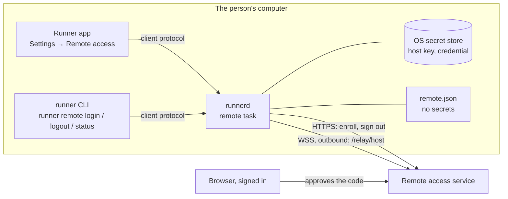

# 836 — Web remote control

> Tracking issue: [#836](https://github.com/yicheng47/runner/issues/836). Scheduling and priority live on the issue and in the [roadmap](../roadmap.md). Platforms: macOS and Windows first; Linux wherever `runnerd` runs ([#823](https://github.com/yicheng47/runner/issues/823)).
> Status: Phase 1, connecting a host to an account, is specified in full for the desktop and ready to build; the service's side of it went live on 2026-10-16. Phase 2's client trust model is written (2026-10-19); the companion protocol, the encrypted channel and terminals (Phases 2 and 3) are specified in full when their development starts, and Phase 4, the Tailscale route, is released together with the hosted service.
> Scope: Runner's side only, what runs on the person's computer: `runnerd`, the `runner` CLI and the desktop app. The web panel and the service are developed separately; this spec describes them only as far as Runner talks to them.
> Design: `design/specs/836-web-remote-control.pen`, the Settings → Remote access pane: every state, the Disconnect confirmation, a light-theme Connected and the five stop reasons. Jason chose the status-card layout on 2026-10-18: one card whose dot, sentence and actions change with the state, then an Access section with the switch and Disconnect.
> Related: [#912](https://github.com/yicheng47/runner/issues/912) (iOS on the same foundation), [#808](https://github.com/yicheng47/runner/issues/808) (SSH hosts), [#838](https://github.com/yicheng47/runner/issues/838) (multi-client resize).

## Motivation

Since 0.13, agents keep running in `runnerd` after the desktop app closes, but the person still needs that desktop to see progress or unblock them. Remote control connects the computer to the person's account so they can reach the same sessions from a browser, on another network or on a phone.

## Phases

| Phase | What Runner builds |
| --- | --- |
| 1 | Connect a host: enrollment under an account, the stored secrets, the outbound connection, and its state in Settings and the CLI |
| 2 | The companion protocol v1 in `runner-core`, with golden JSON for every message, and how a host decides which clients it trusts |
| 3 | The end-to-end channel in `runnerd` (Noise through `snow`) and the adapter that serves the protocol from `runnerd`'s state: overview, live status, terminal attach, input and resize |
| 4 | The Tailscale route: a listener on the host's Tailscale interface and its pairing, carrying Phase 3's channel and Phase 2's protocol unchanged |

Phase 1 is plumbing: the web panel shows the computer online or offline. Nothing a session contains leaves the computer before Phase 3.

**Two routes, one release (Jason, 2026-10-18).** Remote control is released with two ways to reach a host, as two options of the same release: Tailscale for users worldwide, with no account or service, and the hosted service, invite-only, for users in mainland China. Neither audience comes first, so the order of the phases follows how easily each part is built and tested: the relay goes first because its service is live and Phase 1 already connects to it, and Tailscale follows Phase 3 on the same protocol and channel. Remote control is 0.17's focus, and each phase is a sub-issue of #836: [#951](https://github.com/yicheng47/runner/issues/951), [#952](https://github.com/yicheng47/runner/issues/952), [#953](https://github.com/yicheng47/runner/issues/953) and [#954](https://github.com/yicheng47/runner/issues/954).

## Phase 1 — Connect a host



`runnerd` owns everything: the enrollment calls, the secrets, the connection and the state. The app and the CLI only send requests over the client protocol and render the status `runnerd` pushes back. Neither receives a secret from the daemon; the app or interactive CLI sends the PIN only when the person sets it.

### What the person does

**From the app.**

1. Settings → Remote access → **Connect this computer**.
2. Runner shows a short code, the computer's fingerprint and the time left, and opens the browser at the service's Add host page with the code filled in. The person can also type the code on another device, such as a phone, at the short link shown beside it.
3. The person signs in if needed, checks that the fingerprint on the page matches the one in Runner, names the computer and approves.
4. Within a few seconds Settings shows **Connected as @jason** with the name the computer was given, and the web panel shows it online.

**From the CLI.** For a machine without the app, such as a Linux box reached over ssh, or for people who prefer the terminal:

```text
$ runner remote login
Connect this computer to https://runner.yeelinks.com.cn
Remote access is a private beta, available only in mainland China for now.
Signing in needs an account created from an invite code.

  Open         https://runner.yeelinks.com.cn/hosts/add?code=BCDF-GHJK
  Code         BCDF-GHJK
  Fingerprint  630d cd29 66c4 3366 9112

Check that the page shows the same fingerprint, then approve it there.
Waiting for approval… 9:52 left

Approved by @jason (Jason).
Allow remote access to this computer from @jason (Jason)? [y/N] y
Connected as @jason. This computer is "Mac Studio" on your account.
```

**Pause.** The **Allow remote access** switch closes the connection and reopens it, without leaving the account. The computer shows offline in the web panel while paused.

**Disconnect.** Settings → **Disconnect**, or `runner remote logout`, removes the computer from the account and deletes its enrollment credential. Connecting again needs a new code and keeps the host identity key and fingerprint. Reset identity disconnects, creates a new key, clears the PIN and unpairs every device.

**Removed elsewhere.** When the computer is removed in the web panel, or the account is deactivated, the connection closes and Settings says so. **Connect again** starts a fresh enrollment; **Try again** reconnects with the existing credential, which works if an administrator has since reactivated the account.

In every case the agents keep running. Remote access never stops, restarts or replaces `runnerd` or its sessions, and a failure in it never takes the daemon down.

### Who may connect a host

Connecting a host to an account grants that account a route to the computer. From Phase 3 on, reaching its terminals also requires a device paired with the PIN the person sets at the host. Runner's agents run as the same user, can run the `runner` CLI, and can be steered by text they read. An agent that connected the computer to someone else's account, after a prompt injection or by mistake, would give that account a route to attempt pairing. Setting or changing the PIN, unlocking PIN entry and Reset identity follow the same person-only rules:

- **The person starts it.** From the app, the click on Connect is the person's consent. `runner remote login` requires an interactive terminal: stdin and stdout are both terminals (`std::io::IsTerminal`), which an agent's command tool does not provide. It also refuses when `RUNNER_HANDLE` is set, which Runner sets for every agent session it starts; Runner's own terminal tabs do not set it, so a person can log in from one.
- **The person confirms the account.** The approval in the browser happens under whatever account approved it. Before `runnerd` saves the credential for connection, the CLI shows the approving account and asks to allow it; a refusal follows the sign-out cleanup path. The app flow shows the account in the Connected state with Disconnect beside it.
- **Not through the generic call or the agent guide.** The remote requests are absent from `runner call`'s table, and `runner remote` is absent from the agent guide that `runner help` prints for agents; it appears only in clap's own `runner remote --help`.
- **The limit, stated plainly.** Any program running as the user can do what the user can, including connecting to `runnerd`'s socket and reading files. These rules stop an agent from connecting the computer through Runner's own paths or by mistake; they are not a sandbox.

### Secrets on the host

The host holds its identity private key and optional PIN in one secret-store item, and the credential the service issues at enrollment in a separate item. The device code is another secret, but it lives only in `runnerd`'s memory while enrollment or recovery of the approved response is pending, bounded by the enrollment or claim deadline. The private key never leaves the computer; the credential is sent only to the service, in the `Authorization` header over TLS.

- **Storage.** The operating system's secret store, as Platforms describes: the macOS Keychain or Windows Credential Manager, and an owner-only file on Linux for now. Development builds use their own entries, so `make run` never touches the installed app's enrollment.
- **Nowhere else.** Never in Runner's SQLite database, settings, `remote.json`, logs, crash reports or any export; never printed by the CLI after enrollment; never served through `runnerd`'s client protocol to the app or the CLI; never in an environment variable, because every agent and shell `runnerd` starts inherits its environment. The types that hold them implement `Debug` as `[redacted]`.
- **Agents run as the same user.** A Windows credential or an owner-only file is readable by any process of that user, an agent included. The macOS Keychain is not: another program's read raises a prompt the person sees. The Keychain is therefore required on macOS; elsewhere Runner uses the best store available, and nothing in Runner points an agent at the secrets.
- **Transport.** HTTPS and WSS with certificate verification against the system's trust store, with no option to turn it off; a proxy carries the TLS connection through unopened. The only exception is a development service on `http://localhost` or `http://127.0.0.1`, and only when that origin is given explicitly.
- **Recovery.** Removing the host from the account, or a completed `SignOutHost`, invalidates the credential at once. Logout deletes the enrollment credential first and asks the service to remove the host as a best effort; if it cannot, the leftover host is harmless and the web panel removes it. The identity and PIN survive logout and a new enrollment, as do paired devices. A suspected leak calls for Reset identity at the host, which disconnects, changes the key and clears the PIN and devices.
- **What the key will protect.** From Phase 3 the private key authenticates the host to browsers over the end-to-end channel. Noise mixes a fresh ephemeral key into every session, so a stolen host key does not decrypt sessions recorded earlier; it does let its holder pose as the host from then on.

### Talking to the service

What Runner sends and how it reacts. A released Runner speaks this, so a change to it is compatible (new optional fields, new message types, new close codes) or goes into a new path version. Every JSON example in this section is a golden file in Runner's tests.

#### Calls

- The service is one HTTPS origin, written `https://runner.example` in the examples. The default is the hosted service, `https://runner.yeelinks.com.cn`; `runner remote login --server` chooses another, and the app always uses the saved or default origin.
- **Origins** are kept canonical: scheme, lowercase host and a port only when it is not the scheme's default, with no path, query or trailing slash. `https://Runner.Example:443/` becomes `https://runner.example`. Anything else is refused before a request is made: another scheme, a path, user info, or `http://` for a host other than `localhost` or `127.0.0.1`.
- Calls are [Connect](https://connectrpc.com/docs/protocol/) unary calls in JSON: `POST <origin>/api/runner_server.v1.HostEnrollmentService/<Method>` with `Content-Type: application/json`. `reqwest` and `serde` are enough; no protobuf or Connect library is needed. Each call times out after 15 seconds.
- JSON follows the protobuf JSON mapping: lowerCamelCase field names, 64-bit integers such as `hostId` as decimal **strings**, `bytes` as standard base64 with padding, enums by their full names. Fields with default values may be missing from responses and take their defaults. Unknown fields are ignored.
- A failure is a non-200 status with `{"code": "...", "message": "..."}` and possibly `details`, which Runner ignores. Runner acts on `code` alone:

| `code` | Runner |
| --- | --- |
| `invalid_argument` | Logs the message; stops with reason update required, since a released Runner only sends valid requests |
| `resource_exhausted` | Rate limited: on `PollEnrollment` adds 5 s to the poll interval; on `StartEnrollment` returns to Not connected with "Too many attempts. Try again in a minute." |
| `unauthenticated` | On a credential call, the credential no longer identifies a host |
| `unavailable`, `internal`, `unknown`, a timeout or a network error | Transient: retried with backoff |

StartEnrollment is the exception: transient failures are retried for at most 30 seconds, then Runner returns to Not connected with the error, so Connect and runner remote login never wait indefinitely.

#### Host identity

- **Host key.** One persistent X25519 identity key pair per host, generated on first enrollment or PIN setup by `snow` (`Builder::generate_keypair`) from the operating system's secure random source, so the key is the Noise static key Phase 3 uses. Only the 32-byte public half is sent, at enrollment. Disconnect, removal and enrolling again keep it. Reset identity creates a new key and requires enrolling again. A legacy enrollment adopts its existing key into the identity item before its enrollment item is rewritten without the key.
- **Fingerprint.** The lowercase hex of the first 10 bytes of SHA-256 over the 32 raw public-key bytes, in five groups of four separated by spaces. Runner shows it at enrollment and in the Connected state so the person can compare it with the web panel. Golden vector: key bytes `00 01 02 … 1f` (base64 `AAECAwQFBgcICQoLDA0ODxAREhMUFRYXGBkaGxwdHh8=`) have fingerprint `630d cd29 66c4 3366 9112`.
- **Host info.** Sent at enrollment and in `hello` on every connection, so the web panel shows current values after an update. Every field is normalized to its rule before sending; a value that cannot be read falls back to `unknown`.

| Field | Rule | Runner reports |
| --- | --- | --- |
| `hostname` | 1–255 bytes | The OS host name (`gethostname`), cut at a character boundary |
| `platform` | `macos`, `windows` or `linux` | From `std::env::consts::OS` |
| `arch` | 1–16 characters of `a-z0-9_` | `arm64` for `aarch64`, `x86_64` for `x86_64`; anything else lowercased with other characters dropped |
| `osVersion` | 1–64 bytes | macOS: `macOS ` and `sysctl kern.osproductversion` (`macOS 15.4`). Windows: from `HKLM\SOFTWARE\Microsoft\Windows NT\CurrentVersion`, `Windows 11` when `CurrentBuildNumber` is 22000 or higher (the `ProductName` value still says Windows 10 there), else `Windows 10`, then `DisplayVersion` (`Windows 11 24H2`). Linux: `PRETTY_NAME` from `/etc/os-release` |
| `runnerVersion` | 1–32 bytes | `runner_core::version::CRATE_VERSION`, such as `0.18.2`; nightlies report their base version |

#### Enrollment

A device-code flow in the style of [RFC 8628](https://www.rfc-editor.org/rfc/rfc8628).

**`StartEnrollment`**, no authentication:

```json
{
  "host": {"hostname": "jason-mac-studio", "platform": "macos", "arch": "arm64", "osVersion": "macOS 15.4", "runnerVersion": "0.18.2"},
  "hostKey": "AAECAwQFBgcICQoLDA0ODxAREhMUFRYXGBkaGxwdHh8="
}
```

```json
{
  "deviceCode": "pV8m2Qy1nX0bJk3sTq7wE5rLc9aZ4hUd6gFiYoN1MjA",
  "userCode": "BCDF-GHJK",
  "verificationUri": "https://runner.example/hosts/add",
  "verificationUriComplete": "https://runner.example/hosts/add?code=BCDF-GHJK",
  "expiresIn": 600,
  "interval": 5
}
```

Runner keeps `deviceCode` in memory only and never shows or logs it. It shows `userCode` as given, the two links, the fingerprint and the time left, counted down from `expiresIn` seconds after the response. Both links must be on the service's origin; a response that points elsewhere is treated as `invalid_argument`.

**`PollEnrollment`**, no authentication, with `{"deviceCode": "..."}`, first `interval` seconds after the start response and then every `interval` seconds:

| `state` | Runner |
| --- | --- |
| `ENROLLMENT_STATE_PENDING` | keeps polling |
| `ENROLLMENT_STATE_DENIED` | stops: denied |
| `ENROLLMENT_STATE_EXPIRED` | stops: expired |
| `ENROLLMENT_STATE_APPROVED` | confirms the account where required, stores the secrets and connects |

```json
{"state": "ENROLLMENT_STATE_PENDING"}
{"state": "ENROLLMENT_STATE_DENIED"}
{"state": "ENROLLMENT_STATE_EXPIRED"}
```

```json
{
  "state": "ENROLLMENT_STATE_APPROVED",
  "hostId": "7383920468475904",
  "credential": "rhc_Zm9vYmFyYmF6cXV4cXV1eGNvcmdlZ3JhdWx0Z2FycGx",
  "relayUrl": "wss://runner.example/relay/host",
  "account": {"username": "jason", "displayName": "Jason"},
  "claimExpiresAt": "2026-10-16T10:10:00Z"
}
```

- **Recoverable claim.** After a transient failure, Runner retries `PollEnrollment` with the same in-memory device code, at the poll interval with backoff, instead of starting again. Before `claimExpiresAt`, retries return the same host id, credential and deadline and never create another host or extend the deadline. Because an approval may land just before expiry and its response may be lost, Runner keeps retrying transient failures until the service gives a definite state, or until five minutes past the enrollment's expiry, then stops: expired.
- **First connection deadline.** `claimExpiresAt` is an RFC 3339 UTC timestamp. Account confirmation and the first `welcome` must finish before it; otherwise the provisional credential expires and the service removes the unconnected host. An expired or revoked claim, or an inactive approving account, returns `ENROLLMENT_STATE_EXPIRED`.
- **Checks.** An approved response with a missing credential, a credential that is not `rhc_` followed by 43 base64url characters, or a `relayUrl` that is not `wss://` on the service's host (`ws://` only for a development origin on `http://`) is treated as `invalid_argument`.
- The device code is discarded once the approved result is stored, refused or expired.

#### Credential

`rhc_` followed by 43 base64url characters. Runner stores it as Secrets on the host describes, sends it only as `Authorization: Bearer <credential>` on the `/relay/host` upgrade and on `SignOutHost`, never in a URL, and redacts anything matching `rhc_[A-Za-z0-9_-]+` from text it logs. After the first `welcome` it does not expire; it stops working when the host is removed, signs out, or while its account is deactivated.

#### The host connection: `/relay/host`

`runnerd` keeps one WebSocket to `relayUrl` while remote access is on. The upgrade is an HTTP/1.1 `GET` with `Authorization: Bearer <credential>` and `Sec-WebSocket-Protocol: runner-relay.v1`, and no `Origin` header: the service refuses any upgrade that carries one, so a browser page can never pose as a host. Runner checks `Sec-WebSocket-Accept` and that the service chose `runner-relay.v1`; either failing is a protocol error and reconnects with backoff. Phase 3 adds session traffic to this connection; until then Runner sends only text frames.

| Before the upgrade | Runner |
| --- | --- |
| 400 `unsupported_protocol` | stops: update required |
| 401 `unauthenticated` | stops: removed, or expired when this enrollment has never received `welcome` |
| 403 `permission_denied` | an `Origin` header was sent, which is a Runner bug: logs it and stops: update required |
| 429 `rate_limited` | retries after `Retry-After` seconds, 60 when the header is missing |
| 503, any other status, a timeout or a network error | retries with backoff |

**Messages** are text frames, each one JSON object of at most 64 KiB with a `type`; unknown types and fields are ignored, and a binary frame from the service is logged and ignored. Within 10 seconds of the upgrade Runner sends `hello`, and the service answers `welcome`. If `welcome` does not arrive within 10 seconds of `hello`, Runner closes the connection and reconnects with backoff.

```json
{"type": "hello", "host": {"hostname": "jason-mac-studio", "platform": "macos", "arch": "arm64", "osVersion": "macOS 15.4", "runnerVersion": "0.18.2"}}
{"type": "welcome", "hostId": "7383920468475904", "name": "Mac Studio", "account": {"username": "jason", "displayName": "Jason"}}
```

`welcome` makes the host online. Runner stores its `name` and `account` in `remote.json`, since both can change in the web panel, and marks the enrollment activated. A `hostId` that differs from the stored one is a protocol error.

**Heartbeat.** The service pings every 25 seconds and Runner answers each ping with a pong. Runner treats 75 seconds without any frame from the service, pings included, as a dead connection: it drops the connection and reconnects. The service marks a host offline after 60 seconds without hearing from it; that is temporary connectivity loss, never credential revocation or a reason to stop local sessions.

| Close code | Meaning | Runner |
| --- | --- | --- |
| 1000 | normal close from the service | reconnects with backoff |
| 1001 (sent by Runner) | `runnerd` is stopping, or remote access was paused or disconnected | — |
| 1008 | protocol violation, including the service's 60-second silence timeout | logs it, reconnects with backoff |
| 1011 | service error | reconnects with backoff |
| 1012 | service restart | reconnects after a random 1–10 s, without growing the backoff |
| 4001 | another connection used the same credential | stops: in use elsewhere |
| 4003 | removed, signed out, or the account was deactivated | stops: removed |
| any other code, or the connection drops | — | reconnects with backoff |

**Backoff** is exponential with full jitter: before attempt *n* (from 0), a random delay between 0 and min(60, 2ⁿ) seconds. It resets once a connection has stayed past `welcome` for 60 seconds.

**Removed or deactivated.** The service cannot tell Runner whether a 4003 or 401 means removal or deactivation, and deactivation is reversible: the host stays on the account and its credential works again after an administrator reactivates the account. So stopped, removed keeps the key and credential. **Try again** makes one connection attempt with them; **Connect again** first completes the sign-out cleanup below, then starts a fresh enrollment.

#### Signing out: `SignOutHost`

`runner remote logout` and Disconnect run the same steps:

1. Close the WebSocket with 1001, read the credential into memory, then delete the enrollment secret-store item and `remote.json`, keeping the identity item and `remote-trust.json`. The computer is disconnected at this point, with or without a network; the state is Not connected.
2. Call `SignOutHost` once with the in-memory credential, `Authorization: Bearer <credential>` and body `{}`, then drop the credential. Sign-out accepts a valid credential even if the owner is inactive or the first-connection deadline has passed. Success, or `unauthenticated` (the host is already gone), removes the computer from the account.
3. Any other failure is not retried. The computer stays on the account, shown offline, until the person removes it in the web panel; with its credential deleted, nothing can reconnect under that enrollment. Not connected shows one line as its last error: `Couldn't reach the service, so "Mac Studio" is still listed on @jason's account. Remove it in the web panel.`

Refusing the approving account in the CLI runs the same steps for that claim. Pause keeps the identity and credential for resuming the same enrollment; logout, removal and expired-claim cleanup delete only the enrollment. A new enrollment reuses the identity.

### `runnerd`

#### Where it lives

- **`runner-core/src/remote/`**: the wire types (host info, the enrollment requests and responses, control messages, close codes and refusals, all `serde` with the JSON mapping above), the origin rules, the fingerprint, and the status types the client protocol carries. It is separate from the build-locked client protocol: it is the service's contract, which independently released versions of Runner and the service both speak.
- **`runner-daemon/src/remote/`**: the remote task, its pure state machine, the service client, the WebSocket, `remote.json`, host info and the secret-store backends.
- **`AppCore`** gains a `remote` handle: a command channel into the task and a `tokio::sync::watch` of the current `RemoteStatus`. Client requests send a command and await its reply; status changes emit the pushed event.

#### The state machine

The task is a loop around a pure function, `step(state, input, now, rng) -> (state, effects, next_deadline)`. Inputs are client commands, call results, socket events and the deadline firing; effects are calls to make, the socket to open or close, secrets to store or delete, `remote.json` to write and the status to publish. The loop performs the effects and feeds their results back in. Tests drive `step` directly with a fake clock and a seeded random source and never sleep.

| State | Details carried | Leaves to |
| --- | --- | --- |
| `off` | the origin to use next, the last error | `enrolling` on Connect |
| `enrolling` | user code, fingerprint, both links, expiry; in memory: device code, key pair, poll interval | `connecting` when approved from the app; `confirming` when approved from the CLI; `stopped` on denied or expired; `off` on Cancel |
| `confirming` | the approving account, the claim deadline; in memory: the claim | `connecting` on allow; the sign-out cleanup on refuse, or when the CLI disconnects; `stopped: expired` at the claim deadline |
| `connecting` | attempt number | `connected` on `welcome`; `reconnecting` on a retryable failure; `stopped` on a stopping one; `paused` |
| `connected` | since, host name, account | `reconnecting` on a drop; `stopped` on 4001 or 4003; `paused` |
| `reconnecting` | attempt, last error, next retry | `connecting` at the deadline or on Retry now; `paused` |
| `paused` | — | `connecting` when resumed |
| `stopped` | reason: removed, in use elsewhere, update required, denied or expired | `connecting` on Try again (removed, in use elsewhere); `enrolling` on Connect again, after the sign-out cleanup when secrets exist |

Rules that cut across the table:

- **Disconnect** is accepted in every state except `off`. In `enrolling` it cancels; in `confirming` it refuses; otherwise it runs the sign-out cleanup.
- **One enrollment at a time.** Connect is refused while already enrolled; Connect again is the path from `stopped`. Starting from `enrolling` cancels the earlier enrollment first.
- **Expired after approval.** A 401 before the first `welcome`, or the claim deadline passing, means the provisional host is gone: Runner deletes its enrollment credential and `remote.json` locally without calling `SignOutHost`, and stops: expired.
- **Supervision.** The task runs on the daemon's Tokio runtime and `runnerd` watches its join handle. If it ever ends unexpectedly, `runnerd` logs it and starts it again from `remote.json` after the normal backoff, so a bug in remote access costs a reconnect, never the daemon or its sessions.

#### `remote.json`

The state that survives a restart, in `runnerd`'s app-data directory (`com.wycstudios.runner`, or `com.wycstudios.runner-dev` for development builds). It holds no secret. It is written to a temporary file and renamed into place, owner-only (`0600`) on Unix; a file that fails to parse is logged, renamed to `remote.json.bad` and treated as missing.

```json
{
  "version": 1,
  "origin": "https://runner.yeelinks.com.cn",
  "host_id": "7383920468475904",
  "relay_url": "wss://runner.yeelinks.com.cn/relay/host",
  "account": {"username": "jason", "display_name": "Jason"},
  "host_name": "Mac Studio",
  "fingerprint": "630d cd29 66c4 3366 9112",
  "activated": true,
  "claim_expires_at": "2026-10-16T10:10:00Z",
  "paused": false,
  "stopped": null
}
```

`stopped` holds the reason while stopped, so Settings still explains it after a restart.

#### Start-up and shutdown

- **No `remote.json`:** `off`.
- **`stopped`:** stay stopped with the saved reason.
- **`paused`:** stay paused.
- **Otherwise:** load the secrets and connect. If the secret-store item is missing (deleted by hand, a new user profile), delete `remote.json` and stop: removed, offering only Connect again.
- **Shutdown and updates.** Stopping the daemon closes the connection with 1001 before the session teardown. An app update restarts `runnerd`, and the connection comes back with it.

#### The connection's plumbing

- **One HTTP stack.** The enrollment calls use the daemon's async `zed-reqwest` client with `rustls-tls-native-roots`. The WebSocket upgrade is sent through the same client, as HTTP/1.1 with `Response::upgrade`, and the upgraded connection is handed to `tokio-tungstenite` (`WebSocketStream::from_raw_socket`, client role). The connection therefore takes the same proxy, TLS roots and certificate verification as the calls. `tokio-tungstenite` is built without TLS features of its own.
- **Proxies.** `zed-reqwest` reads the Windows system proxy from the registry, but on macOS only with its `macos-system-configuration` feature, which `runnerd` does not enable today; `runnerd`, started by the app, inherits no proxy variables. This work enables that feature for `runner-daemon`, so the calls and the WebSocket follow the system proxy on macOS and Windows, and `HTTPS_PROXY`/`ALL_PROXY` where set. Many people in mainland China run a system proxy such as Clash.
- **Logs.** `runnerd.log` records state changes, the origin, HTTP statuses, close codes and reasons, and the backoff chosen, at info level. It never records the device code, the credential or key material, and the service's error messages pass through the `rhc_` redaction before they are logged.

### Client protocol

New requests in `daemon_api!`, for the app and the CLI. They change no existing request.

| Request | Fast | Result |
| --- | --- | --- |
| `remote_status()` | yes | `RemoteStatus` |
| `remote_enroll_start(origin: Option<String>, confirm_account: bool)` | no | `RemoteStatus` in `enrolling`, after `StartEnrollment` answers. `origin` defaults to the saved or default origin. The CLI sets `confirm_account`; the app does not. From `stopped` it first runs the sign-out cleanup. |
| `remote_enroll_confirm(allow: bool)` | no | `RemoteStatus`; only in `confirming` |
| `remote_enroll_cancel()` | no | `RemoteStatus`; only in `enrolling` |
| `remote_set_paused(paused: bool)` | no | `RemoteStatus` |
| `remote_retry()` | no | `RemoteStatus`: Retry now in `reconnecting`, Try again in `stopped` (removed, in use elsewhere) |
| `remote_logout()` | no | `RemoteLogout`: `removed`, or `still_listed` with the error when `SignOutHost` failed; local removal has happened either way |

A request that does not apply to the current state fails with a message the CLI and the app can show as is, such as "This computer is already connected as @jason. Run `runner remote logout` first."

```rust
pub struct RemoteStatus {
    pub state: RemoteState,
    pub origin: String,
    pub account: Option<RemoteAccount>,  // username, display_name
    pub host_name: Option<String>,
    pub host_id: Option<String>,
    pub fingerprint: Option<String>,
    pub last_error: Option<String>,
}

pub enum RemoteState {
    Off,
    Enrolling { user_code: String, verification_uri: String, verification_uri_complete: String, expires_at: DateTime<Utc> },
    Confirming { account: RemoteAccount, expires_at: DateTime<Utc> },
    Connecting { attempt: u32 },
    Connected { since: DateTime<Utc> },
    Reconnecting { attempt: u32, next_retry_at: DateTime<Utc> },
    Paused,
    Stopped { reason: StopReason },  // Removed, InUseElsewhere, UpdateRequired, Denied, Expired
}
```

Local requests that change remote access, including `remote_enroll_start`, allow 45 seconds for the service call and connection work. `remote_enroll_start` retries transient failures for at most 30 seconds, then replies with Not connected and `Couldn't reach <origin host>.` Each individual service call still times out after 15 seconds and is bounded by the remaining startup budget. Closing the CLI cancels its pending request.

A pushed `remote/status` event carries the snapshot whenever it changes. No secret is ever in a request, a response or the event. None of these requests is added to `call_daemon` in `runner-cli/src/client.rs`, so `runner call remote_enroll_start` fails as an unknown tool.

### CLI

- **`runner remote login [--server <origin>]`.** Refused, before contacting `runnerd`, when stdin or stdout is not a terminal or `RUNNER_HANDLE` is set: "`runner remote login` needs you at an interactive terminal outside an agent session. Use Runner → Settings → Remote access, or run it in your own terminal." It calls `remote_enroll_start` with `confirm_account`, prints the transcript above, follows `remote/status` and redraws the time left on one line every second. On `confirming` it asks `Allow remote access to this computer from @jason (Jason)? [y/N]`; anything but `y` or `yes` refuses. It waits for `connected`, prints any reconnect error it sees on the way, and exits at a stop or the claim deadline. Ctrl-C while waiting cancels the enrollment, or refuses it in `confirming`. It does not open a browser, so it behaves the same over ssh.
- **`runner remote pin`.** Uses the same terminal and agent-session guard as login, reads the PIN twice without echo and saves it only if both entries match and contain exactly six ASCII digits. **`runner remote reset-identity`** uses the same guard and asks `[y/N]` before disconnecting, clearing the PIN and devices, and creating a new key.

- **`runner remote devices [--json]`** lists paired devices, or their JSON array; **`runner remote revoke <fingerprint>`** removes the named device. Both are allowed inside agent sessions.

- **`runner remote logout`.** Prints `Removed this computer from @jason's account.`, or `Disconnected this computer. Couldn't reach the service, so "Mac Studio" is still listed on @jason's account; remove it in the web panel.` Both exit 0, since the computer is disconnected either way. With nothing connected it prints `This computer is not connected.` and exits 0.
- **`runner remote status [--json]`.** One line per field: state with its detail, account, computer name and host id, fingerprint and service. `--json` prints the `RemoteStatus` fields with an additional `trust` object containing `RemoteTrust`. Human-readable output includes whether the PIN is set or locked and the device count. Exits 0.

```text
$ runner remote status
State        connected since 10:02 (2 h 14 min)
Account      @jason (Jason)
Computer     Mac Studio (host 7383920468475904)
Fingerprint  630d cd29 66c4 3366 9112
Service      https://runner.yeelinks.com.cn
PIN          set
Devices      0
```

Exit codes for `login`: 0 connected; 1 denied, expired, refused, cancelled, or stopped for any other reason, with the reason printed; 2 for usage errors, from clap. `logout` and `status` are allowed inside agent sessions: removing access is harmless, and status shows no secret. The guide's CLI reference is regenerated with `make guide-cli`.

### Desktop app

A new Settings pane, **Remote access**, in the App group after Notifications, with the route key `remote` and the lucide `globe` icon added to `assets.rs`. The pane reads `remote_status` when it opens. The app loads `remote_status` and `remote_trust`, follows `remote/status` and `remote/trust`, and refreshes both after reconnecting; every window shows the same state. Layout follows the Pencil design; the content and actions are these:

| State | Shows | Actions |
| --- | --- | --- |
| Not connected | What remote access does; a **Private beta** callout saying remote access is invite-only and available only in mainland China for now, and that signing in to the hosted service needs an account created from an invite code; that sessions will be encrypted end to end once session access ships; the last error, if any | **Connect this computer** |
| Waiting for approval | The code, large and monospaced; the fingerprint; the short link; the time left, counting down | **Open in browser**, **Copy link**, **Cancel** |
| Connecting | The account if known, and a spinner | **Allow remote access** switch, **Disconnect** |
| Connected | A green status line with the time connected; `@jason · Jason`; the computer's name, set in the web panel; the fingerprint; the service origin | **Allow remote access** switch, **Disconnect** |
| Reconnecting | The last error and the time to the next try | **Retry now**, the switch, **Disconnect** |
| Paused | Remote access is off; the computer shows offline | The switch, **Disconnect** |
| Stopped | Why, in a sentence from the table below | The reason's actions |

| Stop reason | Sentence | Actions |
| --- | --- | --- |
| Removed | This computer was removed from @jason's account, or the account was deactivated. | **Connect again**, **Try again** |
| In use elsewhere | Another copy of Runner connected with this computer's credential. | **Try again**, **Disconnect** |
| Update required | The service needs a newer version of Runner. | **Check for updates**, which opens Settings → Updates |
| Denied | The request was denied in the browser. | **Connect again** |
| Expired | The code expired before this computer connected. | **Connect again** |

- **Connect** calls `remote_enroll_start` with no origin, so `runnerd` uses the saved or default one, then opens `verificationUriComplete` with `cx.open_url`. **Copy link** copies `verificationUriComplete`.
- **Disconnect** asks first with the existing confirmation dialog. It says the computer is removed from the account and its enrollment credential is deleted, while its identity, PIN and paired devices are kept; connecting again needs a new code. The actions are **Disconnect** and **Cancel**.
- **Pairing and Devices.** The pane offers Set/Change PIN, Unlock when locked, Reset identity behind a confirmation, and Revoke beside each device. The PIN dialog explains that the service never sees it and reads exactly six digits in two steps, one masked six-box row at a time: Choose a PIN → Continue, then Enter it again → Set PIN. Enter activates the current action only at six digits. Back clears both entries and returns to step 1. A mismatch shows “The PINs don't match.” as a toast and returns to step 1 cleared. Continue, Set PIN and the no-PIN row's Set PIN use the theme's accent fill and accent-ink label. A live transition into PIN entry locked raises a warning toast; a locked state loaded at launch only shows the row. The device list uses the approved table in Client trust below.
- **Toast.** When the state moves into stopped for removed, in use elsewhere or update required while the app runs, Runner shows a warning toast with the sentence above. A stopped state found at launch shows no toast; the pane explains it.
- **Text.** Every string is in `i18n/en.toml` and `i18n/zh-hans.toml`. The Chinese terms are 远程访问 (Remote access), 连接这台电脑 (Connect this computer), 断开连接 (Disconnect), 允许远程访问 (Allow remote access) and 指纹 (fingerprint). The CLI's output stays English, like the rest of the CLI.

### Platforms

- **macOS.** One Keychain generic-password item per origin for enrollment, plus the identity item with account `host-identity`: service `com.wycstudios.runner.remote` (development builds `com.wycstudios.runner-dev.remote`), account the canonical origin, label `Runner remote access`, written with `security-framework`, which is already in the dependency tree. It lives in the login keychain and is not synchronizable, so iCloud Keychain does not carry it to another Mac. Only `runnerd` reads or writes it. Because `runnerd` creates it, the item's access list names `runnerd`'s code signature, so later reads by the Developer ID–signed `runnerd`, including after an app update replaces it, need no prompt. A development build's ad hoc signature changes with each rebuild, so a rebuilt development `runnerd` may prompt; that is expected.
- **Windows.** One generic credential per origin in Credential Manager, plus the identity at `com.wycstudios.runner.remote/host-identity` (development builds `com.wycstudios.runner-dev.remote/host-identity`), target `com.wycstudios.runner.remote/<origin>` (development builds `com.wycstudios.runner-dev.remote/<origin>`), persisted per machine (`CRED_PERSIST_LOCAL_MACHINE`) rather than roaming with the profile, written with `CredWriteW` through `windows-sys`'s `Win32_Security_Credentials`. The `keyring` crate is not used: it persists Windows credentials as roaming.
- **Linux.** Linux packaging arrives with [#823](https://github.com/yicheng47/runner/issues/823), and CI does not run Linux yet. Phase 1 builds the owner-only fallback, `remote-secrets.json` for enrollment and `remote-identity.json` for identity in the app-data directory, each created with mode `0600` rather than changed after; the Secret Service over D-Bus joins with #823.
- **The item's content.** The enrollment item is `{"v": 2, "credential": "rhc_…"}`. The separate `host-identity` item is `{"v": 1, "key": "<base64 private key>", "pin": null}` until a PIN is set. On upgrade, a `v: 1` enrollment key is adopted only when no identity exists, then that enrollment is rewritten as `v: 2` without the key.
- **Tests** use an in-memory store for the state machine and the integration tests. The platform round-trip tests use their own service or target name and delete what they create, so they never touch a real enrollment.

### Out of scope

Everything in Phases 2 to 4, including the Tailscale route; push notifications and the iOS app ([#912](https://github.com/yicheng47/runner/issues/912)); same-network and Bonjour routes; one computer on several accounts or services at once; renaming the computer from Runner, which the web panel does; credential rotation; the Linux Secret Service; starting, stopping or archiving sessions remotely.

### Verification

- **Unit tests.** Host info normalization on each platform, including the Windows 11 build rule and fallbacks; origin canonicalization and refusals; the fingerprint against the golden vector; the redaction of `rhc_` values; `Debug` of the secret types.
- **The state machine,** through `step` with a fake clock and seeded randomness: every row of the state table; backoff bounds, growth and reset after 60 s past `welcome`; the 75 s dead-connection timer; 1012's 1–10 s delay without growing the backoff; `Retry-After`; every close code and refusal status mapped to its next state; the poll interval growing on `resource_exhausted`; the recoverable claim retried after a transient failure and given up five minutes past expiry; the claim deadline in `confirming`; one enrollment at a time.
- **Wire fixtures.** Every JSON example in Talking to the service as a golden file, parsed and produced by the `runner-core` types, including missing default fields and unknown fields.
- **Integration tests** against a fake service in the test suite, a small Tokio server on `127.0.0.1` that answers the calls and the WebSocket as specified: enrollment from the app path and the CLI path (allow and refuse); denial; expiry; `resource_exhausted`; a lost approved response followed by the same claim; the claim deadline passing before the first `welcome`; approval then `welcome`; a missed heartbeat; 1012; 4001; 4003 followed by a successful Try again; a 401 on reconnect; a 403 when an `Origin` header is present; an unknown close code; logout; offline logout deleting only the enrollment credential and `remote.json`, reporting the computer as still listed and never reconnecting after a restart; refusal with the service unreachable; pause and resume keeping the key; a daemon restart that reconnects. Re-enrollment after removal or logout keeps the fingerprint; Reset identity changes it. A failure in the remote task leaves sessions running in every case.
- **Secret stores.** A round trip on macOS and Windows CI with test names. If a CI runner cannot reach its secret store, the pull request says so rather than silently skipping the test.
- **The agent rules.** `runner remote login` refused with `RUNNER_HANDLE` set and without a TTY; `runner call remote_enroll_start` refused as an unknown tool; `runner remote` absent from the agent guide.
- **The app.** Each pane state rendered from a status snapshot, in English and Chinese; the toast only on a live transition.
- **Live,** recorded with Runner's version and platform, against a development service first and then the hosted one: connect the Mac and the Windows PC from the app and a third machine from the CLI; see each online in the web panel; pause and resume; disconnect while offline, see the still-listed line, restart the development daemon and verify no reconnect, then remove the leftover host in the web panel; enroll again with the same fingerprint, then Reset identity and verify a new fingerprint; remove one in the web panel and see stopped, removed; on macOS, confirm that another program's read of the item prompts and that an app update does not.

### Implementation

The work lands as one pull request in five commits, each building and passing its tests:

1. **Wire types and identity**, `runner-core`: the `remote` module with host info, origins, the enrollment and control types, close codes and refusals, the fingerprint, the status types, and the golden fixtures. Key generation through `snow`.
2. **Secret store**, `runner-daemon`: the interface, the macOS Keychain, Windows Credential Manager, owner-only file and in-memory backends, and the round-trip tests.
3. **The remote task**, `runner-daemon`: the state machine, the service client, the WebSocket through `reqwest`'s upgrade, `remote.json`, start-up, shutdown and supervision, log redaction, and the fake-service integration tests.
4. **Client protocol and CLI**: the requests and `remote/status` in `daemon_api!`; `runner remote login`, `logout` and `status`; the agent guide left unchanged; `make guide-cli`.
5. **Settings → Remote access**, `runner-app`: the pane from the Pencil design, its states, the confirmation and the toast, the `globe` icon, English and Chinese strings, and the user guide page `docs/guide/guides/remote-access.md` with its line in `docs/guide/README.md`.

New dependencies: `snow`; `tokio-tungstenite` without TLS features; `windows-sys` gains `Win32_Security_Credentials`; `zed-reqwest` gains `macos-system-configuration` for `runner-daemon`. Each is pinned in `Cargo.lock` and builds on both CI platforms.

### Decisions

- **Default origin and visibility (Jason, 2026-10-18).** `https://runner.yeelinks.com.cn`, the hosted service, with `runner remote login --server` for others; the app has no origin field (Jason, 2026-10-18). The pane appears in every build, released ones included. Its Not connected state, `runner remote login` and the user guide say plainly that remote access is a private beta, available only in mainland China for now, and that signing in needs an account created from an invite code; there is no feature switch to build and later remove.
- **Host key type (2026-10-18).** An X25519 key generated by `snow`, the Noise static key Phase 3 will use. The service keeps the public key unchanged for the host's lifetime, so Phase 2 adopts each enrolled host’s existing key without re-enrollment; only Reset identity replaces it.
- **WebSocket through the same HTTP stack (2026-10-18).** Upgraded through `reqwest` so it takes the same proxy, roots and verification as the enrollment calls, with macOS's system proxy enabled for both. `zed-reqwest` 0.12.15's `Response::upgrade` was checked in its source the same day.
- **Disconnect is local first (Jason, 2026-10-18).** Disconnect deletes the enrollment credential and asks the service to remove the host once, as a best effort. There is no pending-removal state or retry: a host left on the account is offline, cannot be used without its deleted credential, and is removed in the web panel.
- **Secrets stay with the OS (Jason, 2026-10-18).** The Keychain and Credential Manager keep the secrets on this computer; Runner adds no machine check of its own.
- **Proposed in this revision, for Jason's review (2026-10-18):** Try again for a removed or in-use credential; `CRATE_VERSION` as `runnerVersion`; the Linux file fallback only, with the Secret Service moved to #823; the toast as a message without an action, since toasts have none; one secret-store item per origin holding both secrets (superseded by Phase 2’s separate identity item, 2026-10-19).

### Open questions

| Question | Recommendation | Settle before |
| --- | --- | --- |
| Should the app also confirm enrollments started from the CLI when it is running? | Not in Phase 1: the TTY and account confirmation cover the CLI; revisit with Phase 3's client trust | Phase 2 |
| How a browser trusts a host's key, and how the host trusts a browser | Settled in Phase 2's Client trust (Jason, 2026-10-19): each device is paired once with a PIN the person sets at the host, and the PIN exchange proves the host's identity key to the device | Phase 2 |

## Phase 2 — Companion protocol and client trust

The companion protocol is specified in full when its development starts. The trust model is written first, because both routes and the service's browser channel build on it. Two constraints are settled:

- **The protocol and the channel do not depend on the route (Jason, 2026-10-18).** The companion protocol and Phase 3's end-to-end channel run over any ordered, reliable byte stream; the relay's WebSocket is the first such stream, not part of either. A host trusts clients by per-device keys that it can list and revoke, not by the account session alone. Phase 4's Tailscale route, and any later direct route such as a same-network listener ([#912](https://github.com/yicheng47/runner/issues/912)), then adds only its listener, and reuses the protocol, the channel, the trust model and its pairing unchanged.
- **The person decides who reaches their terminals (Jason, 2026-10-19).** The host trusts a device only after it has been paired with a PIN the person set at the host. Being signed in to the account is not enough: if it were, whoever runs the service, an administrator included, could open any host's terminals.

### Client trust

**Two checks.** On the relay route a client passes two checks, which answer different questions. The service joins only a signed-in browser to a host on that browser's account: that decides whom the service routes. The host accepts only a device it has paired: that decides whom the host trusts. On the Tailscale route the tailnet takes the service's place, and the host's check is the same. Nothing the service holds, including account sessions, host credentials, host public keys and the traffic it forwards, lets anyone pass the host's check, so neither an administrator nor someone who breaks into the service can open a terminal.

**Sharing a host.** The host's check does not depend on whose device it is: a colleague's browser paired with the host's PIN is trusted like the person's own, and is revoked on its own. What keeps a host to one person is the service's check, which routes only the account that owns the host; on the Tailscale route, anyone on the tailnet who knows the PIN can already pair. Sharing a host between accounts, such as an office server several colleagues use, is out of scope in the first release. When it comes, only the service's routing changes: the owner grants other accounts access to the host, and each of their devices still pairs with the host's PIN, so trust stays on the host.

**The host's identity key.** Each host has one X25519 identity key, the Noise static key of both routes. Runner creates it the first time it is needed, at the first enrollment or when the PIN is first set, and keeps it in the OS secret store as an item of its own, apart from each origin's enrollment. Every enrollment sends it as `hostKey`, and Disconnect, removal and enrolling again keep it, so paired devices stay paired. **Reset identity**, in Settings or with `runner remote reset-identity`, makes a new key, unpairs every device and clears the PIN, since the PIN shares the key's secret-store item and a leak of one is a leak of both. Because the service keeps a host's key for the host's lifetime, Reset identity also disconnects the computer from the account, and connecting again enrolls the new key. It is the answer to a suspected leak.

**The PIN.** The person sets a PIN of exactly six ASCII digits, in Settings → Remote access, or with `runner remote pin` at an interactive terminal. No device can pair before a PIN exists: Settings asks for one once the computer is connected, and Phase 4's Tailscale listener cannot be turned on without one. The PIN is kept as entered in the identity key's secret-store item, so the exchange Phase 3 settles on does not change what is stored. It is never shown again, sent to the service, logged or returned over the client protocol. Changing it means setting a new one, and does not unpair the devices already paired.

**Pairing a device.**

1. Signed in to the web panel, the person opens the host. A browser that holds no key for this host asks for the computer's PIN.
2. The browser and the host run a password-authenticated key exchange over the connection. The PIN never crosses it, and what the service relays lets it neither learn the PIN nor test guesses offline. Only the real host knows the PIN, so the exchange also proves the host to the browser, which takes the host's identity key from inside the exchange, not from the service.
3. On success the browser generates its own X25519 key for this host, a non-extractable WebCrypto key in IndexedDB that the page's own code cannot copy out, and sends the public half with a name as the device describes itself, such as `Chrome on Windows`. The host saves it. A device keeps a separate key for each host it pairs with, so each host's list stands on its own: pairing with one host, or being revoked by it, changes nothing at another.
4. Runner tells the person that a device was paired: a desktop notification while the app runs, and the device in Settings' list either way.

From then on the device connects with its key, from anywhere and over either route, without the PIN. It is asked for the PIN again only when it holds no key: a new device or browser, cleared site data, a private window, or after Revoke or Reset identity.

**Wrong PINs.** Five wrong PINs in a row, from any devices, lock PIN entry: no device can pair until the person unlocks it in Settings, and Runner notifies the person when it locks. Paired devices keep working while it is locked. A malicious service therefore gets five guesses at most, and visibly. The cost is that it can also lock PIN entry on purpose, which it could match anyway by refusing to route.

**Devices.** Settings lists each paired device with its name, when it was paired and when it was last seen, and **Revoke**, which deletes the device's key from the host and closes any channel it has open at once. A device's fingerprint is computed from its public key as the host's is, and names the device: `runner remote devices` lists each device with its name, fingerprint, and when it was paired and last seen, and `runner remote revoke <fingerprint>` removes one. The list holds only public keys, so it is `remote-trust.json` beside `remote.json`, together with the PIN lock's state: not the secret store, and not the database, since the umbrella adds no migration.

**Who may set the PIN.** A PIN opens the host's terminals to any device that knows it, so setting or changing the PIN, unlocking PIN entry and Reset identity follow Who may connect a host. They start from the app, or from `runner remote pin` or `runner remote reset-identity` at an interactive terminal outside an agent session, the same check `runner remote login` makes; they are not reachable through `runner call`, and are absent from the agent guide. Listing and revoking devices are allowed inside agent sessions, like `logout` and `status`.

**Requests.** New requests in `daemon_api!`, for the app and the CLI. None is added to `call_daemon`, so `runner call` refuses each as an unknown tool.

| Request | Fast | Result |
| --- | --- | --- |
| `remote_trust()` | yes | `RemoteTrust`: the fingerprint, whether a PIN is set, whether PIN entry is locked, and the devices |
| `remote_set_pin(pin)` | no | `RemoteTrust`. The PIN is in this request and nowhere else, and the request's `Debug` redacts it |
| `remote_unlock_pin()` | no | `RemoteTrust` |
| `remote_revoke_device(fingerprint)` | no | `RemoteTrust` |
| `remote_reset_identity()` | no | `RemoteTrust`, after the sign-out cleanup when the computer is connected |

A pushed `remote/trust` event carries `RemoteTrust` whenever it changes. `runner remote pin` reads the PIN twice without echo, and `runner remote reset-identity` asks `[y/N]` first. `runner remote status` gains a PIN line and the device count.

**How the person knows.** The guarantee is worth only what the person can see of it:

- **Told where it matters.** Setting the PIN says, in a sentence, that Runner's service never sees it, so the service cannot pair a device on its own. The user guide page `docs/guide/guides/remote-access.md` gains a section, Who can reach this computer, that says what the service can and cannot do, the browser limit included.
- **Shown as it happens.** The new-device notification, the device list with when each was last seen, and the PIN lock make a pairing the person did not make visible on their own computer.
- **Checkable.** The host makes the decision, in Runner's open-source code, and this spec describes the exchange, so anyone can read and test that the service is never asked. Reading the source shows what it does, not that an installed app was built from it: releases are built from the public repository by its GitHub Actions workflows, but not reproducibly, so a person either trusts that pipeline or builds Runner themselves. What a person cannot read is the web panel's code, which the service serves; that is the limit below.

**The limit, stated plainly.** A browser runs the web panel's code as the service serves it. A service that sent malicious code to a person's browser could capture the PIN as it is typed and pair a device of its own, or use a paired browser's key while the page is open, though it could not copy that key out. Pairing stops the service from reaching any host on its own, silently and at scale; it does not make a browser safe from the site that serves it. A device paired this way still appears in the list and raises the notification. A native client whose code does not come from the service, such as the iOS app ([#912](https://github.com/yicheng47/runner/issues/912)), does not have this limit.

**Proposed, settled with Phase 3's channel.** The PIN exchange is SPAKE2 ([RFC 9382](https://www.rfc-editor.org/rfc/rfc9382)) or CPace, bound to the host's identity key, and its output is the pre-shared key of the Noise `IK` handshake that pairs the device. Every later connection is plain `IK`: the client knows the host's identity key from pairing, and the host rejects a client key that is not on its list.

Jason approved the PIN, its lock, Revoke and Reset identity frames on 2026-10-19, with Devices table option B (`eiIy3`) as the canonical connected state. The other references are `KNmA3` (no PIN/devices), `zSJNq` (locked/toast) and `T0hixs` (Reset identity). After live testing, Jason replaced the PIN design with the two-step option B: `K2ww03` (choose), `VckyU` (confirm) and the replacement `TLJNH` (step 1 over Settings), exported at 15:24 on 2026-10-19. Each input has six equal boxes, 48 px tall, 6 px radius, bg fill and border-strong border; the current box has a 1.5 px accent border and a caret. Entries accept ASCII digits only, Backspace removes the last digit, a six-digit paste fills the row, and copy/cut and native reads never expose digits. In m2, the table shows recorded last-seen times, without inferring a connected state, and its footer says pairing arrives in a later update; Jason approved this Phase 3 distinction through Runner on 2026-10-19.

### Changes to Phase 1

The stable identity key changes what Phase 1 built on the umbrella. The changes are made with Phase 2's implementation, and Phase 1's sections are updated with the code:

- Enrollment sends the identity key instead of a fresh one, and Disconnect and removal no longer delete it. The enrollment item keeps only the credential. A host enrolled before the change adopts its enrollment item's key as its identity key, so it keeps its fingerprint and does not enroll again.
- Enrolling again keeps the fingerprint; Reset identity is the way to a new one. #951's live check that enrolling again gives a fresh fingerprint becomes: enrolling again keeps it, and Reset identity changes it.
