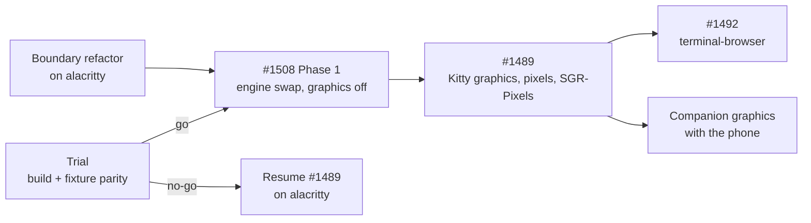

# Moving the terminal engine to libghostty-vt

This note records why Runner replaced `alacritty_terminal` inside `runner-terminal` with Ghostty's `libghostty-vt` ([#1508](https://github.com/yicheng47/runner/issues/1508)) and tracks the remaining graphics phase ([#1489](https://github.com/yicheng47/runner/issues/1489)). Phase 1 (trial, boundary refactor, and engine swap with Kitty graphics disabled) is complete on `feat/1508-libghostty-vt`; [`libghostty-vt.md`](./libghostty-vt.md) documents the shipped engine and replaces the former `alacritty-terminal.md`. This migration note remains until `#1489` lands.

## In one paragraph

Runner's terminal has outgrown `alacritty_terminal`. The crate deliberately leaves out inline graphics and several newer terminal protocols, and Runner may only add read-only accessors to its vendored copy, so every protocol Runner needed beyond it became a byte scanner running beside the parser. Building Kitty graphics that way (#1489) meant re-implementing Ghostty's graphics engine in Rust, and it cost more review rounds than any other part of the work. `libghostty-vt` is Ghostty's terminal core published as a C library, with a 1.0 release and a stability promise, and it already does what those scanners do, plus graphics. Runner keeps its architecture, two copies of each terminal, one in runnerd and one in the app, and changes the engine inside both copies. The swap is gated on a trial, done with graphics switched off first, and kept behind a module boundary so that nothing outside `runner-terminal` changes with it.

## How Runner's terminal works today

Every session has two copies of its terminal state:

- **runnerd's `TerminalModel`** (`crates/runner-terminal/src/terminal/model.rs`) is the authority. It answers the program's queries, takes the snapshots a reopened window attaches from, and feeds the features that read terminal state: input tracking, delivery confirmation and agent status.
- **The app's `TerminalMirror`** (`crates/runner-terminal/src/terminal.rs`) is what a pane paints, scrolls, selects in and searches. Its replies are discarded.

Output flows through runnerd once. The session's forwarder thread collects PTY reads into bursts of up to 1 MiB, and `ingest_output_for_launch` (`crates/runner-daemon/src/session/manager/output.rs`) publishes each burst to every subscriber as `TerminalFrame::Output` before feeding the model. A window that attaches later receives a snapshot: today, the grid replayed as escape sequences, starting with `RIS`.

Before Phase 1, the engine in both copies was a vendored `alacritty_terminal` 0.26 with its parser `vte` 0.15; [`libghostty-vt.md`](./libghostty-vt.md) walks through the `libghostty-vt` engine that replaced it. `vendor/alacritty_terminal/RUNNER_PATCH.md` had limited Runner's changes to read-only accessors, so that the copy could follow upstream.

Around that engine Runner has built:

- **Byte scanners beside the parser:** `OSC 7` working directories, the `DEC 2031` color-scheme subscription and its `DECRQM` answer, `OSC 7501` program status and `OSC 133` prompt marks, and masking of Kitty keyboard flags in replies (`terminal.rs`, `program_status.rs`). Each must find escape-sequence boundaries across bursts and agree with the parser about them.
- **Trackers that shadow the parser:** `TrackedProcessor` and `BoundaryScanner` for synchronized updates, `REP` and unfinished sequences in snapshots (`snapshot.rs`), and `find::ScrollTracker`, which counts the lines that scroll into history so a selected find match stays put (`terminal/find.rs`).
- **Product features that read the grid:** `InputTracker` (`input_state.rs`) recognises an agent's composer and whether it is empty, `InputProbe` (`delivery_probe.rs`) lets the router confirm that a message reached an agent's prompt (`crates/runner-daemon/src/router/dispatch.rs`, `router/report.rs`), and `program_status` turns `OSC 7501` reports into the Working, Blocked and Done states the Codex, Claude Code and Grok runtimes show (`crates/runner-daemon/src/runtimes/status.rs`).

## Why change

### The ceiling

`vte` drops every APC sequence without telling its handler (`vte-0.15.0/src/lib.rs:377`), so Kitty graphics commands never arrive. It does not dispatch `CSI 16 t`, and `alacritty_terminal` treats mode 1016 (SGR-Pixels mouse) as unknown. Upstream leaves these out on purpose. Under the accessor-only rule, each feature Runner needs beyond them becomes another scanner outside the parser, and each scanner is a second, partial parser that must stay in step with the real one.

### What #1489 showed

Kitty graphics were first built on `alacritty_terminal`. The implementation reached every phase: 26 implementation commits, 22 of them fixes from review, about 30,000 added lines. About 11,600 of those lines re-implemented Ghostty's graphics engine and tracked how alacritty scrolls its private grid, so that image placements would move with the text. Most review findings were about keeping runnerd's model and the app's mirrors in exact agreement while both ran Runner's own re-implementation. The work is kept on `backup/1489-alacritty-kitty` (`7b09eae1`), and about half of it, the part that does not depend on the engine, is reused.

### Gaps beyond graphics

The same ceiling applies to grapheme clustering (mode 2027), which decides how wide CJK text and emoji sequences are; to the full Kitty keyboard protocol, which agents such as pi use; and to text sizing (`OSC 66`).

### What libghostty-vt offers

`libghostty-vt` is the terminal core of Ghostty, the terminal emulator, published as a library with a C interface. Its 1.0 line has three releases so far: `vt-1.0.0` on 2026-11-06, `vt-1.0.1` on 2026-11-11 and `vt-1.0.2` on 2026-11-24. The C interface comes with a stability promise; the binary snapshot format is excluded, which does not matter to Runner, because the app and runnerd always come from one build.

It already provides what Runner wrote by hand:

| Runner today | libghostty-vt `vt-1.0.2` |
| --- | --- |
| `OSC 7` scanner | `GHOSTTY_TERMINAL_OPT_PWD_CHANGED` callback |
| `DEC 2031` scanner and `DECRQM` rewrite | `GHOSTTY_TERMINAL_OPT_COLOR_SCHEME` callback |
| `OSC 7501` and `OSC 133` parser | `GHOSTTY_TERMINAL_OPT_PROGRAM_STATUS` and `_SEMANTIC_PROMPT` callbacks |
| Kitty keyboard flag masking | full Kitty keyboard support and key encoder (`key.h`) |
| `TextAreaSizeRequest` with zero cell sizes, no `CSI 16 t` | `ghostty_terminal_resize(cols, rows, cell_width_px, cell_height_px)` and the size callback |
| Synchronized-update buffering in `vte` | a render hold (`GHOSTTY_TERMINAL_OPT_RENDER_HOLD`): parsing continues and the embedder holds painting |
| `ScrollTracker`, Runner's find | search and tracked grid references (`search.h`, `grid_ref_tracked.h`) |
| Escape-sequence snapshots, `BoundaryScanner` | binary snapshots with continuation bytes (`snapshot.h`) and a VT `Formatter` |
| No inline graphics | Kitty graphics with Unicode placeholders and animation (`kitty_graphics.h`) |
| No mode 1016 | SGR-Pixels in the mouse encoder (`mouse/encoder.h`) and mode 1016 with its `DECRQM` answer |

### Someone has done it

herdr ships the same architecture on `libghostty-vt` today: a GPUI desktop app ([`herdrdev/herdr-app`](https://github.com/herdrdev/herdr-app)) that runs an engine for each terminal it shows, and a separate core ([`herdrdev/herdr-core`](https://github.com/herdrdev/herdr-core)) that owns the terminals, on macOS, Linux and Windows, with Kitty graphics drawn in GPUI. herdr made the same move itself: its terminal UI ([`herdrdev/herdr`](https://github.com/herdrdev/herdr)) first used the `vt100` crate, ran a Ghostty backend beside it behind a cargo feature from late March 2026, and removed `vt100` on 2026-04-05 (`b2e6929a`, "remove vt100 backend and make ghostty default"); the desktop app, started in October 2026, used `libghostty-vt` from the start. Its pins predate the 1.0 release, but its build approach is the one Runner follows.

## What stays the same

- **Two copies of each terminal.** A single engine in runnerd that the app only renders was considered and rejected (#1508 Decision 1). Remote windows need an engine in the app anyway, and keeping the mirror local keeps scrolling, selection, find and link hover free of round trips to runnerd.
- **Product logic.** Session lifecycle, PTY spawning, missions, crews, the router, the event log, the CLI and persistence do not change.
- **The companion protocol.** Companion snapshots stay escape-sequence snapshots, now written by `libghostty-vt`'s `Formatter`, and `companion::VERSION` stays 1, so existing companion clients keep working.

## What changes

- **The engine in both copies:** parsing and screen state, replies to programs, scrollback, local snapshots, selection, find, links, and key, mouse and paste encoding.
- **The features that read terminal state keep their code** and read the screen through `runner-terminal`'s own view instead of alacritty's grid. These are the ones to watch: a difference between the engines would show up as a wrong agent status or an unconfirmed message delivery, not as a drawing glitch. Their recorded-session tests (`tests/input_state_replay.rs`, `tests/delivery_probe_replay.rs`) must pass unchanged.
- **The build** needs Zig 0.17.0, because `libghostty-vt` is written in Zig.

## How Runner embeds it

### The binding

Runner owns a small crate, `crates/ghostty-vt-sys`, instead of depending on a community wrapper (#1508 Decision 2). The `uzaaft/libghostty-rs` crate was considered; its crates.io release predates `vt-1.0.2`, so Runner would pin a git commit of a third party's wrapper and wait on it for every upstream change.

- **Source:** the trial is vendoring Ghostty's release tarball for `vt-1.0.2` under `vendor/libghostty-vt`, recorded with its URL and SHA-256 in `vendor/libghostty-vt.vendor.json`, together with a separate tarball of its Zig dependencies, so a fresh worktree builds without network access. Any local patch is listed in `vendor/libghostty-vt.patches.md` with its reason and when to drop it, as herdr does.
- **Build:** `build.rs` runs `zig build -Demit-lib-vt -Demit-xcframework=false -Doptimize=ReleaseFast -Dtarget=<zig target>`, with an explicit Zig target for each Rust target, so Zig never builds for the build machine's newest CPU. It takes the Zig binary from `ZIG`, so a machine can keep another Zig as its default.
- **Link:** only the static library, so no `.dylib`, `.dll` or `.so` ships beside the app.
- **Bindings:** `bindgen` generates raw declarations from `ghostty/vt.h`. The safe wrapper lives in `runner-terminal`. PNG decoding and logging are callbacks Runner installs through `sys.h`, with the `png` crate and `tracing`.

### The boundary

Nothing outside `runner-terminal` may name an engine type. Today twelve files in `runner-app` and `runner-daemon` import `alacritty_terminal` directly. The heaviest is the terminal element, whose prepaint walks alacritty's cells itself. `runner-daemon` also runs its own `vte` parser for Codex title events. `runner-terminal`'s own public API takes `&Term`, returns `TermMode` and uses alacritty's points, colors and cursor shapes. A refactor that changes no behavior moves all of that behind Runner-owned types and one read-only screen view, then removes `alacritty_terminal` and `vte` from the other crates' dependencies, so the compiler enforces the rule from then on.

### Threading

`libghostty-vt`'s terminal handles may not move between threads or be shared. Each `TerminalModel` and each `TerminalMirror` therefore becomes one thread that owns its terminal and takes commands from a queue (#1508 Decision 4). The model writes replies right after each write returns, in order. The mirror publishes an immutable `ViewportSnapshot` that GPUI paints from without taking a lock. This replaces today's `FairMutex<Term>` and the two background threads on each side.

### Snapshots

Local attach uses the binary snapshot, which carries both screens, scrollback, modes and unfinished escape sequences. Companion attach uses the `Formatter` (#1508 Decision 5). When graphics arrive in #1489, local snapshots also carry images, can outgrow the 64 MiB frame limit, and are streamed in chunks.

## The plan

1. **The trial (passed).** Built `ghostty-vt-sys` on all five CI targets against `vt-1.0.2` and verified corpus parity across all 24 recorded fixtures and 10/11 focused cases (with `resize_reflows_wrapped_lines` adopting Ghostty's reflow behavior).
2. **The boundary refactor (landed on `main`).** Moved `runner-terminal`'s public API onto Runner-owned types and `ScreenView`, removing `alacritty_terminal` and `vte` from `runner-app` and `runner-daemon`.
3. **#1508 Phase 1: the engine swap, graphics off (complete on `feat/1508-libghostty-vt`).**
   - 1a: `ghostty-vt-sys` static Zig `0.17.0` build with offline dependency cache in every CI, nightly and release workflow, plus safe `!Send`/`!Sync` `runner-terminal::vt` wrapper with PNG and `tracing` callbacks.
   - 1b: single-owner `TerminalModel` and `TerminalMirror` actors, native effect callbacks replacing the byte scanners, binary local snapshots and `Formatter` companion v1 snapshots, and `input_state`, `delivery_probe`, `mappings` and `replay` ported with all recorded-session tests passing unchanged.
   - 1c: `TerminalElement::prepaint` painting from `ViewportSnapshot`, native `selection.h`, `search.h` and `TrackedGridRef` anchoring, bounded link hover, and `vendor/alacritty_terminal`, `alacritty_terminal` and `vte` deleted from the workspace.

   Graphics stay off (storage limit 0), so Phase 1 is verified on parity alone before `#1489` turns graphics on.
4. **#1489: Kitty graphics on the new engine.** On `feat/1489-kitty-graphics-protocol`, rebased after Phase 1. runnerd stays the only reader and replier, because sessions run with no window open and `t=t` and `t=s` media are deleted by whoever reads them first. The app's mirrors receive a relayed stream that hands over runnerd's decoded pixels, by shared memory or a private file. The step also covers:
   - one cell size per session, on every size path;
   - streamed snapshots, and no graphics for hidden sessions;
   - three paint layers, a streaming surface for 30 fps panes, and SGR-Pixels and hover reports;
   - companion clients receiving the text without graphics, plus the session's cell size.

   It unblocks `terminal-browser` (#1492).
5. **Companion graphics.** Later, together with the iPhone app: clients that ask for graphics receive them within a budget.

## Risks and how the plan contains them

| Risk | Containment |
| --- | --- |
| The swap breaks the terminal Runner is built on | The trial measures parity first; Phase 1 runs with graphics off and must pass the recorded-session corpus unchanged; QA runs the terminal regression cases. |
| Agent status or message delivery changes | `input_state_replay` and `delivery_probe_replay` must pass unchanged, and the trial reports what those features read before Phase 1 starts. |
| Zig in every build | One pinned version, 0.17.0, chosen through `ZIG`; vendored source and dependencies, so builds need no network; CI installs it on every platform. |
| Windows | Built first in the trial; ConPTY's handling of APC sequences is a live check before Windows graphics are claimed. |
| Maintaining a binding | Runner's own small crate on a tagged release; any local patch tracked with its reason, as herdr does. |
| Threads per session | One thread per terminal instead of two per side; the threading cost with 25 open sessions is measured in Phase 1 (#1508 Open question 3). |
| The snapshot format is not covered by the stability promise | The app and runnerd come from one build, which the hello's executable hash enforces. |
| Image memory | Per-screen limits set explicitly, since the library's default is 10 MB; a limit across sessions is open (#1489 Open question 2). |

## Alternatives considered

- **Stay on alacritty and finish #1489.** It was close, but it would leave Runner maintaining a second implementation of Ghostty's graphics, the scanners would keep growing with each new protocol, and a later migration would then have to preserve graphics too.
- **A community binding.** Rejected for the reason under [The binding](#the-binding).
- **One engine in runnerd, with the app only rendering.** Rejected because remote windows need an engine in the app anyway, and local scrolling, selection and find would start waiting on runnerd.
- **Letting viewers handle graphics**, as `herdr-core` does, relaying bytes unchanged and taking one viewer's answers. Rejected for Runner, because a session with no window open must still answer and read its media.

## Open questions

From #1508: how the vendored source and the Zig cache reach CI and fresh worktrees (the trial settles it); whether `libghostty-vt`'s `OSC 7501` handling matches Runner's program-status rules byte for byte; the threading cost at 25 sessions; and ConPTY. From #1489: shared memory or files for handing over pixels, a memory limit across sessions, and the cost of encoding a snapshot with large images under the session lock.

## Reading path

1. The two specs, on their branches until they land: `docs/features/1508-libghostty-vt.md` on `feat/1508-libghostty-vt` and `docs/features/1489-kitty-graphics-protocol.md` on `feat/1489-kitty-graphics-protocol`.
2. Ghostty `vt-1.0.2`'s headers, starting with `include/ghostty/vt.h`, then `terminal.h`, `render.h` and `snapshot.h`: `gh api 'repos/ghostty-org/ghostty/contents/include/ghostty/vt/<file>?ref=vt-1.0.2' --jq .content | base64 -d`.
3. The `libghostty-vt` engine and rendering pipeline: [`libghostty-vt.md`](./libghostty-vt.md) and [`terminal-rendering.md`](./terminal-rendering.md), then `crates/runner-terminal/src/terminal.rs`, `terminal/model.rs`, `vt/terminal.rs`, `snapshot.rs` and `program_status.rs`.
4. The features to watch: `input_state.rs` and `delivery_probe.rs`, and their callers in `crates/runner-daemon/src/router/` and `session/state/`.
5. Prior art: herdr-app's `crates/ghostty-sys/build.rs` and `src/vt.rs`, and herdr-core's `crates/ghostty-vt/src/lib.rs`.
