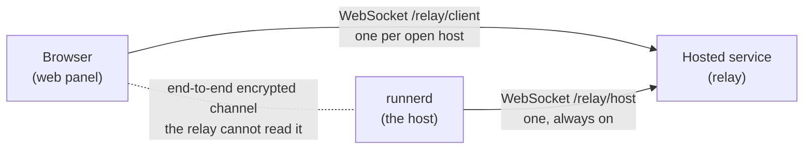
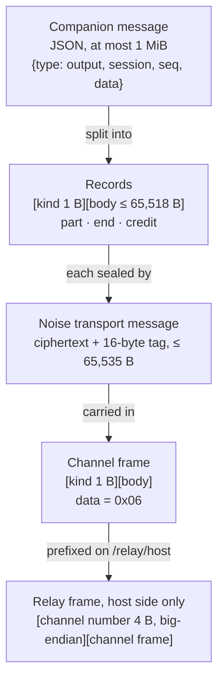
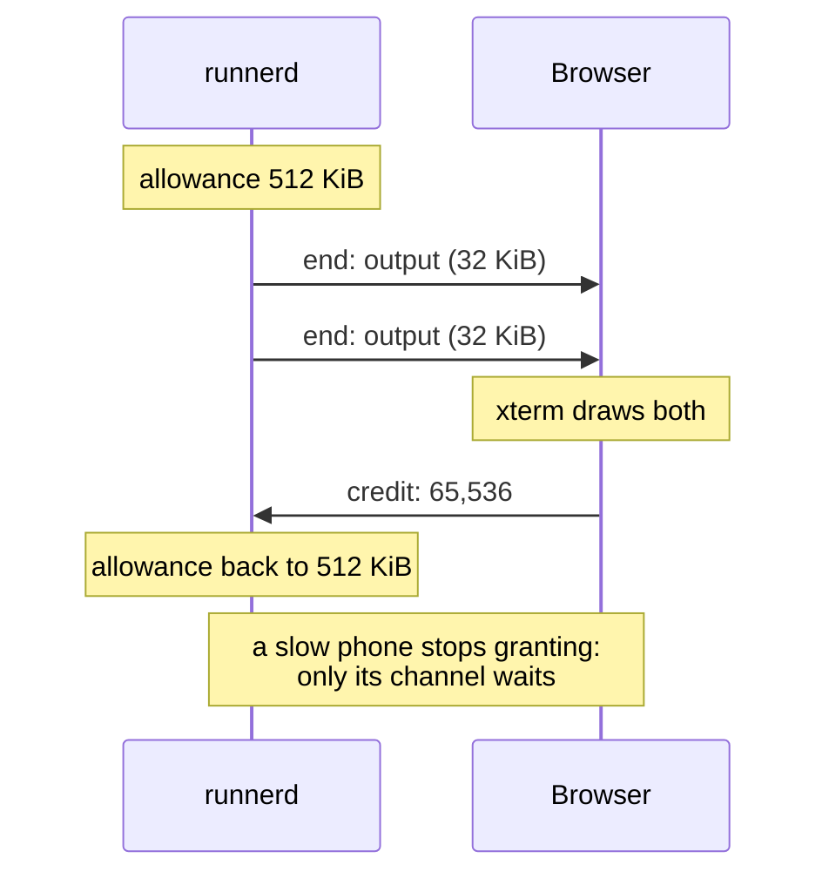
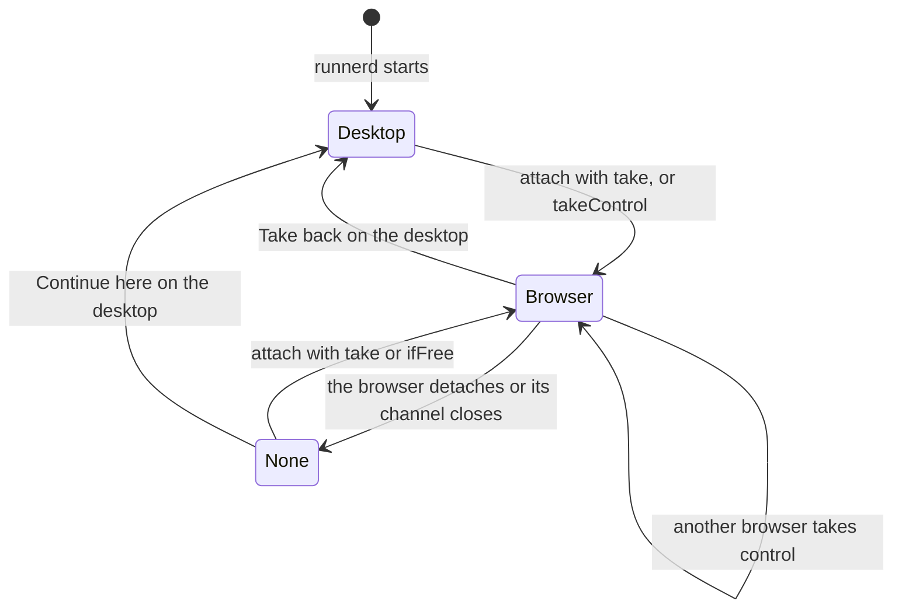

# Remote control: how a browser reaches a terminal through the relay

How a browser opens one of Runner's terminals through a hosted relay that cannot read it, for someone reading this code for the first time. The rules are in the [#836 spec](../features/836-web-remote-control.md); this note explains the machinery behind them: who connects to whom, how bytes are wrapped, how a six-digit PIN turns into keys, how the pace of a slow phone is kept from hurting anyone else, and how a terminal's size is shared.

Written against `nightly-remote` at `9842cee0` (2026-10-21), with Phase 1's enrollment, Phase 2's host trust and protocol, and Phase 3's m4 (the channel) and m5 (the adapter) merged. The desktop's control card (m6) and the service's side of the route are not built yet. Dependencies as pinned in `Cargo.lock`: `snow` 0.9.6, `curve25519-dalek` 4.1.3, `sha2` 0.10.9 and `tokio-tungstenite` 0.28.0.

## 1. Three parties, two outbound connections



Both ends dial out; nobody dials in. The host is usually behind a home or office router with no open port, and a browser page cannot accept connections at all. So the service is a meeting point: `runnerd` keeps one WebSocket to it while remote access is on, and a browser opens one more for each host it is looking at. The relay joins the two and copies bytes between them.

Everything that matters happens between the two ends, inside an encrypted **channel** the relay only carries. The relay never holds a key for it and never parses it. It does exactly three things: it decides whom it routes (only an account's own hosts), it numbers channels, and it copies, bounds and closes them.

Because the relay is only a route, two consequences follow:

- **Each end reconnects itself.** When the service restarts for a deploy, both WebSockets close. `runnerd` reconnects after a random 1–10 seconds (`remote/machine.rs`, `Retry::Restart`); the browser waits a little longer, so its host is usually back first, then opens a fresh channel. Pairing, keys and sessions survive; only the channel's session keys, the scroll position and anything typed during the gap are lost.
- **The route is replaceable.** Phase 4 carries the same channel over Tailscale instead of the relay, and nothing above the route changes.

## 2. The layers: what wraps what

A terminal's output on its way to the browser is wrapped five times. Read the picture from the inside out on the way down, and from the outside in at the other end:



| Layer | Bytes | Who reads it | Code |
| --- | --- | --- | --- |
| Companion message | JSON, with terminal bytes in base64, at most 1 MiB | Browser, `runnerd`'s adapter | `runner-core/src/companion/messages.rs` |
| Record | 1 kind byte and a body of at most 65,518 bytes | Both ends, after decrypting | `runner-core/src/companion/channel/records.rs` |
| Noise transport message | The record, sealed with ChaCha20-Poly1305 | Both ends | `snow`'s `TransportState` |
| Channel frame | 1 kind byte and the Noise message, at most 65,536 bytes | Both ends | `channel/mod.rs`: `frame`, `body` |
| Relay frame | A 4-byte channel number and the channel frame | The relay, which reads only the number | `channel/mod.rs`: `wrap`, `unwrap` |

The limits fit together exactly. Noise caps one message at 65,535 bytes; less its 16-byte tag and the record's kind byte, that leaves 65,518 for a record's body. Add the frame's kind byte and a channel frame is at most 65,536, and the relay's number brings a host-side WebSocket frame to at most 65,540.

On the browser's side there is no channel number: the browser's WebSocket is that one channel. On the host's side every channel shares one WebSocket, which is why the relay prefixes the number: `channelOpen`, `channelClosed` and `closeChannel` are JSON text frames, and everything else is binary.

## 3. Who holds what

There are two separate gates. The service decides **whom it routes**: only a signed-in account, and only to that account's own hosts. The host decides **whom it trusts**: only a browser it has paired with its PIN. Either alone is not enough, which is the point: whoever runs the service, or steals an account's password, still meets the PIN.

| Secret or record | Kept by | Where | Purpose |
| --- | --- | --- | --- |
| Host identity key (X25519) | Host | OS secret store, with the PIN | The host's Noise static key; its fingerprint is shown at enrollment |
| PIN, six digits | Host | The same secret-store item | CPace's password |
| PIN failures, lock, device list | Host | `remote-trust.json` | Five failures lock PIN entry; each paired browser's public key, name and times |
| Enrollment credential | Host | A separate secret-store item | Authenticates `/relay/host`; the account binding, not the channel |
| Browser's key for one host (X25519) | Browser | IndexedDB, as a non-extractable WebCrypto key | The browser's Noise static key for that host |
| The host's public key | Browser | IndexedDB, beside its own | Pinned after pairing; checked on every later connect |
| Account sign-ins, the host credential's hash, the host's public key | Service | Its own storage | Routing only |

The service never holds the PIN, a private key or a channel's session keys.

## 4. Pairing a browser: CPace inside Noise `XXpsk3`

The first time a browser opens a host, it has no key for it, and the host has never seen the browser. They have only the PIN, typed by the person in the browser and set by the same person at the host.

### Why the PIN cannot simply be the key

The obvious design is to use the PIN as Noise's pre-shared key. That fails against an attacker who stands in the middle, as the relay does. It plays the host to the browser: it answers the browser's first message with its own keys, and the browser's third message comes back encrypted under keys that mix in the PIN. The attacker knows everything in that mix except the PIN, so it can try all one million PINs against the message's authentication tag, offline, in seconds.

A password-authenticated key exchange closes that hole. In CPace each side commits to its PIN before learning anything, in a way that can be tested against only one guess. An attacker gets one guess per attempt, online, where the host's five-failure lock limits it.

### CPace in one paragraph

Both sides hash the PIN, a context string and a random session id `sid` into a point `G` on the ristretto255 group (`cpace.rs`, `generator`). Each picks a secret scalar and sends its scalar times `G`: the browser sends `Ya = a·G`, the host `Yb = b·G` (`Cpace::new`). Each multiplies the other's point by its own scalar, so both reach `K = a·b·G`, and hashes it with the transcript into the intermediate session key, the ISK (`Cpace::isk`). The same PIN gives the same `G` and therefore the same ISK; a different PIN gives a different `G` and unrelated ISKs. The two points on the wire look random: without a secret scalar, nobody can tell which PIN made them, and having committed to `Yb`, an attacker cannot later rework it for a second guess.

### Noise `XXpsk3` carries it

CPace produces a shared secret, but not the long-term identities each side should remember. Noise's `XX` pattern does that: both static keys travel inside the handshake, encrypted, so the browser learns the host's identity key without having to know it beforehand. The `psk3` modifier mixes the first 32 bytes of the ISK into the third message, so that message decrypts only if both sides used the same PIN.

```mermaid
sequenceDiagram
    participant B as Browser
    participant R as Relay
    participant H as runnerd
    Note over B: make this host's X25519 key,<br/>pick sid and CPace scalar a
    B->>R: pair 0x03: sid, Ya, Noise msg 1 (→ e)
    R->>H: channel 17: the same bytes
    Note over H: no PIN → reject noPin<br/>locked → reject pinLocked<br/>else ISK from Ya and the stored PIN
    H->>R: pairReply 0x04: Yb, Noise msg 2 (← e, ee, s, es)
    R->>B: the same bytes
    Note over B: ISK from Yb and the typed PIN<br/>PSK = ISK[0..32]
    B->>R: pairFinish 0x05: Noise msg 3 (→ s, se, psk)<br/>payload {"name":"Chrome on Windows"}
    R->>H: the same bytes
    Note over H: PSK = ISK[0..32]; read msg 3<br/>fails → wrongPin, 5th → pinLocked<br/>ok → record the device's key and name
    H->>B: first data frame 0x06
    Note over B: it decrypts, so the host knew the PIN:<br/>keep the host's key
```

Three details are easy to miss:

- **The browser trusts the host's key only after the host's first `data` frame decrypts.** Message 2 carries a static key before any PIN has entered the handshake, so on its own it proves nothing. Only a host that derived the same ISK can produce a frame the browser can open.
- **A failed authentication counts as a wrong PIN.** The host cannot tell a wrong PIN from a tampered message, so both count toward the lock. Malformed frames and invalid points do not (`channels.rs`, `authorize`).
- **Attempts are serialized.** The host checks the lock again before reading each `pairFinish` and reads them one at a time, so five parallel attempts cannot slip past the fifth failure.

Code: `channel/cpace.rs`; `channel/handshake.rs`, `HostPair::start` and `HostPair::finish` for the host, `BrowserPair` for the test browser; `runner-daemon/src/remote/channels.rs`, `authorize`, for the lock and recording the device.

## 5. Connecting again: Noise `IK`

A paired browser already knows the host's static key, so it uses Noise's `IK` pattern, one round trip with no PIN:

```mermaid
sequenceDiagram
    participant B as Browser (knows the host's key)
    participant H as runnerd
    B->>H: connect 0x01: → e, es, s, ss
    Note over H: read the browser's static key;<br/>not on the device list → unknownDevice
    H->>B: accept 0x02: ← e, ee, se
    Note over B,H: transport keys ready; data frames follow
```

`IK`'s first message is encrypted to the host's static key, and it carries the browser's static key, which the host looks up in `remote-trust.json`. Two failures share one answer, `unknownDevice`: Revoke removed the browser's key from the list, or Reset identity gave the host a new key, so the browser's message no longer decrypts. Either way the browser forgets its keys and offers to pair again.

Code: `channel/handshake.rs`, `connect` for the host and `BrowserConnect` for the test browser.

## 6. Records and credit: one slow phone must not stall the rest

Every browser's channel to a host shares that host's one WebSocket. If `runnerd` simply wrote output as fast as terminals produced it, a phone on a weak connection would let bytes pile up somewhere: in the relay, without limit, or in the host's socket, where they would block every other channel behind them.

Records solve this with credit, the same windowed flow control as SSH channels or HTTP/2 streams. Each side may send only as many message bytes as the other has granted, starting at 512 KiB. The receiver grants more once it has handled what arrived: for the browser, after xterm has drawn the output. It batches the grant into a `credit` record once it owes 64 KiB or more.



When a channel has no credit, that channel's terminal output waits on the host, in that terminal's queue. A queue that grows past 1 MiB is thrown away and replaced by a fresh snapshot once credit returns: the browser falls behind, then catches up to the screen as it is now, rather than replaying minutes of output. Other channels never notice.

The host also bounds what it accepts: a channel's queue of incoming frames is capped at 1 MiB, counting 64 bytes per frame on top of its length (`channels.rs`, `feed`), and a message over 1 MiB ends the channel. A misbehaving browser can hurt only its own channel.

Code: `channel/records.rs`: `queue` and `next_frame` split and pace outgoing messages; `receive` reassembles and checks incoming ones; `handled` grants credit back. The constants are in `channel/mod.rs`.

## 7. The adapter: the companion protocol on an open channel

Once a channel is open, `runnerd` serves it through the adapter in `runner-daemon/src/companion/`. The browser's first message must be `hello`; `welcome` answers with the protocol version and `features`, the requests this host serves. At `9842cee0` that is `overview`, `attach`, `input`, `takeControl`, `viewport` and `detach`.

- **The overview** mirrors the desktop's sidebar: projects, tabs with their split panes, missions and sessions with their status. It is pushed again whenever any of that changes, at most every 250 ms.
- **A terminal** opens with `attach`: a snapshot in 32 KiB chunks, with at most 1,000 lines of history by default, then `output` as the program writes, `resized` when the size changes, and `closed` when it ends. `input` goes into the same input queue the desktop's typing uses, so draft-aware mission delivery and status detection see a browser's typing too.
- **Send order** keeps a busy terminal from starving anything: results, errors and pushes first, then the open terminals in turn, one chunk each.

The adapter reaches `runnerd`'s state through a narrow `Core` trait over a weak reference (`companion/core.rs`), so an open channel can never keep a shutting-down daemon alive, and tests can drive the adapter with a fake core.

Code: `companion/mod.rs`, `Adapter` and `Stream`; `remote/channels.rs`, `serve`, which runs the handshake, then the records, then the adapter, for one channel.

## 8. Terminal size: one controller per terminal

A PTY has exactly one size, and the programs in it draw for that grid. Two screens of different sizes cannot both be right, so each live terminal has one **controller**, and only the controller's size applies.



While a browser controls a terminal, the desktop's own size pushes are ignored (`session/manager/output.rs`, `resize_with_origin`), since a desktop pane pushes its size on every repaint and would otherwise undo the browser's at once. When the browser leaves, the size stays as it was until the desktop takes the terminal back. m6 draws the desktop's card with Take back over a pane a browser controls.

Code: `session/manager/terminal.rs`, `Controller`; the client protocol's `TerminalController`.

## 9. The life of a keystroke

```mermaid
sequenceDiagram
    participant X as xterm.js
    participant BC as Browser channel
    participant S as Relay
    participant RC as runnerd: remote/channels.rs
    participant A as Adapter
    participant P as PTY
    X->>BC: the person types "l"
    BC->>BC: input message → end record → Noise seal → data frame
    BC->>S: binary WebSocket frame
    S->>RC: prefix channel 17, write to the host's WebSocket
    RC->>A: unwrap, open, reassemble the message
    A->>P: the session's input queue
    P-->>A: the shell echoes "l"
    A-->>RC: output message, in turn with other terminals, within credit
    RC-->>S: seal, wrap with channel 17
    S-->>BC: strip the number
    BC-->>X: open, write; once drawn, grant credit back
```

## 10. What the relay can and cannot do

It **can** see that a channel exists, its sizes and its timing; drop, delay or close it; refuse to route; and forge or drop a `reject`, which travels in the clear. A browser only shows a reject, and pairing again after a forged `unknownDevice` costs nothing beyond a prompt the page already shows.

It **cannot** read a message, learn the PIN, test PIN guesses offline, pose as a paired host to a browser that has pinned its key, or pose as a browser to a host without that browser's key. An attacker who intercepts a pairing gets one PIN guess per attempt, and the host locks after five.

One limit is honest to state: the web panel's code comes from the service. A malicious service could ship code that reads the PIN and the terminal as the person types. End-to-end encryption protects against a relay that only forwards bytes, a database leak and anyone on the network, not against the page's own author; a native app, such as the planned iPhone app, can do better. The spec's Client trust section has the full model.

## Reading path

1. `crates/runner-core/src/companion/channel/mod.rs`: frame kinds, rejects, limits, `wrap` and `unwrap`. Short, and it names everything else.
2. `channel/cpace.rs`, then `channel/handshake.rs`: the PIN exchange and both Noise patterns.
3. `channel/records.rs`: records and credit.
4. `channel/tests.rs` with `channel/vectors/channel.json`: a complete pairing, connect, wrong PIN and record sequence, byte for byte. The browser's implementation replays these vectors.
5. `crates/runner-daemon/src/remote/mod.rs` from `ChannelOpen` (about line 407): where `/relay/host`'s frames reach the channels.
6. `remote/channels.rs`: `Channels::open`, `feed`, `authorize` and `serve`, one channel's whole life.
7. `crates/runner-daemon/src/companion/mod.rs` and `core.rs`: the adapter.
8. `session/manager/terminal.rs` and `output.rs`: the controller.

## Background reading

- [The Noise Protocol Framework](https://noiseprotocol.org/noise.html): read §7, handshake patterns, for the `→ e, es, s, ss` notation, and §9 for PSK modes. Then the `XX` and `IK` patterns read as one line each.
- [Noise Explorer](https://noiseexplorer.com/patterns/): each pattern drawn as a diagram, with what every message proves.
- [CPace, draft-irtf-cfrg-cpace-21](https://datatracker.ietf.org/doc/draft-irtf-cfrg-cpace/): §§3–6 for the protocol; appendix B.3 holds the ristretto255 vectors `cpace-b3.json` copies.
- [Ristretto](https://ristretto.group/): why ristretto255 rather than raw Curve25519 points for hashing to a group.
