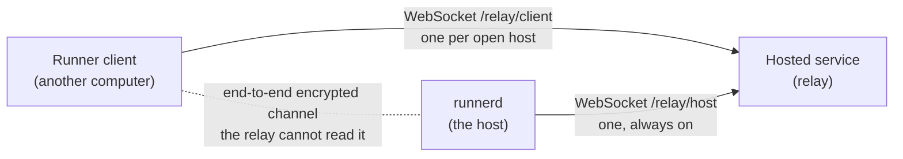
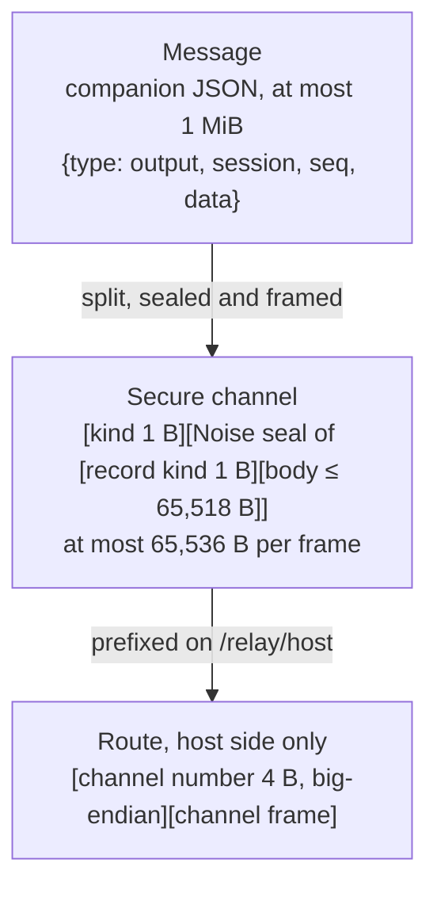
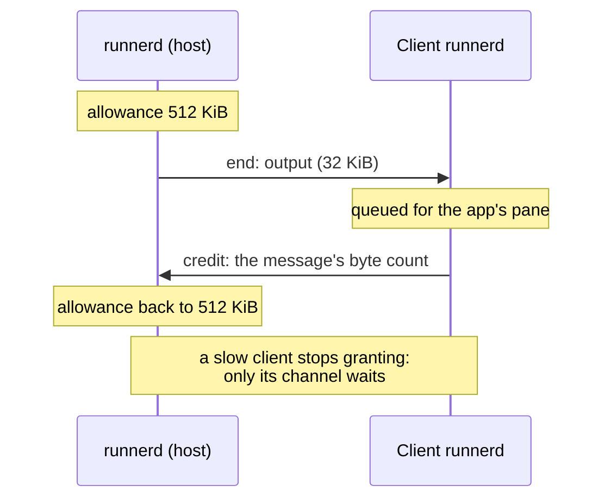
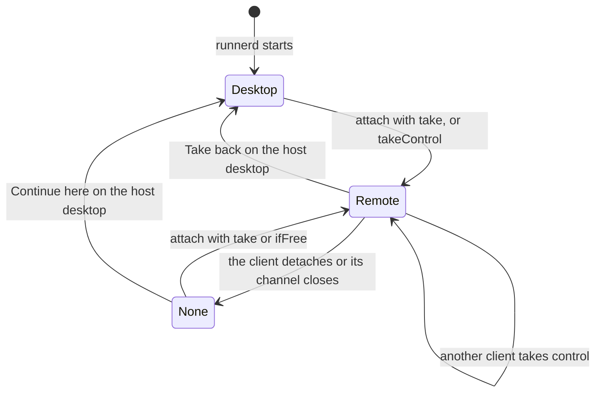

# Remote control: how a Runner client reaches a terminal through the relay

How Runner on one computer opens another computer's terminals through a hosted relay that cannot read them, for someone reading this code for the first time. The rules are in the [#836 spec](../features/archive/836-web-remote-control.md); this note explains the machinery behind them: who connects to whom, how bytes are wrapped, how a six-digit PIN turns into keys, how the pace of a slow client is kept from hurting anyone else, how a terminal's size is shared, and where the time between a keystroke and its echo goes.

Written against `main` at `0d5ef17a` (2026-11-10), with both ends built: the host's channel and adapter, and Runner as a client (the client's `runnerd` holds the channel, the app draws the remote window). The relay is the private `YeelinksCo/runner_server` repository at `246952b`, under `backend/app/relay/`. Dependencies as pinned in `Cargo.lock`: `snow` 0.9.6, `curve25519-dalek` 4.1.3, `sha2` 0.10.9, `tokio-tungstenite` 0.28.0 and `zed-reqwest` 0.12.15-zed.

**The client is Runner** (Jason, 2026-10-21): the desktop app on another computer, later the iPhone app, and not a browser. The code and the spec still say *browser* for it, as in `BrowserPair`, `Controller::Browser` and `browser_input`; read each as the remote Runner client.

## 1. Three parties, two outbound connections



Both ends dial out; nobody dials in. The host is usually behind a home or office router with no open port, and so is the client. So the service is a meeting point: the host's `runnerd` keeps one WebSocket to it while remote access is on, and the client's `runnerd` opens one more for each host it is looking at. The relay joins the two and copies bytes between them.

Everything that matters happens between the two ends, inside an encrypted **channel** the relay only carries. The relay never holds a key for it and never parses it. It does exactly three things: it decides whom it routes (only an account's own hosts), it numbers channels, and it copies, bounds and closes them.

The relay is a Go service (gorilla/websocket) behind nginx, which terminates TLS and proxies to it on localhost with buffering off. The default origin, `https://runner.yeelinks.com.cn`, runs on one Aliyun ECS server, for a private beta in the Chinese community. For each channel the relay keeps one queue per direction, each capped at 1 MiB, and closes the channel with 4413 when a frame would overflow one; a single writer per host connection takes the channels' queued frames in turn (`relay/channels.go`, `next`). It pings both sockets every 25 seconds and drops a socket that has been silent for 60.

Because the relay is only a route, two consequences follow:

- **Each end reconnects itself.** When the service restarts for a deploy, both WebSockets close. The host's `runnerd` reconnects after a random 1–10 seconds (`remote/machine.rs`, `Retry::Restart`); the client reconnects on its own as well (§9) and opens a fresh channel once its host is back. Pairing, keys and sessions survive; only the channel's session keys, the scroll position and anything typed during the gap are lost.
- **The route is replaceable.** A later Tailscale route ([#954](https://github.com/yicheng47/runner/issues/954)) would carry the same channel, from one Runner straight to the other, and the service is not involved at all. Nothing above the route changes.

## 2. The layers: what wraps what

There are three layers: the message, the secure channel that carries it, and the route the relay copies. Read the picture from the top down on the way out, and from the bottom up at the other end:



**The message** is what the two ends actually say to each other: a companion protocol message, JSON with terminal bytes in base64, at most 1 MiB. Only the client's route and the host's adapter read it. Code: `runner-core/src/companion/messages.rs`.

**The secure channel** turns a message into frames only the two ends can read. It is Noise with one header byte inside the encryption and one outside:

| Part | Bytes | Why it is there | Code |
| --- | --- | --- | --- |
| Record | 1 kind byte (part, end or credit) and a body of at most 65,518 bytes | Noise seals at most 65,535 bytes at a time, but a message can be 1 MiB, so a message is split into records; credit (§6) rides in the same byte, encrypted, so the relay cannot tell credit from data | `channel/records.rs` |
| Noise seal | The record, sealed with ChaCha20-Poly1305, plus a 16-byte tag | End-to-end encryption | `snow`'s `TransportState` |
| Channel frame | 1 kind byte in the clear, then the Noise message | Tells the handshake frames (§§4–5) and `reject`, which travel before any transport keys exist, from `data` | `channel/mod.rs`: `frame`, `body` |

The limits fit together exactly. Noise caps one message at 65,535 bytes; less its 16-byte tag and the record's kind byte, that leaves 65,518 for a record's body. Add the frame's kind byte and a channel frame is at most 65,536, and the relay's number brings a host-side WebSocket frame to at most 65,540.

**The route** is the only part the relay reads. On the client's side there is nothing to add: the client's WebSocket is that one channel. On the host's side every channel shares one WebSocket, so the relay prefixes each binary frame with a 4-byte channel number (`channel/mod.rs`: `wrap`, `unwrap`). `channelOpen`, `channelClosed` and `closeChannel` are JSON text frames on the same socket, and everything else is binary.

Both ends of the channel are one implementation, in Rust in `runner-core`: the host's side in `HostPair` and `connect`, the client's in `BrowserPair` and `BrowserConnect`, which the client's `runnerd` runs (`remote/client/route.rs`).

## 3. Who holds what

There are two separate gates. The service decides **whom it routes**: only an enrolled computer on a signed-in account, and only to that account's own hosts. The host decides **whom it trusts**: only a client it has paired with its PIN. Either alone is not enough, which is the point: whoever runs the service, or steals an account's password, still meets the PIN.

| Secret or record | Kept by | Where | Purpose |
| --- | --- | --- | --- |
| Host identity key (X25519) | Host | OS secret store, with the PIN | The host's Noise static key; its fingerprint is shown at enrollment |
| PIN, six digits | Host | The same secret-store item | CPace's password |
| PIN failures, lock, device list | Host | `remote-trust.json` | Five failures lock PIN entry; each paired client's public key, name, times and kind (phone, computer or unknown, mapped from the `client` in its latest authenticated `Hello`; display only) |
| Enrollment credential | Each computer | A separate secret-store item | Authenticates `/relay/host` and, for the same computer acting as a client, `/relay/client?host=<id>`; the account binding, not the channel |
| Client's key for one host (X25519) | Client's `runnerd` | The `client-keys` secret-store item, one entry per host fingerprint, split across several items when large (`remote/store.rs`, `ClientKeys`) | The client's Noise static key for that host |
| The host's public key | Client's `runnerd` | The same entry, with the host's name and pairing time | Pinned after pairing; checked on every later connect |
| Account sign-ins, credential hashes, the host's public key | Service | Its own storage | Routing only |

The service never holds the PIN, a private key or a channel's session keys. Keys live in the client's `runnerd`, never in the app or the CLI, which reach remote hosts through the client protocol as they reach local sessions.

## 4. Pairing a client: CPace inside Noise `XXpsk3`

The first time a client opens a host, it has no key for it, and the host has never seen the client. They have only the PIN, typed by the person into the client's PIN dialog and set by the same person at the host.

### Why the PIN cannot simply be the key

The obvious design is to use the PIN as Noise's pre-shared key. That fails against an attacker who stands in the middle, as the relay does. It plays the host to the client: it answers the client's first message with its own keys, and the client's third message comes back encrypted under keys that mix in the PIN. The attacker knows everything in that mix except the PIN, so it can try all one million PINs against the message's authentication tag, offline, in seconds.

A password-authenticated key exchange closes that hole. In CPace each side commits to its PIN before learning anything, in a way that can be tested against only one guess. An attacker gets one guess per attempt, online, where the host's five-failure lock limits it.

### CPace in one paragraph

Both sides hash the PIN, a context string and a random session id `sid` into a point `G` on the ristretto255 group (`cpace.rs`, `generator`). Each picks a secret scalar and sends its scalar times `G`: the client sends `Ya = a·G`, the host `Yb = b·G` (`Cpace::new`). Each multiplies the other's point by its own scalar, so both reach `K = a·b·G`, and hashes it with the transcript into the intermediate session key, the ISK (`Cpace::isk`). The same PIN gives the same `G` and therefore the same ISK; a different PIN gives a different `G` and unrelated ISKs. The two points on the wire look random: without a secret scalar, nobody can tell which PIN made them, and having committed to `Yb`, an attacker cannot later rework it for a second guess.

### Noise `XXpsk3` carries it

CPace produces a shared secret, but not the long-term identities each side should remember. Noise's `XX` pattern does that: both static keys travel inside the handshake, encrypted, so the client learns the host's identity key without having to know it beforehand. The `psk3` modifier mixes the first 32 bytes of the ISK into the third message, so that message decrypts only if both sides used the same PIN.

```mermaid
sequenceDiagram
    participant C as Client
    participant R as Relay
    participant H as runnerd (host)
    Note over C: make this host's X25519 key,<br/>pick sid and CPace scalar a
    C->>R: pair 0x03: sid, Ya, Noise msg 1 (→ e)
    R->>H: channel 17: the same bytes
    Note over H: no PIN → reject noPin<br/>locked → reject pinLocked<br/>else ISK from Ya and the stored PIN
    H->>R: pairReply 0x04: Yb, Noise msg 2 (← e, ee, s, es)
    R->>C: the same bytes
    Note over C: ISK from Yb and the typed PIN<br/>PSK = ISK[0..32]
    C->>R: pairFinish 0x05: Noise msg 3 (→ s, se, psk)<br/>payload: the client's device name
    R->>H: the same bytes
    Note over H: PSK = ISK[0..32]; read msg 3<br/>fails → wrongPin, 5th → pinLocked<br/>ok → record the device's key and name
    H->>C: first data frame 0x06
    Note over C: it decrypts, so the host knew the PIN:<br/>keep the host's key
```

Five details are easy to miss:

- **The client trusts the host's key only after the host's first `data` frame decrypts.** Message 2 carries a static key before any PIN has entered the handshake, so on its own it proves nothing. Only a host that derived the same ISK can produce a frame the client can open.
- **A failed authentication counts as a wrong PIN.** The host cannot tell a wrong PIN from a tampered message, so both count toward the lock. Malformed frames and invalid points do not (`channels.rs`, `authorize`).
- **Attempts are serialized.** The host checks the lock again before reading each `pairFinish` and reads them one at a time, so five parallel attempts cannot slip past the fifth failure.
- **Weak PINs remain a user choice.** Shared detection identifies repeated single digits, ascending/descending runs and a short list of common PINs. Settings and the CLI warn that the PIN could be guessed within five tries, then require an explicit confirmation to keep it. The host validates only the six-digit ASCII format; no confirmation flag or new wire field is introduced. CPace still allows one online guess per attempt.
- **Pending pairings are invalidated.** Set PIN, disabling remote access, sign-out and identity reset advance a generation checked before `pairFinish` and after the trust save. Before an invalidating command saves its other changes or reports success, the ordered trust writer durably removes unconfirmed devices and prevents older snapshots from restoring them. Save failure reports an error and restarts the remote task. This protects a fresh process loading trust from disk as well as delayed completions within the process; the generation stays distinct across remote-task restarts. Already authenticated channels remain usable after a PIN change.

Code: `channel/cpace.rs`; `channel/handshake.rs`, `HostPair::start` and `HostPair::finish` for the host, `BrowserPair` for the client; `runner-daemon/src/remote/channels.rs`, `authorize`, for the lock and recording the device; `remote/client/route.rs`, `pair`, for the client.

## 5. Connecting again: Noise `IK`

A paired client already knows the host's static key, so it uses Noise's `IK` pattern, one round trip with no PIN:

```mermaid
sequenceDiagram
    participant C as Client (knows the host's key)
    participant H as runnerd (host)
    C->>H: connect 0x01: → e, es, s, ss
    Note over H: read the client's static key;<br/>not on the device list → unknownDevice
    H->>C: accept 0x02: ← e, ee, se
    Note over C,H: transport keys ready
    C->>H: data: hello
    H->>C: data: welcome (version, features)
```

`IK`'s first message is encrypted to the host's static key, and it carries the client's static key, which the host looks up in `remote-trust.json`. Two failures share one answer, `unknownDevice`: Revoke removed the client's key from the list, or Reset identity gave the host a new key, so the client's message no longer decrypts. This rejection is plaintext and unauthenticated, so a relay can forge it. The client keeps its saved keys, reports that this computer was not recognized, and offers explicit Pair again after fingerprint verification. Only Forget or submitting Pair again removes the saved key.

Both handshake messages carry empty payloads. The companion `hello` and `welcome` follow as the channel's first data messages, one more round trip, before the client sends anything else.

Code: `channel/handshake.rs`, `connect` for the host and `BrowserConnect` for the client; `route.rs`, `connect` and `welcome`.

## 6. Records and credit: one slow client must not stall the rest

Every client's channel to a host shares that host's one WebSocket. If `runnerd` simply wrote output as fast as terminals produced it, a client on a weak connection, such as a phone, would let bytes pile up somewhere: in the relay, without limit, or in the host's socket, where they would block every other channel behind them.

Records solve this with credit, the same windowed flow control as SSH channels or HTTP/2 streams. Each side may send only as many message bytes as the other has granted, starting at 512 KiB. The receiver grants bytes back once it has handled them: the host's channel task once the adapter has taken the request, the client's route once it has passed the message on, for terminal output into the terminal's queues toward the app (§9). A grant goes out after every complete message, and in the middle of a long one once 64 KiB is owed, so for small messages such as typing echo every message is answered by a `credit` record.



When a channel has no credit, that channel's terminal output waits on the host, in that terminal's queue. A queue that grows past 1 MiB is thrown away and replaced by a fresh snapshot once credit returns: the client falls behind, then catches up to the screen as it is now, rather than replaying minutes of output. Other channels never notice.

The host also bounds what it accepts: a channel's queue of incoming frames is capped at 1 MiB, counting 64 bytes per frame on top of its length (`channels.rs`, `feed`), and a message over 1 MiB ends the channel. A misbehaving client can hurt only its own channel.

Code: `channel/records.rs`: `queue` and `next_frame` split and pace outgoing messages; `receive` reassembles and checks incoming ones; `handled` grants credit back. The constants are in `channel/mod.rs`.

## 7. The adapter: the companion protocol on an open channel

Once a channel is open, the host's `runnerd` serves it through the adapter in `runner-daemon/src/companion/`. The client's first message must be `hello`; `welcome` answers with the protocol version and `features`, the requests this host serves. It includes overview and terminal requests, mission feed/follow/answer/post, and the front page action allowlist defined in the feature spec's Remote actions section.

- **The overview** mirrors the host desktop's sidebar: projects, tabs with their split panes, missions and sessions with their status. It also carries the host's terminal palette, the one runnerd answers its agents' color queries with, so a client draws that host's terminals against the background their output was styled for; a client falls back to its own palette when an older host leaves it out. The whole overview is pushed again whenever any of that changes, the palette included, at most every 250 ms. A remote window shows it as its sidebar.
- **A terminal** opens with `attach`: a snapshot in 32 KiB chunks, with at most 1,000 lines of history by default, then `output` as the program writes, `resized` when the size changes, `clipboard` when its program copies text with OSC 52, in pieces of at most 32 KiB that the client reassembles up to the 1 MiB cap, and `closed` when it ends. `input` goes into the same input queue the host desktop's typing uses, so draft-aware mission delivery and status detection see a remote client's typing too. Every `input` is a request with an id and gets a `result`.
- **Terminal output is merged on the host.** A PTY read is one frame in the terminal's queue, and a fullscreen program's single redraw can take several, so every `output` carries all the output frames waiting behind it, up to 32 KiB. A frame that would overflow stays queued for the next message, one larger than the limit still splits, and a `resized` frame ends the merge. `seq` rises by one per message, so a client cannot tell a merged message from a single read. Each terminal also has a window of about 5 ms: output with no `output` sent in the last 5 ms goes at once, so typing echo keeps its latency, and output arriving sooner waits for the rest of the window and goes out merged. Nothing waits that cannot gain from it: a merge that already fills 32 KiB, since holding it would only push a flood towards the queue's overflow; the remaining chunks of a split frame; and output with a `resized` behind it or on a terminal that has ended. A held terminal spends no credit and does not hold back other terminals or feeds, and the adapter wakes itself when the window ends. Output that builds up without credit merges when credit returns.
- **Front page actions** have their own camelCase companion requests and call the same `AppCore` operations as the desktop. Catalog responses project names and choices without commands, account configuration folders or environment values; folder browsing returns directories only. Starts carry the client's terminal size. Settings, role/crew editing, pairing and archived-item operations remain outside the allowlist. The client protocol's `remote_request` forwards the companion request and returns its result without changing client state; `feedAppended` becomes `remote/feed`. Feeds omit desktop-hidden status/inbox/ask noise, page by visible entries within a 64 KiB encoded budget, and drain bounded append batches under output backpressure rather than accumulating a reply-queue backlog. Terminals and followed missions share fair turns. Oversized individual entries become fixed `feedEntryTooLarge` markers at the same ID/time. Mission layout writes the desktop's drawer-only representation and preserves drawer presentation; mission members are never persisted as drawer sessions. A disconnected caller refreshes the feed and follows again. No action is exposed by `runner call`.
- **Usage** is a read-only `usage` action negotiated through the welcome's `usage` feature, with the protocol version kept at 1. The request's `popover` flag selects the host's Open (older than 5 minutes) or Schedule (15 minutes) refresh rule. The host replies from its current snapshot without waiting for a fetch, listing only enabled, installed usage agents with their windows, percentages, reset times, update timestamps and unavailable reasons; it includes the active Claude account's name only when several accounts exist, without paths, commands or configuration. Remote windows share one request per computer on entry or connection, every 60 seconds while shown, on opening the usage popover, and every 2 seconds while an open popover reports a refresh in progress. Requests also keep usage current when the host app is closed. Failed requests retain the last reply until the app quits or the computer is forgotten; hosts without the feature receive no usage request.
- **Latency** is measured with a `ping` request and a `pong` reply carrying its id. It is negotiated through the `ping` entry in `features`, so the protocol version stays 1 and an older host is never sent one. Each route pings once on connecting and every 5 seconds after, and reports the median of its last 3 round trips as the `remote/latency` event; a ping with no reply within 10 seconds counts as a 10,000 ms sample. Overview and feed reads run beside the channel loop, and the host keeps only the newest ping and answers it ahead of everything else, so a pong waits on neither those reads nor the reply queue. A terminal attach, input, an answer or a post is handled in the loop, so a ping waits for those as typing does. A ping never changes a route: an unanswered or refused one only lowers the reading, and the route's existing failure handling stays the only source of Reconnecting and Unreachable. Samples belong to one route, so a reconnect starts again with none.
- **Send order** keeps a busy terminal from starving anything: a `pong` first, then results, errors and pushes (overview and status included, a newer overview or status replacing a queued one), then replies to `overview` requests, then, while the channel has credit, followed feeds and the open terminals in turn, one message each (`Adapter::next`).

The adapter reaches `runnerd`'s state through a narrow `Core` trait over a weak reference (`companion/core.rs`), so an open channel can never keep a shutting-down daemon alive, and tests can drive the adapter with a fake core. Calls into it that touch SQLite or a session, input included, run on Tokio's blocking pool.

Code: `companion/mod.rs`, `Adapter` and `Stream`; `remote/channels.rs`, `serve`, which runs the handshake, then the records, then the adapter, for one channel.

## 8. Terminal size: one controller per terminal

A PTY has exactly one size, and the programs in it draw for that grid. Two screens of different sizes cannot both be right, so each live terminal has one **controller**, and only the controller's size applies. A remote client is `Controller::Browser` in the code.



Opening a tab or a mission on the client takes every terminal in it, at the size of each terminal's pane on the client. While a client controls a terminal, the host desktop's own size requests are refused (`ResizeControl::apply` in `session/manager/terminal.rs`, called by `resize_controlled` in `output.rs`), since a desktop pane pushes its size on every repaint and would otherwise undo the client's at once. Every mirror, the requesting pane's included, takes its size only from the attach snapshot and the ordered `Resized` frames (#986), so a refused request leaves the host desktop drawing at the size the PTY really has. When the client leaves, the size stays as it was until the host desktop takes the terminal back. The host desktop draws a card with Take back over a pane a client controls.

Tab ownership is transferred as one group, including its drawer shells, while each terminal retains an independent grid. The daemon derives the group from the persisted tab layout, serializes control changes, and sends each terminal's ordered controller frame. The group's controller survives a pane restart; the existing tab-layout upsert reconciles added or moved panes with the destination controller before publishing the layout change. The host keeps one centered tab card during mixed frame delivery. A stream records its channel, subscriber and tab at attachment: closing or replacing one stream does not release surviving streams in that tab, and closing the last one releases that tab without affecting other tabs on the channel. Input is accepted only from the terminal's current controlling channel.

Code: `session/manager/terminal.rs`, `Controller`; the client protocol's `TerminalController`.

## 9. The client: one route per computer

The client's `runnerd` holds every channel; the app and the CLI never see a key. They reach a remote computer through the client protocol: `remote_request` for companion requests, `attach_remote` for a terminal, and the ordinary input and resize frames, addressed to `remote::terminal_address(computer, session)` rather than a local session id.

- **`Client`** (`remote/client/mod.rs`) knows the account's computers, listed by the service and cached for 5 seconds, and this computer's client keys. It keeps one **route** per host fingerprint, opened on first use by `Client::route`.
- **A route** (`route.rs`, `run`) is one task that owns the channel: it opens `/relay/client?host=<id>` with this computer's own enrollment credential, runs `IK` against the pinned key (§5), then exchanges `hello` and `welcome`. Its loop queues commands from the client protocol as companion messages, writes every frame credit allows, then waits for the next command, socket message, request deadline or ping. A route with no followers, feeds, terminals or pending requests closes after 60 seconds unused. A failed route reconnects after 1, 2, 4, 8, 16, then every 30 seconds while something still needs it; a route that stayed up for a minute starts that sequence again.
- **Input never waits for a route.** `Client::input` finds a ready route and hands the bytes to its command queue, which holds 32 commands, with the route's generation. Typing during a reconnect, into a full queue or across a reconnect is dropped and reported with `session/input-error`, never replayed into a different screen.
- **`Terminals`** (`terminal.rs`) keeps one stream per remote session on the route. It assembles the snapshot's chunks, checks that every `output` and `resized` continues the sequence (a gap fails the route, and the reconnect brings a fresh snapshot), and copies each frame into a bounded queue per listening pane, which, like a local terminal's, becomes a `Resync` past 1 MiB. It also keeps a replay of the frames since the snapshot, so a second pane or a returning tab attaches without asking the host again. On reconnect it attaches every open stream again with `ifFree`.
- **The app** wraps each remote pane in a `RemoteTransport` (`runner-app/src/surfaces/remote_client/transport.rs`), a `Transport` whose first attach takes control and whose input, resize and take-back go to the client daemon's remote paths. The pane's mirror is a `runner-terminal` remote mirror, which holds a reprint burst and paints it once (§11).

## 10. The life of a keystroke

```mermaid
sequenceDiagram
    participant V as Client app: pane
    participant CD as Client runnerd: route
    participant S as Relay
    participant HL as Host runnerd: relay loop
    participant A as Host runnerd: channel task, adapter
    participant P as PTY
    V->>CD: input frame on the local socket
    CD->>CD: input message → end record → Noise seal
    CD->>S: binary WebSocket frame
    S->>HL: prefix channel 17, queue, write in turn
    HL->>A: unwrap, feed the channel's queue
    A->>P: open, decode; blocking pool: session check, input queue
    A-->>HL: result (null), sealed
    P-->>A: the shell echoes "l"
    A-->>HL: output, at once or within 5 ms, sealed
    HL-->>S: wrap with channel 17, send and flush
    S-->>CD: strip the number, queue, write
    CD-->>V: open, push to the pane's queue; grant credit
```

Hop by hop, with the code for each:

1. The pane's `RemoteTransport::input` sends an input frame to the client's `runnerd` over the local client-protocol socket. That connection's input worker (`daemon/server.rs`) reads frames in order on a blocking thread and calls `RemoteHandle::remote_input`.
2. `Client::input` and `Handle::input` hand the bytes to the route's command queue. The route encodes an `input` message (JSON, base64 data, a fresh id), seals it as one record and writes it as one WebSocket frame.
3. The relay's client reader prefixes the channel number and queues the frame; the host connection's writer sends it when its turn comes (`relay/channels.go`, `enqueue` and `next`).
4. The host's remote loop (`remote/mod.rs`, `run`) reads the frame, strips the number and feeds the channel task's queue (`Channels::feed`).
5. The channel task (`channels.rs`, `serve`) opens the record and decodes the message, and the adapter's `request` runs `DaemonCore::input` on the blocking pool: it reads the session's row from SQLite, then `browser_input` puts the bytes in the session's input queue, which writes them to the PTY. The adapter queues a `result` with a null value, which the client drops, and the channel task grants credit for the input.
6. The PTY reader's output reaches the stream's subscriber, whose thread puts it in the stream's queue and wakes the channel task (`Stream::new`). `Adapter::next` sends the `result` first, then the output in the terminal's turn (§7).
7. Each sealed frame goes to the remote loop as an `Event::Send` on a queue of 64 shared by every channel; the loop wraps it, sends it and flushes, one frame at a time, then reads or sends the next.
8. The relay copies it to the client's channel queue and socket. The client's route opens it, `Terminals::message` checks the sequence and pushes the output to each listening pane's queue, and the route grants credit for it.
9. The client daemon passes the frame to the app over the local socket, as it does a local terminal's, and the pane's mirror parses and repaints.

## 11. Where the time goes

The delay between a keystroke and its echo is the whole path in §10, out and back. Almost all of it is the network; Runner's own work per keystroke is small and fixed, and the rest is queues that are empty unless something else is flowing.

### The network: two legs and one place

Every byte crosses two TCP connections, client to relay and relay to host, so the round trip is the sum of both legs plus the relay's turn-taking. Two computers on the same desk still meet at the one relay server, and every user's traffic goes through it. A lost packet on either leg holds every later byte on that connection until it is resent, and the host's one connection carries every client's channels, so a loss on the host's leg delays all of them.

Nagle's algorithm is off at every hop, so a small frame is never held for a following one: `zed-reqwest`'s connector sets `TCP_NODELAY` by default (`ClientBuilder`, `nodelay: true`), and the upgraded connection keeps it; Go's `net` package sets it on every TCP connection; nginx's `tcp_nodelay` is on by default for proxied and upgraded connections.

The ping in §7 measures this path, with whatever is already in flight on it, but not what the host still has queued: a pong goes ahead of everything waiting there.

### Opening a route

Before the first screen, a route spends these round trips, each waiting for the last:

| Step | Round trips | Between |
| --- | --- | --- |
| `Client::route` resolves the computer (below) | 0 or 1 to the service | client and service |
| TCP, TLS and the WebSocket upgrade to `/relay/client` | 3 with TLS 1.3 | client and relay |
| Noise `IK`: `connect` and `accept` | 1 | client and host |
| `hello` and `welcome` | 1 | client and host |
| `attach`, then the snapshot: up to 1,000 lines of history in 32 KiB messages | 1 and the transfer | client and host |

A reconnect pays the same, without the route resolution, and reattaches every open terminal with a full snapshot.

`Client::route` runs before every request that goes through it: companion requests, `attach`, take control and follow. It resolves the computer first and looks for the live route only after: `context` reads the saved enrollment state from disk and the credential from the OS secret store, the computer list comes from the 5-second cache or, once that has expired, from the service over HTTPS, `keys` reads the client keys from the secret store, and `context` runs again. Input and resize (`Client::input`, `queue_viewport`) skip all of it and use a ready route directly.

### Each keystroke

A keystroke costs one `input` message on the way out and, on the way back, a `result` and the echo's `output`, each its own sealed WebSocket frame; each side answers each message with a `credit` record (§6). On the host the input crosses to the blocking pool and back and reads one SQLite row (§10, step 5). The 5 ms window does not apply to the first output after a quiet terminal, which is what typing echo is.

### Under load: what can sit in front of an echo

These are empty while a terminal is quiet, and set the latency while it is not:

- **The credit window.** Up to 512 KiB of one channel's messages can be in flight: in socket buffers, in the relay's queue toward the client, and in the client's socket. An echo leaves behind them and arrives once they drain, so on a link whose slowest leg carries 4 Mbit/s, a full window is about a second of waiting. The 1 MiB resync bounds only output the host has not sent yet.
- **State pushes go first.** Results, errors and pushes, the whole `overview` among them, are sent ahead of terminal output (§7), so an overview pushed while agents change status (at most every 250 ms) goes out before the echo behind it.
- **One writer per socket.** The host's remote loop sends one frame at a time and awaits each send, with a 10-second limit; while a send waits on a full socket, the loop reads nothing, so input from every client waits as well. The client's route writes everything its credit allows before it reads again.
- **The app holds reprints.** A remote mirror that receives 32 KiB within 100 ms, or a clear-scrollback, holds the output and paints it in one step after 80 ms of quiet, after 500 ms, or at 2 MiB held (`runner-terminal/src/terminal.rs`, `BurstHold`). Echo typed while a burst is held shows when the burst is released.

### Noticing a dead route

The client's route has no deadline of its own: a ping never ends a route (§7), so a connection that died silently, as across sleep or a change of network, stays open with its latency reading rising to 10,000 ms until a write fails or the operating system gives up on the TCP connection. The relay drops a client socket after 60 seconds without traffic, which the client does not hear if its network is gone. The host is bounded: its remote loop treats 75 seconds without a frame from the relay, which pings every 25, as a lost connection and reconnects.

### The numbers in one place

| Constant | Value | Code |
| --- | --- | --- |
| Output merge window | 5 ms after the last `output` | `companion/mod.rs`, `OUTPUT_WINDOW` |
| Overview push | at most every 250 ms | `companion/mod.rs`, `Adapter::changed` |
| Terminal chunk | 32 KiB | `companion/mod.rs`, `TERMINAL_CHUNK_SIZE` |
| Message cap | 1 MiB | `companion/mod.rs`, `MAX_MESSAGE_SIZE` |
| Initial credit, mid-message grant | 512 KiB, 64 KiB | `channel/mod.rs` |
| Terminal queue before resync | 1 MiB, host and client | `companion/mod.rs`, `Queue::push`; `remote/client/terminal.rs` |
| Relay queue per channel and direction | 1 MiB | `relay/channels.go`, `maxQueuedBytes` |
| Ping interval, timeout, samples | 5 s, 10 s, median of 3 | `remote/client/route.rs` |
| Route command queue | 32 | `route.rs`, `spawn` |
| Computer list cache | 5 s (60 s after `resource_exhausted`) | `remote/client/mod.rs`, `computers` |
| Idle route close | 60 s | `route.rs`, `run` |
| Client reconnect | 1, 2, 4, 8, 16, then 30 s | `route.rs`, `run` |
| Host reconnect after a relay restart | random 1–10 s | `remote/machine.rs` |
| Host relay deadline | 75 s after the last frame | `remote/machine.rs` |
| Relay ping, idle | 25 s, 60 s | `relay/host.go`, `DefaultTiming` |
| Remote reprint hold | 32 KiB in 100 ms; release after 80 ms quiet, 500 ms or 2 MiB | `runner-terminal/src/terminal.rs` |

## 12. What the relay can and cannot do

It **can** see that a channel exists, its sizes and its timing; drop, delay or close it; refuse to route; and forge or drop a `reject`, which travels in the clear. A client only shows a reject, and pairing again after a forged `unknownDevice` costs nothing beyond the PIN dialog.

It **cannot** read a message, learn the PIN, test PIN guesses offline, pose as a paired host to a client that has pinned its key, or pose as a client to a host without that client's key. An attacker who intercepts a pairing gets one PIN guess per attempt, and the host locks after five.

It also ships no code into either end. Both are Runner, installed from Runner's signed releases, which is why the client is not a browser: a page the service sends is code the service can change, and a compromised service could have served one that reads the PIN as it is typed or types into a paired terminal. What is left is the ordinary trust in the Runner build you installed. The spec's Clients are Runner apps and Client trust sections have the full model.

## Reading path

1. `crates/runner-core/src/companion/channel/mod.rs`: frame kinds, rejects, limits, `wrap` and `unwrap`. Short, and it names everything else.
2. `channel/cpace.rs`, then `channel/handshake.rs`: the PIN exchange and both Noise patterns, from both ends.
3. `channel/records.rs`: records and credit.
4. `channel/tests.rs` with `channel/vectors/channel.json`: a complete pairing, connect, wrong PIN and record sequence, byte for byte.
5. `crates/runner-daemon/src/remote/mod.rs`, `run`, from `ChannelOpen`: where `/relay/host`'s frames reach the channels and where every outgoing frame is written.
6. `remote/channels.rs`: `Channels::open`, `feed`, `authorize` and `serve`, one channel's whole life.
7. `crates/runner-daemon/src/companion/mod.rs` and `core.rs`: the adapter.
8. `session/manager/terminal.rs` and `output.rs`: the controller.
9. `remote/client/mod.rs`, then `route.rs` and `terminal.rs`: the client's routes and terminals.
10. `crates/runner-app/src/surfaces/remote_client/transport.rs` and `crates/runner-terminal/src/terminal.rs`, `BurstHold`: the app's end.
11. In `runner_server`, `backend/app/relay/host.go`, `client.go` and `channels.go`: the relay's sockets, queues and timings.

## Background reading

- [The Noise Protocol Framework](https://noiseprotocol.org/noise.html): read §7, handshake patterns, for the `→ e, es, s, ss` notation, and §9 for PSK modes. Then the `XX` and `IK` patterns read as one line each.
- [Noise Explorer](https://noiseexplorer.com/patterns/): each pattern drawn as a diagram, with what every message proves.
- [CPace, draft-irtf-cfrg-cpace-21](https://datatracker.ietf.org/doc/draft-irtf-cfrg-cpace/): §§3–6 for the protocol; appendix B.3 holds the ristretto255 vectors `cpace-b3.json` copies.
- [Ristretto](https://ristretto.group/): why ristretto255 rather than raw Curve25519 points for hashing to a group.
- [Mosh: An Interactive Remote Shell for Mobile Clients](https://mosh.org/mosh-paper.pdf): why a byte stream under a large window makes typing wait behind output, and how sending the current screen instead of every intermediate one avoids it. The resync in §6 is a coarse form of the same idea.
