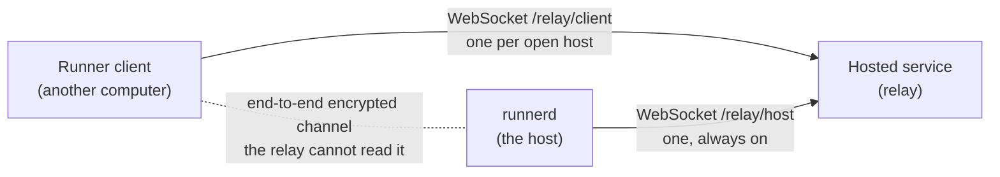
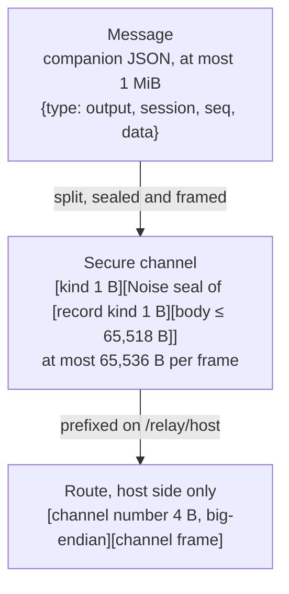
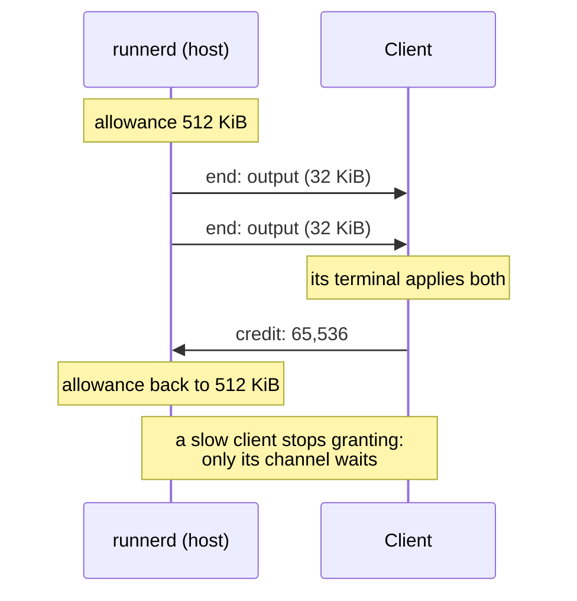
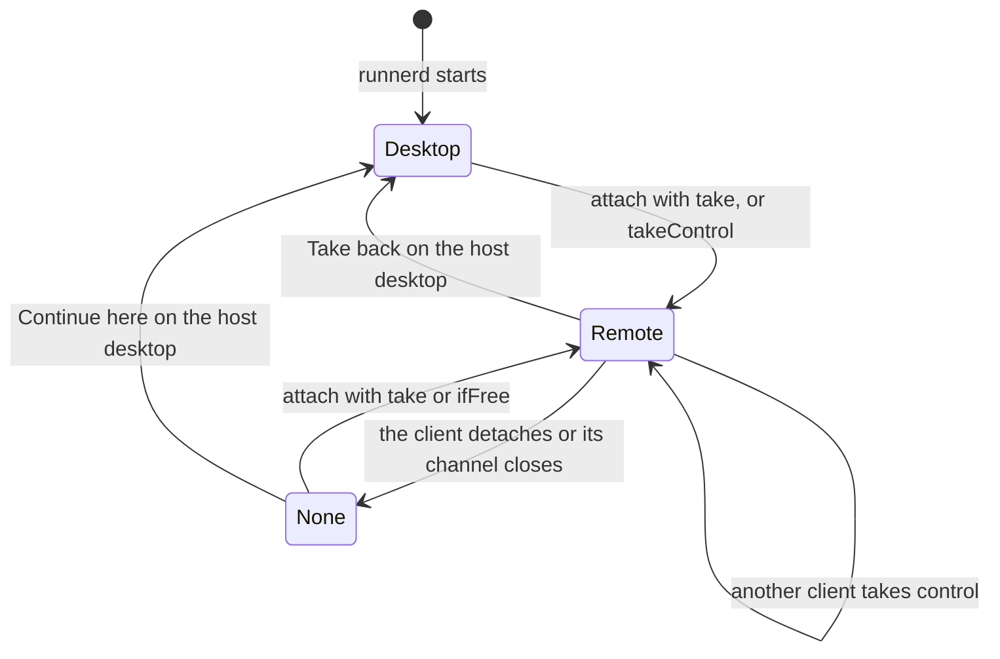

# Remote control: how a Runner client reaches a terminal through the relay

How Runner on one computer opens another computer's terminals through a hosted relay that cannot read them, for someone reading this code for the first time. The rules are in the [#836 spec](../features/836-web-remote-control.md); this note explains the machinery behind them: who connects to whom, how bytes are wrapped, how a six-digit PIN turns into keys, how the pace of a slow client is kept from hurting anyone else, and how a terminal's size is shared.

Written against `nightly-remote` at `2fec5011` (2026-10-22). Built: Phase 1's enrollment, Phase 2's host trust and protocol, and Phase 3's m4 (the channel), m5 (the adapter) and #986 (the desktop's mirror under a remote controller), which is the whole host side; and the service's relay channel. Not built: the desktop's control card (m6), Runner as a client (m7) and the service's client enrollment. Rows marked *proposed* follow the spec's Runner as a client section and may change before m7. Dependencies as pinned in `Cargo.lock`: `snow` 0.9.6, `curve25519-dalek` 4.1.3, `sha2` 0.10.9 and `tokio-tungstenite` 0.28.0.

**The client is Runner** (Jason, 2026-10-21): first the desktop app on another computer, later the iPhone app, and not a browser. The code and the spec's Phase 2 and Phase 3 still say *browser* for it, as in `BrowserPair`, `Controller::Browser` and `browser_resize`; read each as the remote Runner client.

## 1. Three parties, two outbound connections



Both ends dial out; nobody dials in. The host is usually behind a home or office router with no open port, and so is the client. So the service is a meeting point: the host's `runnerd` keeps one WebSocket to it while remote access is on, and the client opens one more for each host it is looking at. The relay joins the two and copies bytes between them.

Everything that matters happens between the two ends, inside an encrypted **channel** the relay only carries. The relay never holds a key for it and never parses it. It does exactly three things: it decides whom it routes (only an account's own hosts), it numbers channels, and it copies, bounds and closes them.

Because the relay is only a route, two consequences follow:

- **Each end reconnects itself.** When the service restarts for a deploy, both WebSockets close. The host's `runnerd` reconnects after a random 1–10 seconds (`remote/machine.rs`, `Retry::Restart`); the client reconnects on its own as well and opens a fresh channel once its host is back. Pairing, keys and sessions survive; only the channel's session keys, the scroll position and anything typed during the gap are lost.
- **The route is replaceable.** Phase 4 carries the same channel over Tailscale, from one Runner straight to the other, and the service is not involved at all. Nothing above the route changes.

## 2. The layers: what wraps what

There are three layers: the message, the secure channel that carries it, and the route the relay copies. Read the picture from the top down on the way out, and from the bottom up at the other end:



**The message** is what the two ends actually say to each other: a companion protocol message, JSON with terminal bytes in base64, at most 1 MiB. Only the client and the host's adapter read it. Code: `runner-core/src/companion/messages.rs`.

**The secure channel** turns a message into frames only the two ends can read. It is Noise with one header byte inside the encryption and one outside:

| Part | Bytes | Why it is there | Code |
| --- | --- | --- | --- |
| Record | 1 kind byte (part, end or credit) and a body of at most 65,518 bytes | Noise seals at most 65,535 bytes at a time, but a message can be 1 MiB, so a message is split into records; credit (§6) rides in the same byte, encrypted, so the relay cannot tell credit from data | `channel/records.rs` |
| Noise seal | The record, sealed with ChaCha20-Poly1305, plus a 16-byte tag | End-to-end encryption | `snow`'s `TransportState` |
| Channel frame | 1 kind byte in the clear, then the Noise message | Tells the handshake frames (§§4–5) and `reject`, which travel before any transport keys exist, from `data` | `channel/mod.rs`: `frame`, `body` |

The limits fit together exactly. Noise caps one message at 65,535 bytes; less its 16-byte tag and the record's kind byte, that leaves 65,518 for a record's body. Add the frame's kind byte and a channel frame is at most 65,536, and the relay's number brings a host-side WebSocket frame to at most 65,540.

**The route** is the only part the relay reads. On the client's side there is nothing to add: the client's WebSocket is that one channel. On the host's side every channel shares one WebSocket, so the relay prefixes each binary frame with a 4-byte channel number (`channel/mod.rs`: `wrap`, `unwrap`). `channelOpen`, `channelClosed` and `closeChannel` are JSON text frames on the same socket, and everything else is binary.

Both ends of the channel are one implementation, in Rust in `runner-core`: the host's side in `HostPair` and `connect`, the client's in `BrowserPair` and `BrowserConnect`, which today drive the host's tests and which m7 is to run in the client's `runnerd` (*proposed*).

## 3. Who holds what

There are two separate gates. The service decides **whom it routes**: only an enrolled device on a signed-in account, and only to that account's own hosts. The host decides **whom it trusts**: only a client it has paired with its PIN. Either alone is not enough, which is the point: whoever runs the service, or steals an account's password, still meets the PIN.

| Secret or record | Kept by | Where | Purpose |
| --- | --- | --- | --- |
| Host identity key (X25519) | Host | OS secret store, with the PIN | The host's Noise static key; its fingerprint is shown at enrollment |
| PIN, six digits | Host | The same secret-store item | CPace's password |
| PIN failures, lock, device list | Host | `remote-trust.json` | Five failures lock PIN entry; each paired client's public key, name and times |
| Enrollment credential | Host | A separate secret-store item | Authenticates `/relay/host`; the account binding, not the channel |
| Client's key for one host (X25519) | Client's `runnerd` | Beside its own host identity (*proposed*) | The client's Noise static key for that host |
| The host's public key | Client's `runnerd` | Beside the client's key for it (*proposed*) | Pinned after pairing; checked on every later connect |
| Client's enrollment credential | Client's `runnerd` | Settled with the service's client enrollment, which approves a client as it approves a host (*proposed*) | Authenticates `/relay/client`; the account binding, not the channel |
| Account sign-ins, credential hashes, the host's public key | Service | Its own storage | Routing only |

The service never holds the PIN, a private key or a channel's session keys. Keys live in the client's `runnerd`, never in the app or the CLI, which reach remote hosts through the client protocol as they reach local sessions (*proposed*).

## 4. Pairing a client: CPace inside Noise `XXpsk3`

The first time a client opens a host, it has no key for it, and the host has never seen the client. They have only the PIN, typed by the person into the client's PIN dialog and set by the same person at the host.

### Why the PIN cannot simply be the key

The obvious design is to use the PIN as Noise's pre-shared key. That fails against an attacker who stands in the middle, as the relay does. It plays the host to the client: it answers the client's first message with its own keys, and the client's third message comes back encrypted under keys that mix in the PIN. The attacker knows everything in that mix except the PIN, so it can try all one million PINs against the message's authentication tag, offline, in seconds.

A password-authenticated key exchange closes that hole. In CPace each side commits to its PIN before learning anything, in a way that can be tested against only one guess. An attacker gets one guess per attempt, online, where the host's five-failure lock limits it.

### CPace in one paragraph

Both sides hash the PIN, a context string and a random session id `sid` into a point `G` on the ristretto255 group (`cpace.rs`, `generator`). Each picks a secret scalar and sends its scalar times `G`: the client sends `Ya = a·G`, the host `Yb = b·G` (`Cpace::new`). Each multiplies the other's point by its own scalar, so both reach `K = a·b·G`, and hashes it with the transcript into the intermediate session key, the ISK (`Cpace::isk`). The same PIN gives the same `G` and therefore the same ISK; a different PIN gives a different `G` and unrelated ISKs. The two points on the wire look random: without a secret scalar, nobody can tell which PIN made them, and having committed to `Yb`, an attacker cannot later rework it for a second guess.

### Noise `XXpsk3` carries it

CPace produces a shared secret, but not the long-term identities each side should remember. Noise's `XX` pattern does that: both static keys travel inside the handshake, encrypted, so the client learns the host's identity key without having to know it beforehand. The `psk3` modifier mixes the first 32 bytes of the ISK into the third message, so that message decrypts only if both sides used the same PIN.

```mermaid
sequenceDiagram
    participant C as Client
    participant R as Relay
    participant H as runnerd (host)
    Note over C: make this host's X25519 key,<br/>pick sid and CPace scalar a
    C->>R: pair 0x03: sid, Ya, Noise msg 1 (→ e)
    R->>H: channel 17: the same bytes
    Note over H: no PIN → reject noPin<br/>locked → reject pinLocked<br/>else ISK from Ya and the stored PIN
    H->>R: pairReply 0x04: Yb, Noise msg 2 (← e, ee, s, es)
    R->>C: the same bytes
    Note over C: ISK from Yb and the typed PIN<br/>PSK = ISK[0..32]
    C->>R: pairFinish 0x05: Noise msg 3 (→ s, se, psk)<br/>payload: the client's device name
    R->>H: the same bytes
    Note over H: PSK = ISK[0..32]; read msg 3<br/>fails → wrongPin, 5th → pinLocked<br/>ok → record the device's key and name
    H->>C: first data frame 0x06
    Note over C: it decrypts, so the host knew the PIN:<br/>keep the host's key
```

Three details are easy to miss:

- **The client trusts the host's key only after the host's first `data` frame decrypts.** Message 2 carries a static key before any PIN has entered the handshake, so on its own it proves nothing. Only a host that derived the same ISK can produce a frame the client can open.
- **A failed authentication counts as a wrong PIN.** The host cannot tell a wrong PIN from a tampered message, so both count toward the lock. Malformed frames and invalid points do not (`channels.rs`, `authorize`).
- **Attempts are serialized.** The host checks the lock again before reading each `pairFinish` and reads them one at a time, so five parallel attempts cannot slip past the fifth failure.

Code: `channel/cpace.rs`; `channel/handshake.rs`, `HostPair::start` and `HostPair::finish` for the host, `BrowserPair` for the client; `runner-daemon/src/remote/channels.rs`, `authorize`, for the lock and recording the device.

## 5. Connecting again: Noise `IK`

A paired client already knows the host's static key, so it uses Noise's `IK` pattern, one round trip with no PIN:

```mermaid
sequenceDiagram
    participant C as Client (knows the host's key)
    participant H as runnerd (host)
    C->>H: connect 0x01: → e, es, s, ss
    Note over H: read the client's static key;<br/>not on the device list → unknownDevice
    H->>C: accept 0x02: ← e, ee, se
    Note over C,H: transport keys ready; data frames follow
```

`IK`'s first message is encrypted to the host's static key, and it carries the client's static key, which the host looks up in `remote-trust.json`. Two failures share one answer, `unknownDevice`: Revoke removed the client's key from the list, or Reset identity gave the host a new key, so the client's message no longer decrypts. Either way the client forgets its keys for that host and offers to pair again.

Code: `channel/handshake.rs`, `connect` for the host and `BrowserConnect` for the client.

## 6. Records and credit: one slow client must not stall the rest

Every client's channel to a host shares that host's one WebSocket. If `runnerd` simply wrote output as fast as terminals produced it, a client on a weak connection, such as a phone, would let bytes pile up somewhere: in the relay, without limit, or in the host's socket, where they would block every other channel behind them.

Records solve this with credit, the same windowed flow control as SSH channels or HTTP/2 streams. Each side may send only as many message bytes as the other has granted, starting at 512 KiB. The receiver grants more once it has handled what arrived: for the client, once its terminal has applied the output. It batches the grant into a `credit` record once it owes 64 KiB or more.



When a channel has no credit, that channel's terminal output waits on the host, in that terminal's queue. A queue that grows past 1 MiB is thrown away and replaced by a fresh snapshot once credit returns: the client falls behind, then catches up to the screen as it is now, rather than replaying minutes of output. Other channels never notice.

The host also bounds what it accepts: a channel's queue of incoming frames is capped at 1 MiB, counting 64 bytes per frame on top of its length (`channels.rs`, `feed`), and a message over 1 MiB ends the channel. A misbehaving client can hurt only its own channel.

Code: `channel/records.rs`: `queue` and `next_frame` split and pace outgoing messages; `receive` reassembles and checks incoming ones; `handled` grants credit back. The constants are in `channel/mod.rs`.

## 7. The adapter: the companion protocol on an open channel

Once a channel is open, the host's `runnerd` serves it through the adapter in `runner-daemon/src/companion/`. The client's first message must be `hello`; `welcome` answers with the protocol version and `features`, the requests this host serves. At `2fec5011` that is `overview`, `attach`, `input`, `takeControl`, `viewport` and `detach`.

- **The overview** mirrors the host desktop's sidebar: projects, tabs with their split panes, missions and sessions with their status. It is pushed again whenever any of that changes, at most every 250 ms. The client shows it as that host's section of its own sidebar (*proposed*).
- **A terminal** opens with `attach`: a snapshot in 32 KiB chunks, with at most 1,000 lines of history by default, then `output` as the program writes, `resized` when the size changes, and `closed` when it ends. `input` goes into the same input queue the host desktop's typing uses, so draft-aware mission delivery and status detection see a remote client's typing too.
- **Send order** keeps a busy terminal from starving anything: results, errors and pushes first, then the open terminals in turn, one chunk each.

The adapter reaches `runnerd`'s state through a narrow `Core` trait over a weak reference (`companion/core.rs`), so an open channel can never keep a shutting-down daemon alive, and tests can drive the adapter with a fake core.

Code: `companion/mod.rs`, `Adapter` and `Stream`; `remote/channels.rs`, `serve`, which runs the handshake, then the records, then the adapter, for one channel.

## 8. Terminal size: one controller per terminal

A PTY has exactly one size, and the programs in it draw for that grid. Two screens of different sizes cannot both be right, so each live terminal has one **controller**, and only the controller's size applies. A remote client is `Controller::Browser` in the code.



Opening a tab or a mission on the client takes every terminal in it, at the size of each terminal's pane on the client. While a client controls a terminal, the host desktop's own size requests are refused (`ResizeControl::apply` in `session/manager/terminal.rs`, called by `resize_controlled` in `output.rs`), since a desktop pane pushes its size on every repaint and would otherwise undo the client's at once. Every mirror, the requesting pane's included, takes its size only from the attach snapshot and the ordered `Resized` frames (#986), so a refused request leaves the host desktop drawing at the size the PTY really has. When the client leaves, the size stays as it was until the host desktop takes the terminal back. m6 draws the host desktop's card with Take back over a pane a client controls.

Code: `session/manager/terminal.rs`, `Controller`; the client protocol's `TerminalController`.

## 9. The life of a keystroke

The client's half follows m7's proposal: the app reaches remote terminals through its own `runnerd`, which holds the channel.

```mermaid
sequenceDiagram
    participant V as Client app: terminal view
    participant CD as Client runnerd: channel
    participant S as Relay
    participant RC as Host runnerd: remote/channels.rs
    participant A as Adapter
    participant P as PTY
    V->>CD: the person types "l"
    CD->>CD: input message → end record → Noise seal → data frame
    CD->>S: binary WebSocket frame
    S->>RC: prefix channel 17, write to the host's WebSocket
    RC->>A: unwrap, open, reassemble the message
    A->>P: the session's input queue
    P-->>A: the shell echoes "l"
    A-->>RC: output message, in turn with other terminals, within credit
    RC-->>S: seal, wrap with channel 17
    S-->>CD: strip the number
    CD-->>V: open, apply to the terminal; grant credit back
```

## 10. What the relay can and cannot do

It **can** see that a channel exists, its sizes and its timing; drop, delay or close it; refuse to route; and forge or drop a `reject`, which travels in the clear. A client only shows a reject, and pairing again after a forged `unknownDevice` costs nothing beyond the PIN dialog.

It **cannot** read a message, learn the PIN, test PIN guesses offline, pose as a paired host to a client that has pinned its key, or pose as a client to a host without that client's key. An attacker who intercepts a pairing gets one PIN guess per attempt, and the host locks after five.

It also ships no code into either end. Both are Runner, installed from Runner's signed releases, which is why the client is not a browser: a page the service sends is code the service can change, and a compromised service could have served one that reads the PIN as it is typed or types into a paired terminal. What is left is the ordinary trust in the Runner build you installed. The spec's Clients are Runner apps and Client trust sections have the full model.

## Reading path

1. `crates/runner-core/src/companion/channel/mod.rs`: frame kinds, rejects, limits, `wrap` and `unwrap`. Short, and it names everything else.
2. `channel/cpace.rs`, then `channel/handshake.rs`: the PIN exchange and both Noise patterns, from both ends.
3. `channel/records.rs`: records and credit.
4. `channel/tests.rs` with `channel/vectors/channel.json`: a complete pairing, connect, wrong PIN and record sequence, byte for byte.
5. `crates/runner-daemon/src/remote/mod.rs` from `ChannelOpen` (about line 407): where `/relay/host`'s frames reach the channels.
6. `remote/channels.rs`: `Channels::open`, `feed`, `authorize` and `serve`, one channel's whole life.
7. `crates/runner-daemon/src/companion/mod.rs` and `core.rs`: the adapter.
8. `session/manager/terminal.rs` and `output.rs`: the controller.

## Background reading

- [The Noise Protocol Framework](https://noiseprotocol.org/noise.html): read §7, handshake patterns, for the `→ e, es, s, ss` notation, and §9 for PSK modes. Then the `XX` and `IK` patterns read as one line each.
- [Noise Explorer](https://noiseexplorer.com/patterns/): each pattern drawn as a diagram, with what every message proves.
- [CPace, draft-irtf-cfrg-cpace-21](https://datatracker.ietf.org/doc/draft-irtf-cfrg-cpace/): §§3–6 for the protocol; appendix B.3 holds the ristretto255 vectors `cpace-b3.json` copies.
- [Ristretto](https://ristretto.group/): why ristretto255 rather than raw Curve25519 points for hashing to a group.
