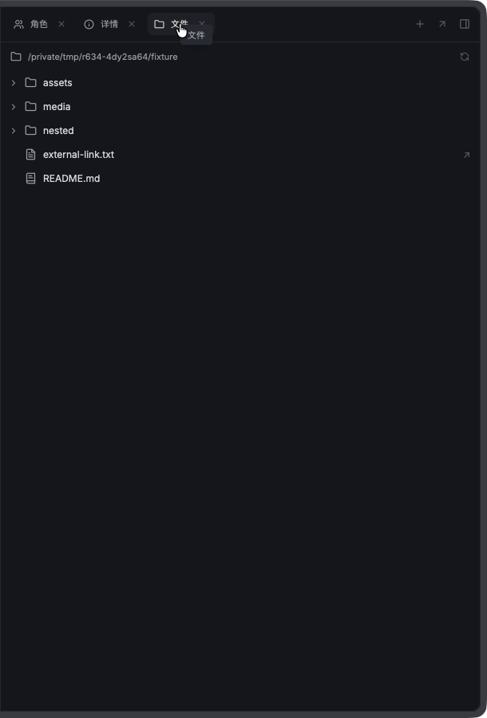
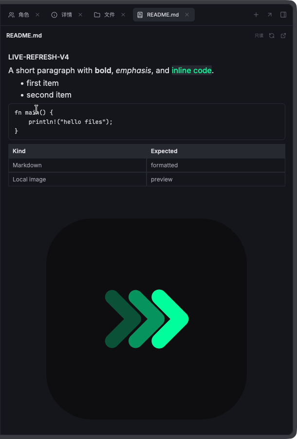

# Workspace panel and Files — bounded native macOS QA (frozen v1)

**Run date:** 2026-10-22 (Asia/Shanghai)
**Scope:** selected native UI acceptance only; not a full regression. No source edits, Cargo builds, commits, global configuration edits, or installed/development Runner shutdowns were performed.

## Candidate and isolation

- Frozen manifest: `/private/tmp/r634-4dy2sa64/candidate.json`
- Worktree HEAD: `df9b4616073ac39a8574c5d24aced0d04eba2d0c`
- Manifest implementation SHA-256: `79395b90074555e698a83c06f22dda2859584af2e37bfea5689b14fd211f5e24`
- App SHA-256: `00ce7eb8a6cdbf9d5077bdea73aa0fe7319a6c852a7bfefebec3b7417051c451`
- CLI SHA-256: `b07cb2375c6ca91639104bea410a46d4be3f2439c61c08441d3c00d1f415b87e`
- The scratch app and CLI copies were verified byte-identical to those hashes. They remain v1 evidence; no v2 rebuild or retest is represented here.
- OS: macOS 26.6.2, arm64. Native Accessibility preflight was trusted.
- Scratch wrapper: `/private/tmp/r634-4dy2sa64/FilesQA.app`, bundle ID `com.wycstudios.runner.files-qa`; owned app PID 89519, window ID 2324.
- Scratch `HOME`/`ZDOTDIR`: `/private/tmp/r634-4dy2sa64/h`. CLI status and app stdout confirmed the database, logs and socket under this HOME's `com.wycstudios.runner-dev` namespace. The copied CLI `--json status` returned the matching scratch socket and version 0.17.0.
- Protected pre-existing processes were inventoried before/after and remained present: installed app PID 90385, installed daemon PID 20141, real development app PID 60577, real development daemon PID 60597. No interaction with their windows or sessions was performed.
- Mission ledger: empty mission `01M5HJ5T8TX5HF1EP8ZF21VY2S`, title `FILES-QA`, cwd `/private/tmp/r634-4dy2sa64/fixture`, zero sessions/agents.

## Fixture

`/private/tmp/r634-4dy2sa64/fixture` contains nested folders, `README.md` (heading, list, code block, table and local PNG), UTF-8 multiline `nested/notes.txt`, `nested/deeper/sample.rs`, copied `assets/icon.png`, dummy `media/unsupported.pdf` and `media/unsupported.mov`, and `external-link.txt` pointing outside the workspace. Fixture and captures are retained for the coordinated v2 rerun.

## Behaviors and selected checks

The candidate changes the workspace Files panel/tree, native file preview, panel layout and tab behavior. The bounded selection was FILES-01 through FILES-05 plus only relevant subsets of WS-CARD-03 and WS-DRAWER-01. Auth, IME, runtime lifecycle, agent startup, and unrelated regression cases were excluded. The parent/coordinator identified a v1 resolve-then-read TOCTOU issue; filesystem confinement is explicitly not counted as passed.

Evidence captures use `screencapture -C -o -l 2324`; screenshot pixel dimensions matched the 1440×900 CGWindowBounds. Native input was sent only while `NSWorkspace.shared.frontmostApplication` reported PID 89519 / `com.wycstudios.runner.files-qa`. A `mouseMoved` event before down/up was required for the GPUI hit target; Command-N opened a direct-chat chooser, which was dismissed without starting an agent.

| Case | Result | Evidence / notes |
|---|---|---|
| FILES-01 — Roles/Details remain accessible; Files panel/tree and nested expansion; clicking a real file | **Partial / Failed** | `captures/02b-mission-selected-shadowless.png` shows the own mission with Roles and Details surfaces. `captures/14-files-panel.png` shows the Files root and entries. Clicking `README.md` changed the preview header (`captures/15-readme-preview.png`), but nested folder expansion and a successful rendered file view were not established. |
| FILES-02 — switch file/Files/new/home, canonical file reuses tab, close restores neighbour | **Blocked / not completed** | The New-tab affordance opened its chooser and the Files route was selected (`captures/13-move-plus.png`, `captures/14-files-panel.png`). Canonical reuse, close-neighbour restoration, and full route-switch assertions were not completed in this bounded v1 run. |
| FILES-03 — Markdown formatting; plain-text line numbers/select/copy; image fit/zoom; unsupported fallback | **Failed** | The real file row was selected and the header reads `README.md`, but the content area stayed entirely blank after waiting 3 seconds: `captures/16-readme-afterwait.png` (also `captures/17-final-preview.png`). Markdown, text, image zoom, and unsupported-format fallback therefore were not validated. This is an observed preview failure, not a pass based on selection/header change. |
| FILES-04 — shell edit refresh after 2 seconds; deleted-file error | **Not run** | No shell edit/delete assertions were made. |
| FILES-05 — panel expand/restore, narrow/wide resize, header overflow, new-tab terminal entry | **Partial** | New-tab chooser and Files entry were visible (`captures/13-move-plus.png`); Files panel tree opened (`captures/14-files-panel.png`). Panel resize/restore, narrow/wide layout, overflow/reveal and terminal entry were not completed. |
| WS-CARD-03 / WS-DRAWER-01 relevant subsets | **Partial** | Native panel and drawer route opened in the exact candidate. No broader card/drawer regression was claimed. |
| Filesystem confinement / symlink safety | **Not passed; blocked by known v1 finding** | The parent reported a resolve-then-read TOCTOU in v1 and that source hardening is underway. No static confinement/security pass is claimed. No adversarial race test was performed. |

### Observed issues

1. **Preview content blank (FILES-03, v1):** selecting the real `README.md` row updated its toolbar label but showed no body after a 3-second wait. Evidence: `captures/16-readme-afterwait.png`. This is the primary UI failure to rerun against the coordinated v2 candidate.
2. **Tree glyph visibility (observation):** `captures/14-files-panel.png` shows names for `assets`, `media`, and `nested`, but their chevrons/file icons are not visibly rendered. The parent noted explicit SVG colors are being added; confirm on v2 rather than treating this as a completed fix.
3. **Image zoom and filesystem safety:** not exercised successfully; v1 zoom may be clamped, and confinement is known not to pass. Rerun only on the authorized v2 candidate.

Direct-chat/runtime behavior was intentionally not forced: it would require launching an agent/runtime and is outside this file-preview scope. Command-N's chooser was dismissed; no role, crew, or agent session was created.

## Cleanup and retained evidence

- Archived the only owned empty mission using the isolated CLI. Final show reported status `completed`, an archive timestamp, and zero live sessions.
- Stopped only scratch daemon PID 88988 through the scratch CLI; final isolated status reported no daemon.
- Terminated only the owned wrapper PID 89519 and unregistered `/private/tmp/r634-4dy2sa64/FilesQA.app` from LaunchServices.
- Rechecked protected PIDs 20141, 60577, 60597 and 90385; all remained running.
- Retained the fixture, manifest, byte-identical candidate copies, logs, CLI/mission status JSON and captures under `/private/tmp/r634-4dy2sa64` for v2 follow-up.
- No agent auth, global configuration, repository source, or unrelated dirty edits were changed by this QA run.

---

# Bounded native follow-up — frozen v2 and v3

**Run date:** 2026-10-22 (Asia/Shanghai). This section supplements, and does not replace, the frozen v1 findings above. No source edits or builds were made during QA. Both follow-ups used the preserved scratch fixture and isolated HOME; no auth or agent sessions were created.

## v2 candidate and results

- Manifest: `/private/tmp/r634-4dy2sa64/candidate-v2.json`
- HEAD: `df9b4616073ac39a8574c5d24aced0d04eba2d0c`
- Implementation SHA-256: `b0a37583f51ed20572b6106911bb6a089e0a137a977b1bd41c3c26bd61dff396`
- App SHA-256 verified in wrapper: `23b5c90df96a8e0ab20bd4e838ee6ae833f20ba1f5516d1843fef8b1749a10cc`
- CLI SHA-256: `b07cb2375c6ca91639104bea410a46d4be3f2439c61c08441d3c00d1f415b87e`
- Wrapper: `/private/tmp/r634-4dy2sa64/FilesQA-v2.app`, bundle `com.wycstudios.runner.files-qa-v2`, PID 9551; shared scratch HOME `/private/tmp/r634-4dy2sa64/h`.
- Mission `01M5HMBG7TE82CYYKH4TNHRRB1` (`FILES-QA-v2`) used the fixture cwd and had zero sessions. It was archived before switching to v3.
- **FILES-01 partial pass:** `captures-v2/03-files-tree.png` and `captures-v2/04-nested-expanded.png` show the native tree, folder/file glyphs, nested folder expansion and `deeper`/`notes.txt` children. `captures-v2/01-mission-selected.png` shows the own mission with Roles and Details surfaces.
- **FILES-03 plaintext subcase passed:** `captures-v2/05-readme.png` (despite the filename) visibly shows `notes.txt`, UTF-8 text and line numbers 1–4. Markdown rendering was not established in v2; the user confirmed that `captures-v2/06-markdown-preview.png` is actually this same `notes.txt` view and must not be interpreted as Markdown evidence. Copy behavior, raster preview/zoom and unsupported-PDF fallback were not verified in v2.
- **FILES-02 partial:** selection of `notes.txt` resulted in a visible `notes.txt` tab beside `新标签页` in `captures-v2/05-readme.png`; a separate file tab becoming visible is established. Reuse/close-neighbour restoration was not tested.
- **FILES-04 not passed:** no edit/delete refresh test was performed on v2. The subsequently reported idle-visibility polling defect means no long-idle refresh pass may be inferred from this build.
- **FILES-05 partial:** New-tab chooser and Files route/tree were exercised; panel width/restore and terminal route were not validated.
- v2 cleanup: archived the empty v2 mission, stopped only v2 wrapper PID 9551 and its shared scratch daemon before launching v3, and unregistered its wrapper.

## v3 candidate and results

- Manifest: `/private/tmp/r634-4dy2sa64/candidate-v3.json`
- HEAD: `df9b4616073ac39a8574c5d24aced0d04eba2d0c`
- Implementation SHA-256: `c4ba53369099e199a23b7dea3ef878ae3052977dddbb076f1f204097512f114b`
- App SHA-256 verified in wrapper: `53d158fddd8535b4ae1f90a0d7bd076c04c34f73b93cad14e34e2c031b3b9245`
- CLI SHA-256: `b07cb2375c6ca91639104bea410a46d4be3f2439c61c08441d3c00d1f415b87e`
- Wrapper: `/private/tmp/r634-4dy2sa64/FilesQA-v3.app`, bundle `com.wycstudios.runner.files-qa-v3`, PID 13522; same scratch HOME and fixture.
- Mission `01M5HMTWS5J8F7SGJFG9HAW3ZD` (`FILES-QA-v3`) used the fixture cwd and had no agent slots/sessions at creation.
- **FILES-01 partial pass:** `captures-v3/02-files-tree.png` visibly shows the tree with folder chevrons and file icons; selecting README opened a visible `README.md` tab.
- **FILES-03 Markdown partial pass:** `captures-v3/03-readme-markdown.png` shows the actual README heading, formatted paragraph, list, code and table. The local-image region still displayed “正在加载图片...” in both `03-readme-markdown.png` and the same-view idle capture `04-readme-idle-7s.png`; raster completion/fit/zoom was not passed. Plain text line-number evidence is in v2 as noted above. PDF fallback and copy were not tested.
- **FILES-04 live refresh failed / unestablished:** after observing the selected README unchanged for 7 seconds (`captures-v3/04-readme-idle-7s.png`), shell-replaced its first heading with unique `# LIVE-REFRESH-V3` in the scratch fixture only. At 3 and 5 seconds after edit, the selected visible preview still showed the old “Workspace Files QA” heading (`captures-v3/05-live-refresh-3s.png`, `captures-v3/06-live-refresh-5s.png`). No manual refresh was pressed. However, a native prepaint panic then occurred while the image row was rendering, before this could establish whether the new heading/poll result would repaint; therefore preserve the observed frozen-frame outcome as failed/unestablished and do not attribute it to an idle-polling defect.
- During subsequent native navigation back toward Files, v3 panicked during native prepaint. The isolated log `/private/tmp/r634-4dy2sa64/h/Library/Logs/com.wycstudios.runner-dev/runner.log` records at 2026-10-22T11:10:48Z: `RefCell already mutably borrowed` in `gpui-pre-0.3.7/src/elements/list.rs:800:16`. Review traced the stack to `file_preview.render_row -> self.list.viewport_bounds` while `ListState` was already mutably borrowed; the affected row was the local image. This explains the image remaining in its loading state and invalidates further repaint/refresh conclusions from the frozen frame. After noticing the crash, process checks showed PID 13522 absent; no further input was sent. Captures attempted after the process exit are not treated as UI evidence.
- v3 wrapper termination was an unexpected app crash. After the parent/coordinator identified the panic cause and the user authorized cleanup, the empty v3 mission was archived, only scratch daemon PID 13524 was stopped, and the v3 LaunchServices registration was removed. The wrapper process was already absent. The scratch HOME, fixture and v1-v3 captures remain retained for the authorized v4 continuation.
- No v3 claim is made for active-tab close restoration, deleted-selected-file error, live refresh, image zoom, or PDF fallback.

## Protected-process check and remaining gaps

After v3 cleanup, installed Runner PID 90385 / daemon 20141 and real development Runner PID 60577 / daemon 60597 remained present. No existing session, auth, global agent configuration, or other Runner window was operated. Direct-chat/runtime and Windows checks remain explicitly out of scope/gaps. The final panel-width fix in the upcoming frozen candidate requires its own authorized native pass; do not reinterpret the v1 or v2 failures as resolved by these v3 screenshots.

---

# Final bounded native pass — frozen v4

**Run date:** 2026-10-22 (Asia/Shanghai). This is a separate v4 candidate run; v1, v2 and v3 results above remain unchanged.

## Candidate, isolation and cleanup

- Manifest: `/private/tmp/r634-4dy2sa64/candidate-v4.json`
- HEAD: `df9b4616073ac39a8574c5d24aced0d04eba2d0c`
- Implementation SHA-256: `02bfc79edcc59ea5f8e4ac03c93665f428d00274d695eb2eace67fd3fc4714a4`
- App SHA-256 verified in wrapper: `0373fd211b7ddb0fd21ef5a097285fa76d7f22ec719452b4cd71d1ef13bee3c6`
- CLI SHA-256: `b07cb2375c6ca91639104bea410a46d4be3f2439c61c08441d3c00d1f415b87e`
- Wrapper `/private/tmp/r634-4dy2sa64/FilesQA-v4.app`; bundle `com.wycstudios.runner.files-qa-v4`; owned PID 21827, window 2513. App and CLI hashes match the candidate manifest. Same isolated scratch HOME `/private/tmp/r634-4dy2sa64/h`.
- Before launch, `runner.log` had **648 lines** (`v4-log-lines-before.txt`). New lines 649–650 contain only duplicate-system-font warnings; no v4 panic was present in the new log tail. The prior v3 panic remains in older log history and was not counted as a v4 event.
- Empty mission `01M5HNSB0GSZBGPXG52S7W6MXF` (`FILES-QA-v4`), fixture cwd, zero sessions/agents. It was archived; final CLI show reports completed, archive timestamp, and zero live sessions.
- Stopped only v4 wrapper PID 21827 and the isolated scratch daemon; unregistered only the v4 wrapper. The scratch HOME, fixture, candidate copies and all captures remain retained.
- Final process inventory showed installed Runner 90385/daemon 20141 and real development Runner 60577/daemon 60597 still running.

## v4 results

| Check | Result | Evidence / notes |
|---|---|---|
| Frozen artifact identity and isolated namespace | **Passed** | App/CLI hashes above match; CLI status socket and app data were under scratch HOME's `com.wycstudios.runner-dev` namespace. Native input was preceded by frontmost verification of PID 21827 / bundle `com.wycstudios.runner.files-qa-v4`. |
| Files tree glyphs and tab visibility | **Passed** | `captures-v4/05-files-tree.png` shows visible folder chevrons and file icons. `captures-v4/06-markdown-image.png` shows the selected `README.md` tab visible beside Files and New Tab in the header; no offscreen-header inference was needed. |
| Markdown content and local raster rendering | **Passed** | `captures-v4/06-markdown-image.png` shows the real Markdown heading, styled paragraph, list, code block, table, and the local `assets/icon.png` rendered as a raster image rather than a loading placeholder. This directly addresses the v3 image-row panic symptom for this fixture. |
| Long-idle then automatic shell edit refresh | **Passed** | The selected README was left unchanged for 7 seconds (`captures-v4/07-readme-idle-7s.png`). The shell then changed only the fixture heading from `LIVE-REFRESH-V3` to unique `LIVE-REFRESH-V4`. At 3 seconds, without pressing manual refresh, the visible heading showed `LIVE-REFRESH-V4` in `captures-v4/08-live-refresh-3s.png`. This v4 evidence supersedes v3's unestablished frozen-frame observation for the tested flow. |
| Delete selected text file shows explicit error | **Passed** | `nested/notes.txt` rendered with UTF-8 content and line numbers in `captures-v4/11-notes-selected.png`; after deleting only that fixture file from shell, selected preview displayed `Cannot access path: No such file or directory (os error 2)` in `captures-v4/12-deleted-selected-file.png`. |
| Narrow and restore window width | **Passed, bounded** | Native window bounds changed from 1440×900 to 1100×850 and were restored to 1440×900. `captures-v4/13-narrow-window.png` shows the center workspace and selected-file viewer remained within the host/window without panel overflow; `captures-v4/14-restored-window.png` records restored bounds. This does not claim a separate panel collapse/expand control check. |
| Raster zoom, unsupported PDF fallback, panel collapse/expand, text copy | **Not tested** | Prioritized core preview, image-load, idle refresh, selected-file deletion and window-width behavior within the bounded pass. |
| Direct chat/runtime and Windows | **Out of scope** | No runtime/auth session was started; this was macOS native UI QA only. |

No v4 source edits, builds, or interaction with installed/development app windows or sessions occurred. The original v1 failure and v3 panic remain documented as historical candidate-specific evidence; do not generalize them as v4 outcomes.

---

# Short native verification — frozen v5 Markdown margins

- Manifest: `/private/tmp/r634-4dy2sa64/candidate-v5.json`; version `v5-markdown-margins`; HEAD `df9b4616073ac39a8574c5d24aced0d04eba2d0c`.
- Implementation SHA-256: `973278c926a15910bfe4b84f53f2989fa680ee94734f42037e0e0bda636f0771`.
- App SHA-256: `0835a08dfa4d3205b0ab50c615110c70550a8bc47d8251b50d4a67aa6e2c7fd6`.
- CLI SHA-256: `b07cb2375c6ca91639104bea410a46d4be3f2439c61c08441d3c00d1f415b87e`.
- App and CLI were copied to `/private/tmp/r634-4dy2sa64/FilesQA-v5.app` and hash-verified. Isolated HOME was `/private/tmp/r634-4dy2sa64/h`; native wrapper was PID 32067, bundle `com.wycstudios.runner.files-qa-v5`, window 2554.
- **Result: Passed for the requested Markdown spacing/wrapping check.** At 1440×900 window bounds, the real fixture Markdown preview occupied approximately 600 px of width. Screenshot `captures-v5/03-markdown-margins.png` shows roughly 16 px between the preview viewport edge and content on both sides; the paragraph wraps, and the code block/table remain within the viewport. The actual local PNG is rendered in the same screenshot. This is a visual native acceptance check, not a new automated measurement of the implementation's 240/480/720 px regression cases.
- Mission `01M5HQGGGG65SAFYEB82NH3GR1` (`FILES-QA-MARGINS`) was empty, had zero sessions, and was archived. Only v5 wrapper and scratch daemon were stopped; v5 LaunchServices registration was removed. Final process checks showed the installed and real development Runner PIDs/daemons unchanged and running.
- Scope limit: only this requested margin/wrapping screenshot was checked on v5; no other v5 behavior is inferred. All v1-v4 outcomes above remain preserved. No source files were edited and no builds were run during QA.

## Review screenshots

The following are cropped from the actual frozen v5 native macOS window; no UI mockup or compositing was used. Full captures and the earlier failures remain identified above.

Windows screenshots and the explicitly unrun native interactions remain unavailable; these two images do not establish those checks.
